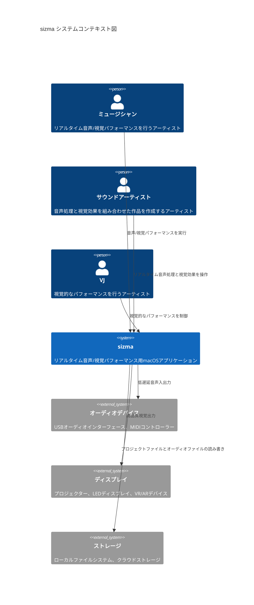
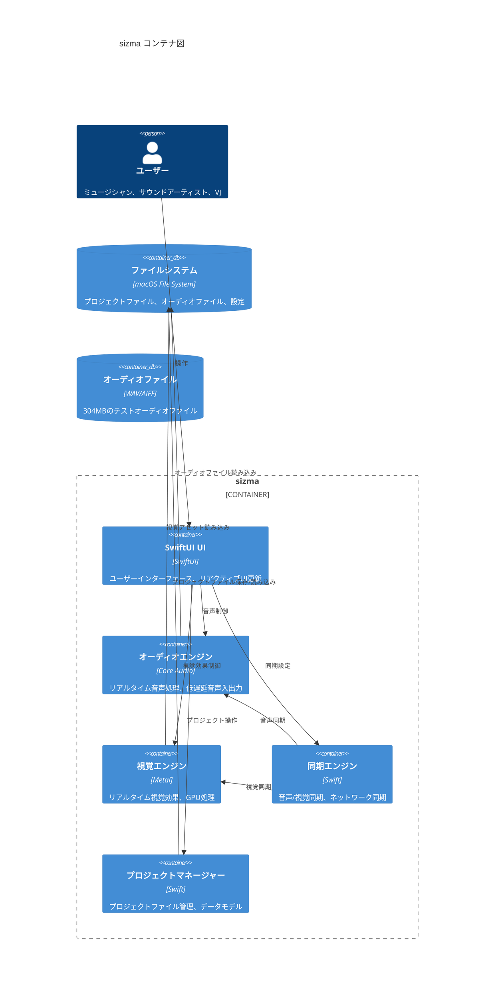
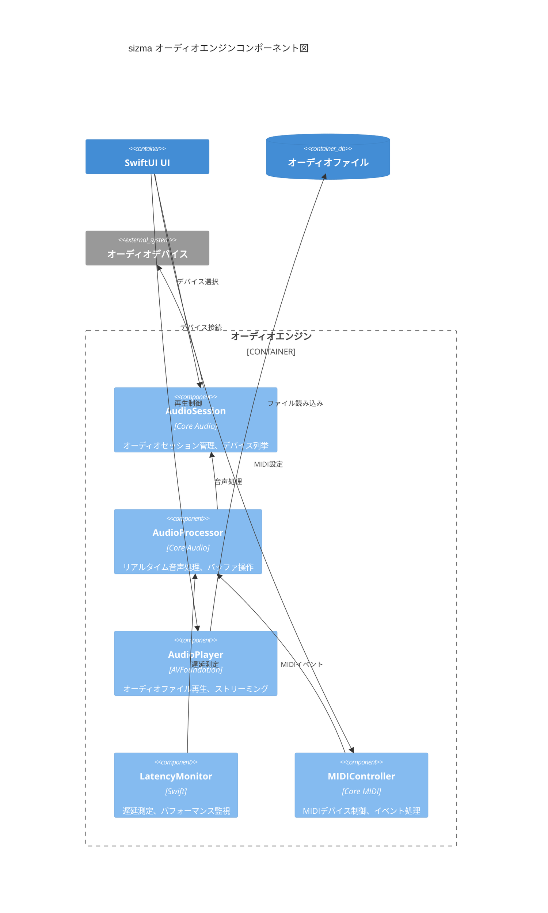

## Language Guideline

日本語をメイン言語とします。
文書や、コメント、メッセージ等は日本語でお願いします。

# sizma (静馬) C4 アーキテクチャ図

## 概要
このドキュメントは、sizma (静馬)プロジェクトのシステムアーキテクチャをC4モデルを使用して視覚化したものです。

## C4 Level 1: システムコンテキスト図



## C4 Level 2: コンテナ図



## C4 Level 3: コンポーネント図



## C4 Level 4: コード図

```mermaid
C4Code
    title sizma オーディオ処理コード図
    
    Component_Boundary(audioProcessor, "AudioProcessor") {
        Class(AudioBuffer, "AudioBuffer", "音声バッファ管理")
        Class(AudioFormat, "AudioFormat", "音声フォーマット変換")
        Class(AudioEffect, "AudioEffect", "音声エフェクト処理")
        Class(AudioScheduler, "AudioScheduler", "音声スケジューリング")
    }
    
    Component_Boundary(audioSession, "AudioSession") {
        Class(AudioDevice, "AudioDevice", "オーディオデバイス管理")
        Class(AudioSession, "AudioSession", "セッション管理")
        Class(AudioRoute, "AudioRoute", "音声ルーティング")
    }
    
    Rel(AudioSession, AudioDevice, "デバイス管理")
    Rel(AudioProcessor, AudioBuffer, "バッファ処理")
    Rel(AudioProcessor, AudioFormat, "フォーマット変換")
    Rel(AudioProcessor, AudioEffect, "エフェクト適用")
    Rel(AudioScheduler, AudioProcessor, "スケジューリング")
```

## 技術仕様

### パフォーマンス要件
- **音声遅延**: 現在の目標 <20ms、将来の目標 <5ms
- **GUI応答性**: 60fps以上
- **メモリ管理**: 大容量オーディオファイル（304MB合計）の効率的な処理

### 開発環境
- **プラットフォーム**: macOS 15.5+ (Sequoia) 必須
- **IDE**: Xcode 16.0+ 必須
- **言語**: Swift 6.0+
- **フレームワーク**: SwiftUI、Core Audio、AVFoundation、Metal Performance Shaders統合予定

### アーキテクチャガイドライン
- **モジュラー設計**: 独立したAudio/Visual/Syncモジュール
- **ECSライクパターン**: リアルタイム処理用のEntity-Componentシステム
- **プロトコル指向**: 柔軟でテスト可能な設計のためのSwiftプロトコル
- **Core Audio統合**: 最小遅延での低レベル音声処理
```

新しいファイル `CLAUDE_C4.md` を作成しました。このファイルには、sizmaプロジェクトのC4モデルアーキテクチャ図が含まれています。

ファイルの場所は以下です：
```
/Users/mito/repos/lnx-experience/CLAUDE_C4.md
```

このファイルを確認していただけますでしょうか？
- コメント等メイン言語は日本語でお願いします。