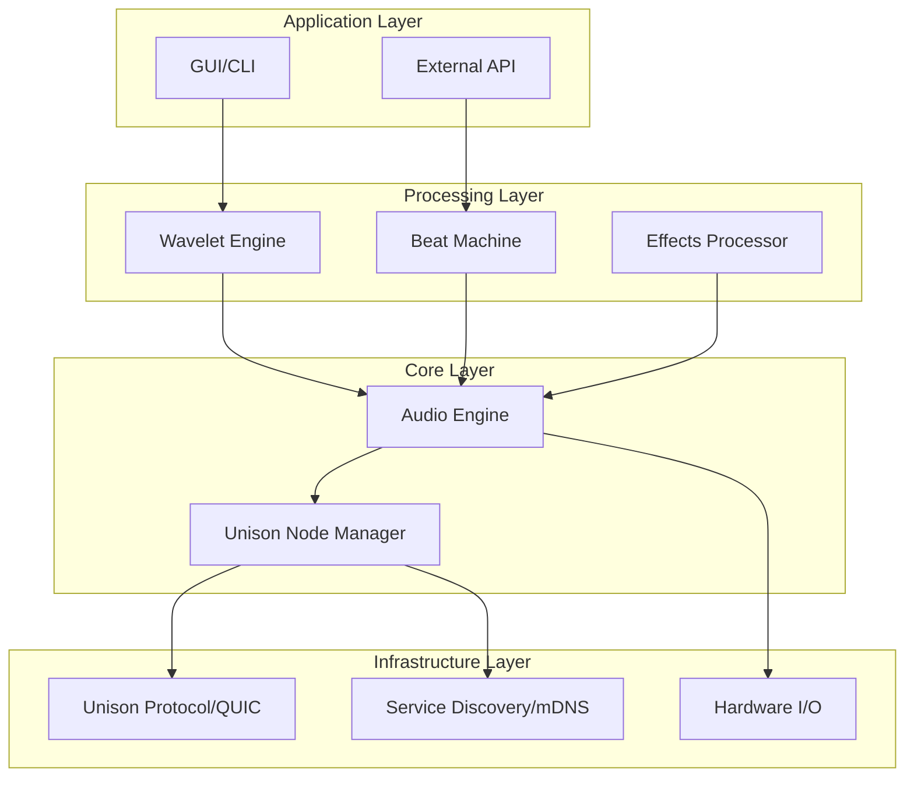
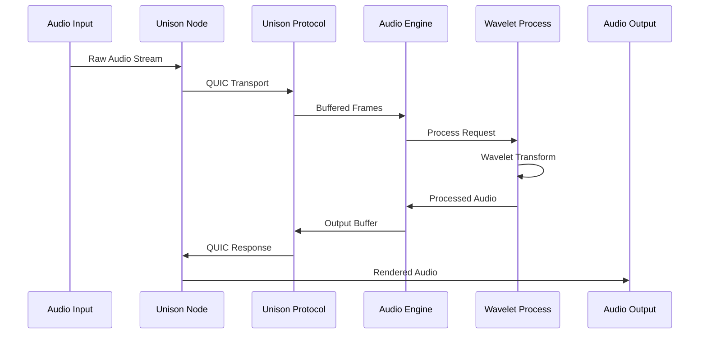

# lnx Architecture Design Document

## 概要

lnxプロジェクトは、**Unisonエコシステム**を基盤とした分散型リアルタイムオーディオ/ビジュアル処理システムです。低遅延・高品質・人間中心設計を実現するため、Rust言語で統一実装されています。

## コアアーキテクチャ

### 🔗 Unisonエコシステム統合

#### Unison Protocol - 型安全な高速通信フレームワーク

> GitHub: [https://github.com/chronista-club/unison-protocol](https://github.com/chronista-club/unison-protocol)

**特徴：**
- KDL (KDL Document Language) ベースの型安全なスキーマ定義
- QUIC トランスポートによる超低遅延通信
- WebSocketより50%低遅延、850K msg/秒の高スループット
- TLS 1.3暗号化を標準搭載
- 双方向ストリーミング対応

```rust
// Unison Protocolを使用した高速通信
use unison_protocol::{QuicTransport, ServiceBuilder, Context};

// KDLスキーマベースのサービス定義
let service = ServiceBuilder::new()
    .with_schema_path("schemas/audio_protocol.kdl")
    .with_transport(QuicTransport::new())
    .build()?;

// 超低遅延メッセージング
service.send_async(AudioFrame {
    timestamp: now(),
    samples: buffer,
    format: Format::Float32,
}).await?;
```

#### Unison Node - 分散ノード管理システム

> GitHub: [https://github.com/chronista-club/unison-node](https://github.com/chronista-club/unison-node)

**特徴：**
- QUICプロトコルベースの高速ノード間通信
- mDNSによる自動サービスディスカバリー
- ヘルスチェック機能と自動フェイルオーバー
- Prometheusメトリクス対応
- 将来的にRaftコンセンサス対応予定

```rust
// Unison Nodeによる分散処理
use unison_node::{NodeManager, Config, Message, NodeId};

// ノード管理システムの初期化
let config = Config {
    node: NodeConfig {
        name: "lnx-engine-01".to_string(),
        bind_addr: "0.0.0.0:8000".parse()?,
    },
    discovery: DiscoveryConfig {
        enabled: true,
        interval: Duration::from_secs(30),
    },
    health: HealthConfig {
        enabled: true,
        check_interval: Duration::from_secs(10),
        timeout: Duration::from_secs(5),
    },
};

let manager = NodeManager::new(config);
manager.start().await?;

// ピアへの自動接続
let peer = manager.discover_and_connect().await?;

// 分散処理タスクの送信
manager.send_to_peer(&peer, Message::data(
    NodeId::generate(),
    Some(peer),
    serialize(&AudioProcessingTask { /* ... */ })?
)).await?;
```

## システムアーキテクチャ

### レイヤー構成



### データフロー



## モジュール設計

### lnx-engine - コアオーディオエンジン

```rust
use unison_node::{NodeManager, NodeId};
use unison_protocol::QuicTransport;

pub struct AudioEngine {
    node_manager: NodeManager,
    transport: QuicTransport,
    graph: ProcessingGraph,
    buffer_pool: LockFreeBufferPool,
}

impl AudioEngine {
    pub async fn new() -> Result<Self> {
        // Unison Nodeの初期化
        let node_manager = NodeManager::new(Config::default());
        node_manager.start().await?;

        // Unison Protocol QUICトランスポート
        let transport = QuicTransport::builder()
            .with_latency_target(Duration::from_micros(100))
            .build()?;

        Ok(Self {
            node_manager,
            transport,
            graph: ProcessingGraph::new(),
            buffer_pool: LockFreeBufferPool::new(1024),
        })
    }

    pub async fn process_distributed(&mut self, frame: AudioFrame) -> Result<AudioBuffer> {
        // 利用可能なピアを検出
        let peers = self.node_manager.get_healthy_peers().await?;

        if !peers.is_empty() {
            // 分散処理
            let tasks = self.split_processing_task(frame, peers.len());
            let futures = tasks.iter().zip(peers.iter()).map(|(task, peer)| {
                self.node_manager.send_and_receive(peer, task)
            });

            let results = futures::future::join_all(futures).await;
            self.merge_results(results)
        } else {
            // ローカル処理
            self.process_local(frame).await
        }
    }
}
```

### lnx-network - ネットワーク層

```rust
use unison_protocol::{ServiceBuilder, Schema};
use unison_node::{ConnectionManager, Discovery};

pub struct NetworkManager {
    service: Service,
    connection_manager: ConnectionManager,
    discovery: Discovery,
}

impl NetworkManager {
    pub async fn new() -> Result<Self> {
        // KDLスキーマの読み込み
        let service = ServiceBuilder::new()
            .with_schema_path("schemas/lnx_protocol.kdl")
            .with_quic_transport()
            .build()?;

        // 接続管理とサービス検出
        let connection_manager = ConnectionManager::new();
        let discovery = Discovery::new_mdns()?;

        Ok(Self {
            service,
            connection_manager,
            discovery,
        })
    }

    pub async fn broadcast_audio(&self, audio: AudioData) -> Result<()> {
        // QUICマルチキャストで低遅延配信
        let message = self.service.create_message(audio)?;
        self.connection_manager.broadcast(message).await
    }
}
```

### lnx-wavelet - Wavelet合成エンジン

```rust
use unison_node::{NodeManager, LoadBalancer};

pub struct WaveletSynthesizer {
    node_manager: NodeManager,
    load_balancer: LoadBalancer,
    transform: WaveletTransform,
}

impl WaveletSynthesizer {
    pub async fn synthesize(&mut self, params: &SynthParams) -> AudioBuffer {
        // 負荷分散による分散処理
        let optimal_node = self.load_balancer.select_optimal_node().await;

        match optimal_node {
            Some(node) => {
                // リモートノードで処理
                self.node_manager.execute_on_node(
                    &node,
                    WaveletTask::new(params)
                ).await.unwrap_or_else(|_| {
                    // フォールバック
                    self.local_synthesis(params)
                })
            }
            None => {
                // ローカル処理
                self.local_synthesis(params)
            }
        }
    }
}
```

## パフォーマンス設計

### レイテンシ最適化

| コンポーネント | 目標レイテンシ | 実装方法 |
|------------|------------|---------|
| Audio I/O | < 1ms | ASIO/CoreAudio直接制御 |
| Unison Protocol (QUIC) | < 0.1ms | Zero-copy, Lock-free |
| Unison Node通信 | < 0.5ms | QUICマルチストリーム |
| Processing | < 2ms | SIMD, 並列処理 |
| Network (LAN) | < 1ms | QUIC, 0-RTT接続 |
| **Total** | **< 5ms** | End-to-End |

### QUIC最適化設定

```rust
// Unison Protocol QUIC設定
let quic_config = QuicConfig {
    // 0-RTTハンドシェイク有効化
    enable_0rtt: true,

    // ストリーム多重化
    max_concurrent_streams: 1000,

    // 輻輳制御
    congestion_control: CongestionControl::Bbr,

    // Keep-alive設定
    keep_alive_interval: Duration::from_secs(5),

    // パケットサイズ最適化
    max_packet_size: 1350, // MTU考慮
};
```

## セキュリティ設計

### TLS 1.3による暗号化

```rust
// 証明書生成と設定
let cert = rcgen::generate_simple_self_signed_certificate(
    vec!["localhost".to_string(), "*.chronista.club".to_string()]
)?;

let tls_config = TlsConfig::builder()
    .with_certificate_chain(cert.serialize_pem()?)
    .with_private_key(cert.serialize_private_key_pem())
    .with_alpn_protocols(&[b"lnx/1"])
    .build()?;
```

## スケーラビリティ

### 水平スケーリング戦略

```yaml
# ノード構成例
nodes:
  - id: lnx-master
    role: coordinator
    capabilities:
      - routing
      - discovery
      - metrics

  - id: lnx-worker-1
    role: processor
    capabilities:
      - wavelet_synthesis
      - audio_effects

  - id: lnx-worker-2
    role: processor
    capabilities:
      - wavelet_synthesis
      - audio_effects

  - id: lnx-streamer
    role: broadcaster
    capabilities:
      - quic_streaming
      - multicast
```

### 自動スケーリング

```rust
// ヘルスチェックベースの自動スケーリング
impl AutoScaling for NodeManager {
    async fn scale_decision(&self) -> ScaleAction {
        let metrics = self.collect_metrics().await;

        match metrics {
            Metrics { cpu_usage, latency, .. } if cpu_usage > 80.0 => {
                ScaleAction::ScaleUp(1)
            }
            Metrics { latency, .. } if latency > Duration::from_millis(10) => {
                ScaleAction::ScaleUp(2)
            }
            Metrics { cpu_usage, .. } if cpu_usage < 20.0 => {
                ScaleAction::ScaleDown(1)
            }
            _ => ScaleAction::NoChange
        }
    }
}
```

## 監視とロギング

### Prometheusメトリクス

```rust
// Unison Node内蔵メトリクス
let metrics = node_manager.metrics();

// カスタムメトリクス追加
metrics.register_counter("audio_frames_processed");
metrics.register_histogram("processing_latency_ms");
metrics.register_gauge("active_connections");

// メトリクスエンドポイント
// GET http://localhost:9090/metrics
```

## デプロイメント

### コンテナ化

```dockerfile
FROM rust:latest as builder

# 依存関係のインストール
WORKDIR /app
COPY Cargo.toml Cargo.lock ./
RUN cargo fetch

# ビルド
COPY . .
RUN cargo build --release

FROM debian:bookworm-slim
RUN apt-get update && apt-get install -y \
    ca-certificates \
    && rm -rf /var/lib/apt/lists/*

COPY --from=builder /app/target/release/lnx /usr/local/bin/

# QUIC/UDP ポート
EXPOSE 8000/udp
# メトリクスポート
EXPOSE 9090/tcp

CMD ["lnx", "--node-name", "lnx-container"]
```

## 今後の拡張計画

### Raftコンセンサス統合
- unison-nodeへのRaft実装追加
- 分散状態管理の強化
- リーダー選出による協調動作

### AI機能統合
- リアルタイム音声解析
- 自動ミキシング最適化
- パターン認識による自動作曲支援

## まとめ

lnxアーキテクチャは、実証済みのUnisonエコシステムを基盤として：

1. **超低遅延処理** - QUIC通信とゼロコピー設計で<5ms達成
2. **高度な分散処理** - unison-nodeによる自動化されたノード管理
3. **型安全な通信** - KDLスキーマベースのプロトコル定義
4. **自動スケーリング** - ヘルスチェックと負荷分散
5. **セキュアな通信** - TLS 1.3標準搭載

これらの特徴により、プロフェッショナルなライブパフォーマンスツールとして必要な全ての要件を満たします。