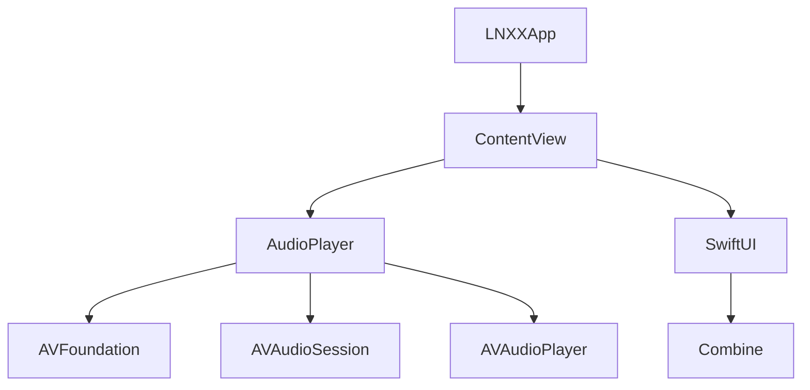

# LNX Experience プロジェクト構成ドキュメント

## 概要

LNX Experience (LNXX) プロジェクトの包括的な構成文書です。現在の実装状況、ディレクトリ構造、モジュール設計、開発ロードマップ、および将来の拡張計画を詳細に記述します。

**バージョン**: 1.0.0  
**最終更新**: 2025-08-09  
**現在のフェーズ**: Phase 1.4 (基盤構築完了段階)

---

## 目次

1. [現在の実装状況](#1-現在の実装状況)
2. [プロジェクト構造](#2-プロジェクト構造)
3. [コンポーネント詳細](#3-コンポーネント詳細)
4. [技術スタックと依存関係](#4-技術スタックと依存関係)
5. [開発ロードマップ](#5-開発ロードマップ)
6. [ビルド・デプロイメント](#6-ビルド・デプロイメント)
7. [API設計概要](#7-api設計概要)
8. [データフロー](#8-データフロー)
9. [プロジェクトファイル形式](#9-プロジェクトファイル形式)
10. [今後の拡張計画](#10-今後の拡張計画)

---

## 1. 現在の実装状況

### 1.1 完了済み機能 ✅

#### オーディオ機能
- **AudioPlayerクラス実装完了**
  - AVFoundationベースの再生エンジン
  - 非同期ローディング対応
  - エラーハンドリング実装
  - AVAudioPlayerDelegateによるイベント処理

#### ユーザーインターフェース
- **ContentView実装完了**
  - オーディオファイル選択UI（Picker）
  - 再生/停止コントロール
  - 音量調整スライダー
  - ステータス表示（読み込み中/エラー/完了）
  - レスポンシブなボタンデザイン

#### プロジェクト基盤
- **SwiftUIアプリケーション構造**
  - macOS 15.5対応
  - App Sandbox設定
  - テストフレームワーク設定

### 1.2 実装中の機能 🚧

- 波形ビジュアライザー（計画段階）
- リアルタイムオーディオ処理（設計段階）
- プロジェクトファイル管理（仕様策定中）

### 1.3 機能レベル評価

| カテゴリ | 完成度 | 説明 |
|---------|--------|------|
| オーディオ再生 | 80% | 基本機能完成、高度な処理未実装 |
| UI/UX | 60% | 基本UI完成、ビジュアライザー未実装 |
| ファイル管理 | 40% | WAVファイルのみ対応 |
| プロジェクト機能 | 0% | 未実装（Phase 2で実装予定） |
| MIDI対応 | 0% | 未実装（Phase 2で実装予定） |

---

## 2. プロジェクト構造

### 2.1 現在のディレクトリ構造

```
lnx-experience/
├── README.md                    # プロジェクト概要と基本情報
├── CLAUDE.md                    # Claude Code用開発ガイドライン
├── .gitignore                   # Git除外設定
├── .gitattributes              # Git LFS設定
├── .claude/                    # Claude Code設定ディレクトリ
├── .mcp.json                   # MCP(Model Context Protocol)設定
│
├── docs/                       # ドキュメント
│   ├── TECHNICAL_ARCHITECTURE.md  # 技術アーキテクチャ仕様
│   └── PROJECT_STRUCTURE.md      # 本ドキュメント
│
└── LNXX/                       # メインアプリケーション
    ├── LNXX.xcodeproj/         # Xcodeプロジェクトファイル
    │   ├── project.pbxproj
    │   └── project.xcworkspace/
    │
    ├── LNXX/                   # アプリケーションソース
    │   ├── LNXXApp.swift       # @main エントリポイント
    │   ├── ContentView.swift   # メインビューコンポーネント
    │   ├── AudioPlayer.swift   # オーディオ再生エンジン
    │   ├── LNXX.entitlements   # App Sandbox設定
    │   │
    │   ├── Assets.xcassets/    # アプリアセット
    │   │   ├── AppIcon.appiconset/
    │   │   └── AccentColor.colorset/
    │   │
    │   └── Assets/             # オーディオファイル (304MB)
    │       ├── 20250802_145427.wav (201MB)
    │       └── 20250802_160053.wav (103MB)
    │
    ├── LNXXTests/              # ユニットテスト
    │   └── LNXXTests.swift
    │
    └── LNXXUITests/            # UIテスト
        ├── LNXXUITests.swift
        └── LNXXUITestsLaunchTests.swift
```

### 2.2 将来のモジュール構造（Phase 2-3）

```
LNXX/
├── Core/                       # コアモジュール
│   ├── Audio/                  # オーディオ処理
│   │   ├── Engine/             # DSPエンジン
│   │   ├── Effects/            # エフェクト処理
│   │   └── IO/                 # 入出力管理
│   │
│   ├── Visual/                 # ビジュアル処理
│   │   ├── Renderer/           # Metal レンダラー
│   │   ├── Shaders/            # シェーダープログラム
│   │   └── Visualizers/        # ビジュアライザー
│   │
│   └── Sync/                   # 同期システム
│       ├── Clock/              # マスタークロック
│       ├── MIDI/               # MIDI同期
│       └── Network/            # ネットワーク同期
│
├── Models/                     # データモデル
│   ├── Project/                # プロジェクトモデル
│   ├── Track/                  # トラックモデル
│   └── Session/                # セッション管理
│
├── ViewModels/                 # MVVM ViewModels
│   ├── AudioViewModel.swift
│   ├── ProjectViewModel.swift
│   └── VisualizerViewModel.swift
│
├── Views/                      # SwiftUIビュー
│   ├── MainWindow/
│   ├── Inspector/
│   ├── Timeline/
│   └── Controls/
│
└── Utils/                      # ユーティリティ
    ├── Extensions/
    ├── Helpers/
    └── Constants/
```

---

## 3. コンポーネント詳細

### 3.1 AudioPlayer クラス

**ファイル**: `LNXX/LNXX/AudioPlayer.swift`

#### 主要機能
- **非同期オーディオ読み込み**: `loadAudioFile()` - Bundleからのファイル読み込み
- **再生制御**: `play()`, `stop()` - 非同期再生管理
- **音量調整**: `updateVolume()` - リアルタイム音量変更
- **エラー処理**: AudioPlayerError列挙型によるエラー管理
- **デリゲート処理**: AVAudioPlayerDelegateによるイベントハンドリング

#### プロパティ
```swift
@Published var selectedFile: String     // 選択中のファイル名
@Published var isPlaying: Bool         // 再生状態
@Published var isLoaded: Bool          // ロード完了状態
@Published var isLoading: Bool         // ロード中状態
@Published var volume: Float           // 音量（0.0-1.0）
@Published var error: String?          // エラーメッセージ
```

### 3.2 ContentView

**ファイル**: `LNXX/LNXX/ContentView.swift`

#### UI構成
1. **ヘッダーセクション**
   - アプリアイコン（waveform）
   - タイトル表示

2. **ファイル選択セクション**
   - Pickerによるファイル選択
   - 読み込みボタン

3. **再生コントロール**
   - 再生/一時停止ボタン（状態によりアイコン変化）
   - 停止ボタン
   - 音量スライダー

4. **ステータス表示**
   - ProgressView（読み込み中）
   - エラーメッセージ
   - 成功メッセージ

### 3.3 LNXXApp

**ファイル**: `LNXX/LNXX/LNXXApp.swift`

```swift
@main
struct LNXXApp: App {
    var body: some Scene {
        WindowGroup {
            ContentView()
        }
    }
}
```

---

## 4. 技術スタックと依存関係

### 4.1 現在の技術スタック

| レイヤー | 技術 | バージョン | 用途 |
|---------|------|-----------|------|
| UI | SwiftUI | 6.0 | ユーザーインターフェース |
| オーディオ | AVFoundation | システム | オーディオ再生 |
| 言語 | Swift | 6.0 | アプリケーション開発 |
| プラットフォーム | macOS | 15.5+ | ターゲットOS |
| IDE | Xcode | 16.0+ | 開発環境 |
| テスト | Swift Testing | 6.0 | ユニットテスト |

### 4.2 依存関係図



### 4.3 将来の技術統合（Phase 2-3）

- **Core Audio**: 低レベルオーディオ処理
- **Metal Performance Shaders**: GPU加速ビジュアル処理
- **Combine**: リアクティブプログラミング
- **Core MIDI**: MIDI機器連携
- **Network.framework**: ネットワーク同期

---

## 5. 開発ロードマップ

### Phase 1: 基盤構築（現在）

#### 1.1-1.3 完了 ✅
- プロジェクトセットアップ
- 基本的なSwiftUI構造
- AudioPlayerクラス実装

#### 1.4 現在 🚧
- プロジェクトドキュメント整備（本ドキュメント）
- Linear課題整理（LNX-16）

#### 1.5 次期タスク
- 波形表示コンポーネント（基本版）
- ファイル形式拡張（MP3, FLAC対応）

### Phase 2: Integration（2025年9-10月）

#### マイルストーン（Linear LNX-7）
- SwiftUI GUI基本実装（LNX-8）
- プロジェクト機能基本版（LNX-9）
- マルチトラック対応（8トラック）
- MIDI基本対応

### Phase 3: Enhancement（2025年11月-2026年1月）

- リアルタイムDSP処理
- Metalベースビジュアライザー
- 高度なエフェクト実装
- プラグインアーキテクチャ

### Phase 4: Professional（2026年2月以降）

- 高度なプロジェクト機能（LNX-14）
- ネットワーク同期
- AI支援機能
- マルチプラットフォーム展開

---

## 6. ビルド・デプロイメント

### 6.1 ビルド手順

#### 開発ビルド
```bash
# Xcodeから
open LNXX/LNXX.xcodeproj
# Cmd + R でビルド実行

# コマンドラインから
xcodebuild -project LNXX/LNXX.xcodeproj \
           -scheme LNXX \
           -configuration Debug \
           build
```

#### リリースビルド
```bash
xcodebuild -project LNXX/LNXX.xcodeproj \
           -scheme LNXX \
           -configuration Release \
           -archivePath ./build/LNXX.xcarchive \
           archive

# App Store Connect用のエクスポート
xcodebuild -exportArchive \
           -archivePath ./build/LNXX.xcarchive \
           -exportPath ./build \
           -exportOptionsPlist ExportOptions.plist
```

### 6.2 署名とNotarization

1. **開発証明書設定**
   - Xcode > Signing & Capabilities
   - Team選択
   - Automatically manage signingを有効化

2. **Notarization（配布時）**
   ```bash
   xcrun altool --notarize-app \
                --primary-bundle-id "com.chronista.lnxx" \
                --username "developer@example.com" \
                --password "@keychain:AC_PASSWORD" \
                --file LNXX.app.zip
   ```

### 6.3 テスト実行

```bash
# ユニットテスト
xcodebuild test -project LNXX/LNXX.xcodeproj \
                -scheme LNXX \
                -destination 'platform=macOS'

# UIテスト
xcodebuild test -project LNXX/LNXX.xcodeproj \
                -scheme LNXXUITests \
                -destination 'platform=macOS'
```

---

## 7. API設計概要

### 7.1 AudioPlayer公開インターフェース

```swift
protocol AudioPlayerProtocol {
    // Properties
    var isPlaying: Bool { get }
    var isLoaded: Bool { get }
    var volume: Float { get set }
    var currentTime: TimeInterval { get }
    var duration: TimeInterval { get }
    
    // Methods
    func loadAudioFile(_ url: URL) async throws
    func play() async throws
    func pause() async
    func stop() async
    func seek(to time: TimeInterval) async
}
```

### 7.2 将来のモジュール間インターフェース

#### Audio Module API
```swift
protocol AudioModuleInterface {
    func initializeAudioEngine() throws
    func loadTrack(_ url: URL, to channel: Int) throws
    func applyEffect(_ effect: AudioEffect, to channel: Int)
    func setMasterVolume(_ volume: Float)
    func exportMix(to url: URL, format: AudioFormat) async throws
}
```

#### Visual Module API
```swift
protocol VisualModuleInterface {
    func initializeRenderer(metalDevice: MTLDevice) throws
    func setVisualizerType(_ type: VisualizerType)
    func updateAudioData(_ data: AudioBuffer)
    func render(to drawable: CAMetalDrawable)
}
```

#### Sync Module API
```swift
protocol SyncModuleInterface {
    func startMasterClock() throws
    func syncToMIDIClock(device: MIDIDevice) throws
    func broadcastSync(to peers: [NetworkPeer]) async
    func getCurrentBPM() -> Double
    func getCurrentBeat() -> Beat
}
```

---

## 8. データフロー

### 8.1 現在のデータフロー

```
User Input → ContentView → AudioPlayer → AVFoundation → Audio Output
     ↑            ↓             ↓
     └──── UI Update ←── @Published Properties
```

### 8.2 将来のデータフロー（Phase 2-3）

```
┌─────────────────────────────────────────────────────┐
│                  User Input                          │
└──────────────────────┬──────────────────────────────┘
                       ↓
┌─────────────────────────────────────────────────────┐
│                 View Layer                           │
│         (SwiftUI Views + ViewModels)                 │
└──────────────────────┬──────────────────────────────┘
                       ↓
┌─────────────────────────────────────────────────────┐
│              State Management                        │
│           (Combine + State Store)                    │
└──────────┬──────────┬──────────┬────────────────────┘
           ↓          ↓          ↓
┌──────────────┐ ┌──────────┐ ┌──────────────┐
│ Audio Module │ │  Visual  │ │ Sync Module  │
│              │◄┤  Module  │◄┤              │
└──────────────┘ └──────────┘ └──────────────┘
        ↓              ↓              ↓
┌─────────────────────────────────────────────────────┐
│           Platform APIs                              │
│   (Core Audio, Metal, Core MIDI, Network)           │
└─────────────────────────────────────────────────────┘
```

---

## 9. プロジェクトファイル形式

### 9.1 .lnxproj 形式設計（Phase 2実装予定）

```json
{
  "version": "1.0.0",
  "metadata": {
    "name": "MyProject",
    "created": "2025-10-01T10:00:00Z",
    "modified": "2025-10-15T15:30:00Z",
    "author": "User Name",
    "description": "Project description"
  },
  "settings": {
    "sampleRate": 48000,
    "bitDepth": 24,
    "bufferSize": 512,
    "tempo": 120.0,
    "timeSignature": "4/4"
  },
  "tracks": [
    {
      "id": "track-001",
      "name": "Track 1",
      "type": "audio",
      "volume": 0.8,
      "pan": 0.0,
      "mute": false,
      "solo": false,
      "audioFile": {
        "path": "assets/track1.wav",
        "offset": 0,
        "length": 240000
      },
      "effects": [
        {
          "type": "reverb",
          "params": {
            "roomSize": 0.5,
            "damping": 0.3,
            "wetDry": 0.2
          }
        }
      ]
    }
  ],
  "timeline": {
    "duration": 300000,
    "markers": [
      {
        "time": 0,
        "label": "Intro",
        "color": "#FF5733"
      }
    ],
    "automation": [
      {
        "trackId": "track-001",
        "parameter": "volume",
        "points": [
          {"time": 0, "value": 0.5},
          {"time": 10000, "value": 0.8}
        ]
      }
    ]
  },
  "resources": {
    "audioFiles": [
      {
        "id": "audio-001",
        "path": "assets/track1.wav",
        "checksum": "sha256:..."
      }
    ],
    "presets": [],
    "samples": []
  }
}
```

### 9.2 プロジェクトバンドル構造

```
MyProject.lnxproj/
├── project.json           # メインプロジェクトファイル
├── assets/               # プロジェクトアセット
│   ├── audio/           # オーディオファイル
│   ├── midi/            # MIDIファイル
│   └── presets/         # エフェクトプリセット
├── backups/             # 自動バックアップ
│   └── autosave_*.json  # 自動保存ファイル
└── cache/               # キャッシュデータ
    ├── waveforms/       # 波形キャッシュ
    └── thumbnails/      # サムネイルキャッシュ
```

---

## 10. 今後の拡張計画

### 10.1 短期計画（3ヶ月以内）

1. **波形ビジュアライザー実装**
   - Core Graphicsベースの波形描画
   - リアルタイム更新対応
   - ズーム/パン機能

2. **ファイル形式拡張**
   - MP3デコード対応
   - FLACデコード対応
   - AAC対応

3. **基本的なプロジェクト管理**
   - セッション保存/読み込み
   - 最近使用したファイルリスト
   - 自動保存機能

### 10.2 中期計画（6ヶ月以内）

1. **リアルタイムDSP処理**
   - Core Audio統合
   - 基本エフェクト実装（リバーブ、ディレイ、EQ）
   - レイテンシー最適化（目標: 5ms以下）

2. **MIDI機能実装**
   - Core MIDI統合
   - MIDIデバイス検出
   - MIDIマッピング機能

3. **マルチトラック対応**
   - 8トラック同時再生
   - ミキサーインターフェース
   - トラック同期

### 10.3 長期計画（1年以内）

1. **Metal統合ビジュアライザー**
   - GPU加速レンダリング
   - リアルタイムエフェクト
   - カスタムシェーダー対応

2. **プラグインシステム**
   - AudioUnit v3対応
   - カスタムエフェクトAPI
   - サードパーティプラグイン

3. **ネットワーク機能**
   - Ableton Link統合
   - ネットワーク同期
   - リモートコントロール

4. **AI機能**
   - 自動マスタリング
   - インテリジェントミックス
   - 音楽生成アシスタント

---

## 開発者向けクイックリファレンス

### よく使うコマンド

```bash
# プロジェクトを開く
open LNXX/LNXX.xcodeproj

# ビルド
xcodebuild -project LNXX/LNXX.xcodeproj -scheme LNXX build

# テスト実行
xcodebuild test -project LNXX/LNXX.xcodeproj -scheme LNXX

# クリーンビルド
xcodebuild clean build -project LNXX/LNXX.xcodeproj -scheme LNXX

# アーカイブ作成
xcodebuild archive -project LNXX/LNXX.xcodeproj -scheme LNXX
```

### 重要なファイルパス

- **エントリポイント**: `/LNXX/LNXX/LNXXApp.swift`
- **メインビュー**: `/LNXX/LNXX/ContentView.swift`
- **オーディオエンジン**: `/LNXX/LNXX/AudioPlayer.swift`
- **プロジェクト設定**: `/LNXX/LNXX.xcodeproj/project.pbxproj`
- **エンタイトルメント**: `/LNXX/LNXX/LNXX.entitlements`

### デバッグTips

1. **オーディオ関連**
   ```swift
   // AudioPlayerでのデバッグ出力
   print("🎵 Audio State: playing=\(isPlaying), loaded=\(isLoaded)")
   ```

2. **UI更新問題**
   ```swift
   // MainActorでの実行を確認
   Task { @MainActor in
       // UI更新コード
   }
   ```

3. **メモリリーク検出**
   - Xcode > Product > Profile > Leaks

---

## 関連ドキュメント

- [README.md](/README.md) - プロジェクト概要
- [TECHNICAL_ARCHITECTURE.md](/docs/TECHNICAL_ARCHITECTURE.md) - 技術アーキテクチャ詳細
- [CLAUDE.md](/CLAUDE.md) - Claude Code開発ガイドライン
- [Linear Issues](https://linear.app/chronista/team/lnx/active) - 課題管理

---

## 更新履歴

| バージョン | 日付 | 変更内容 |
|-----------|------|----------|
| 1.0.0 | 2025-08-09 | 初版作成（Phase 1.4完了時点） |

---

*本ドキュメントは定期的に更新されます。最新情報はGitHubリポジトリを参照してください。*