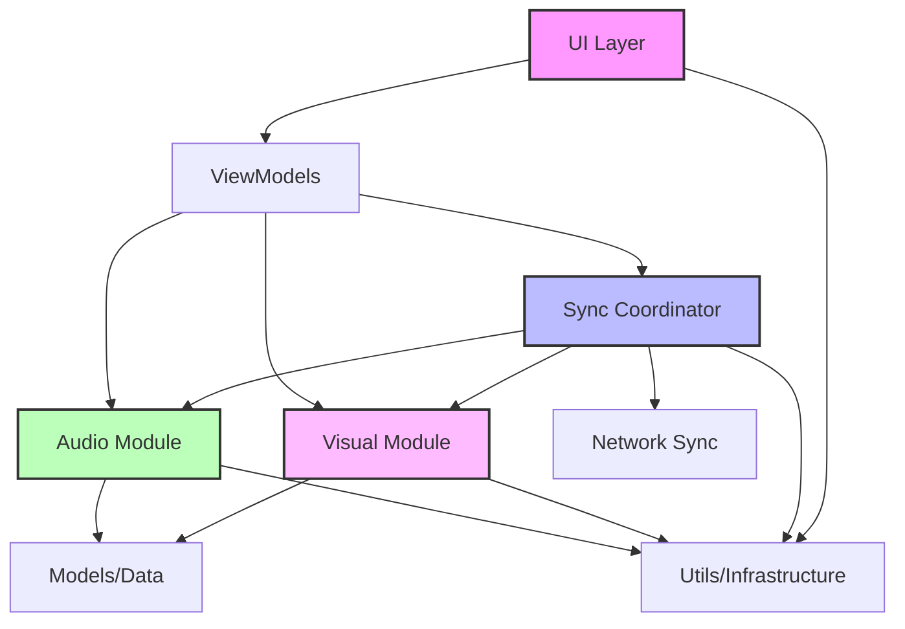

# LNX Experience モジュラー設計詳細仕様書

> **Status**: Deprecated — 2025-08 の Swift（Core Audio / Metal）時代のモジュラー設計。現在の構成は [design 02](../design/02-architecture.md)。経緯の参照用に残す

## 目次
1. [概要](#概要)
2. [Audio モジュール詳細設計](#audio-モジュール詳細設計)
3. [Visual モジュール詳細設計](#visual-モジュール詳細設計)
4. [Sync モジュール詳細設計](#sync-モジュール詳細設計)
5. [UI モジュール詳細設計](#ui-モジュール詳細設計)
6. [Models/Data 層設計](#modelsdata-層設計)
7. [Utils/Infrastructure 層設計](#utilsinfrastructure-層設計)
8. [モジュール間依存関係](#モジュール間依存関係)
9. [実装ロードマップ](#実装ロードマップ)

---

## 概要

### 設計原則
- **低遅延最優先**: すべての設計決定において5ms以下の遅延を目標
- **モジュラー性**: 各モジュールは独立して開発・テスト可能
- **プロトコル指向**: Swift Protocolによる疎結合設計
- **段階的移行**: 現在のSwiftUIアプリから段階的に機能追加

### アーキテクチャパターン
```
┌──────────────────────────────────────────────┐
│                  UI Layer                     │
│              (SwiftUI + MVVM)                 │
├──────────────────────────────────────────────┤
│              Sync Coordinator                 │
│         (Audio-Visual-Network Sync)           │
├────────────────────┬─────────────────────────┤
│    Audio Module    │     Visual Module        │
│   (Core Audio)     │    (Metal Shaders)       │
├────────────────────┴─────────────────────────┤
│              Models/Data Layer                │
│         (Project Files, Settings)             │
├──────────────────────────────────────────────┤
│           Utils/Infrastructure                │
│     (Performance, Memory, Logging)            │
└──────────────────────────────────────────────┘
```

---

## Audio モジュール詳細設計

### 1. Core Audio 統合戦略

#### AudioEngine クラス構造
```swift
// Protocol定義
protocol LNXAudioEngineProtocol {
    var latency: TimeInterval { get }
    var isRunning: Bool { get }
    
    func start() async throws
    func stop() async
    func processBuffer(_ buffer: AudioBuffer) -> AudioBuffer
}

// 実装クラス
class LNXAudioEngine: LNXAudioEngineProtocol {
    private let audioUnit: AudioUnit
    private let renderQueue: DispatchQueue
    private let bufferSize: UInt32 = 64  // 5ms @ 44.1kHz
    
    // リアルタイムスレッド用のlock-freeバッファ
    private let ringBuffer: TPCircularBuffer
}
```

#### デバイス管理
```swift
protocol LNXAudioDeviceManagerProtocol {
    var availableInputDevices: [AudioDevice] { get }
    var availableOutputDevices: [AudioDevice] { get }
    var currentInputDevice: AudioDevice? { get set }
    var currentOutputDevice: AudioDevice? { get set }
    
    func selectDevice(_ device: AudioDevice, type: DeviceType) async throws
    func monitorDeviceChanges() -> AsyncStream<DeviceChangeEvent>
}

struct AudioDevice {
    let id: AudioDeviceID
    let name: String
    let sampleRate: Double
    let bufferSizeRange: ClosedRange<UInt32>
    let latency: TimeInterval
}
```

### 2. リアルタイム処理パイプライン

#### 処理チェーン設計
```swift
protocol AudioProcessor {
    var latencyContribution: TimeInterval { get }
    func process(_ buffer: inout AudioBuffer, context: ProcessingContext)
}

class AudioProcessingChain {
    private var processors: [AudioProcessor] = []
    
    // Lock-free追加/削除
    func addProcessor(_ processor: AudioProcessor)
    func removeProcessor(at index: Int)
    
    // リアルタイムセーフな処理
    func processBuffer(_ buffer: inout AudioBuffer) {
        // プロセッサーチェーンを通じた処理
        // メモリアロケーションなし
    }
}
```

#### 低遅延バッファ管理
```swift
class LowLatencyBufferManager {
    private let bufferPool: UnsafeMutablePointer<AudioBuffer>
    private let poolSize: Int = 16
    
    // Pre-allocated buffers for zero-allocation processing
    func acquireBuffer() -> AudioBuffer?
    func releaseBuffer(_ buffer: AudioBuffer)
}
```

### 3. 大容量ファイルストリーミング

#### ストリーミングローダー
```swift
protocol AudioFileStreamerProtocol {
    func openFile(at url: URL) async throws
    func readNextChunk(frames: UInt32) -> AudioBuffer?
    func seek(to position: TimeInterval) async
    var duration: TimeInterval { get }
    var currentPosition: TimeInterval { get }
}

class LargeFileAudioStreamer: AudioFileStreamerProtocol {
    private let fileHandle: ExtAudioFileRef
    private let cacheSize: Int = 1024 * 1024 * 10  // 10MB cache
    private let readAheadBuffer: CircularBuffer
    
    // 非同期先読み処理
    private func prefetchNextChunk() async {
        // バックグラウンドで次のチャンクを読み込み
    }
}
```

### 4. MIDI 統合

```swift
protocol MIDIManagerProtocol {
    var availableSources: [MIDISource] { get }
    var availableDestinations: [MIDIDestination] { get }
    
    func connect(to source: MIDISource) async throws
    func send(_ message: MIDIMessage, to destination: MIDIDestination)
    func receivedMessages() -> AsyncStream<MIDIMessage>
}

struct MIDIMapping {
    let controller: UInt8
    let parameter: AudioParameter
    let range: ClosedRange<Float>
    let curve: MappingCurve
}
```

### 5. エフェクトシステム

```swift
protocol AudioEffect: AudioProcessor {
    var parameters: [AudioParameter] { get }
    func setParameter(_ parameter: AudioParameter, value: Float)
}

// 基本エフェクト実装例
class ReverbEffect: AudioEffect {
    private var reverbUnit: AudioUnit
    
    var parameters: [AudioParameter] = [
        .init(id: "roomSize", range: 0...1, default: 0.5),
        .init(id: "damping", range: 0...1, default: 0.3),
        .init(id: "wetMix", range: 0...1, default: 0.2)
    ]
}
```

---

## Visual モジュール詳細設計

### 1. Metal Performance Shaders 統合

#### レンダリングエンジン
```swift
protocol LNXVisualEngineProtocol {
    var currentFPS: Double { get }
    var renderResolution: CGSize { get set }
    
    func startRendering() async throws
    func stopRendering() async
    func renderFrame(audioFeatures: AudioFeatures) -> MTLTexture?
}

class LNXMetalVisualEngine: LNXVisualEngineProtocol {
    private let device: MTLDevice
    private let commandQueue: MTLCommandQueue
    private let renderPipeline: MTLRenderPipelineState
    
    // トリプルバッファリング for smooth rendering
    private var frameBuffers: [MTLTexture]
    private var currentBufferIndex: Int = 0
}
```

### 2. 音響反応型ビジュアライゼーション

```swift
protocol AudioReactiveVisualizer {
    func updateWithAudioFeatures(_ features: AudioFeatures)
    func render(to texture: MTLTexture, commandBuffer: MTLCommandBuffer)
}

struct AudioFeatures {
    let spectrum: [Float]           // FFT結果
    let amplitude: Float            // 現在振幅
    let peakFrequency: Float       // ピーク周波数
    let bpm: Float?                // BPM検出結果
    let onset: Bool                // オンセット検出
}

class SpectrumVisualizer: AudioReactiveVisualizer {
    private let computePipeline: MTLComputePipelineState
    private let particleBuffer: MTLBuffer
    
    func render(to texture: MTLTexture, commandBuffer: MTLCommandBuffer) {
        // GPU並列処理によるパーティクル描画
    }
}
```

### 3. エフェクトチェーン

```swift
protocol VisualEffect {
    var parameters: [VisualParameter] { get }
    func apply(input: MTLTexture, output: MTLTexture, commandBuffer: MTLCommandBuffer)
}

class VisualEffectChain {
    private var effects: [VisualEffect] = []
    private var intermediateTextures: [MTLTexture]
    
    func processFrame(input: MTLTexture, output: MTLTexture, commandBuffer: MTLCommandBuffer) {
        // エフェクトチェーンを通じた処理
    }
}
```

### 4. マルチディスプレイ対応

```swift
protocol DisplayManager {
    var availableDisplays: [Display] { get }
    func configureOutput(for display: Display, configuration: DisplayConfiguration)
}

struct DisplayConfiguration {
    let resolution: CGSize
    let refreshRate: Int
    let colorSpace: CGColorSpace
    let hdrEnabled: Bool
}
```

---

## Sync モジュール詳細設計

### 1. オーディオ・ビジュアル同期

```swift
protocol SyncCoordinatorProtocol {
    var masterClock: Clock { get }
    func synchronize(audio: AudioTimestamp, visual: VisualTimestamp)
    func compensateLatency(_ latency: TimeInterval, for component: SyncComponent)
}

class LNXSyncCoordinator: SyncCoordinatorProtocol {
    private let clockSource: ClockSource
    private var componentLatencies: [SyncComponent: TimeInterval] = [:]
    
    // 高精度タイマー
    private let hostTimeBase: mach_timebase_info_data_t
    
    func getCurrentTime() -> TimeInterval {
        // mach_absolute_time()を使用した高精度時刻取得
    }
}
```

### 2. ネットワーク同期

```swift
protocol NetworkSyncProtocol {
    func startServer(port: Int) async throws
    func connectToServer(host: String, port: Int) async throws
    func broadcast(_ event: SyncEvent) async
    func receivedEvents() -> AsyncStream<SyncEvent>
}

class NetworkSyncManager: NetworkSyncProtocol {
    private let session: URLSession
    private let webSocketTask: URLSessionWebSocketTask?
    
    // 低遅延通信のためのUDP実装も検討
    private let udpSocket: NWConnection?
}
```

### 3. タイムコード管理

```swift
struct Timecode {
    let hours: Int
    let minutes: Int
    let seconds: Int
    let frames: Int
    let frameRate: FrameRate
    
    enum FrameRate {
        case fps24, fps25, fps30, fps60
    }
}

protocol TimecodeManagerProtocol {
    var currentTimecode: Timecode { get }
    func sync(to externalTimecode: Timecode)
    func generateLTC() -> Data  // Linear Timecode
}
```

---

## UI モジュール詳細設計

### 1. SwiftUI + MVVM 最適化

#### ViewModel 基本構造
```swift
@MainActor
protocol ViewModelProtocol: ObservableObject {
    associatedtype State
    associatedtype Action
    
    var state: State { get }
    func perform(_ action: Action) async
}

@MainActor
class MainViewModel: ViewModelProtocol {
    @Published private(set) var state: MainViewState
    
    private let audioEngine: LNXAudioEngineProtocol
    private let visualEngine: LNXVisualEngineProtocol
    private let syncCoordinator: SyncCoordinatorProtocol
    
    enum Action {
        case play
        case stop
        case loadFile(URL)
        case adjustParameter(ParameterID, Float)
    }
}
```

### 2. プロフェッショナル操作UI

```swift
// カスタムコントロール
struct ProfessionalKnob: View {
    @Binding var value: Float
    let range: ClosedRange<Float>
    let precision: Float
    
    var body: some View {
        // 高精度ロータリーエンコーダーUI
    }
}

struct WaveformDisplay: View {
    let audioBuffer: AudioBuffer
    let zoomLevel: Float
    
    var body: some View {
        Canvas { context, size in
            // Metal accelerated waveform rendering
        }
    }
}
```

### 3. リアルタイム表示最適化

```swift
// 60fps維持のための最適化
struct OptimizedMeterView: View {
    @StateObject private var meterData = MeterData()
    
    var body: some View {
        TimelineView(.animation(minimumInterval: 1.0/60.0)) { timeline in
            Canvas { context, size in
                // 直接描画によるメーター表示
            }
        }
    }
}
```

---

## Models/Data 層設計

### 1. プロジェクトファイル形式

```swift
struct LNXProject: Codable {
    let version: String
    let metadata: ProjectMetadata
    let tracks: [Track]
    let effects: [EffectConfiguration]
    let visualPresets: [VisualPreset]
    let syncSettings: SyncSettings
}

struct Track: Codable {
    let id: UUID
    let name: String
    let audioFileReference: FileReference?
    let volume: Float
    let pan: Float
    let effects: [EffectInstance]
    let automation: [AutomationLane]
}

// ファイル参照（大容量ファイル対応）
struct FileReference: Codable {
    let originalPath: URL
    let checksum: String  // SHA256
    let fileSize: Int64
    let isStreamable: Bool
}
```

### 2. 設定管理

```swift
protocol SettingsManagerProtocol {
    func getValue<T>(for key: SettingsKey) -> T?
    func setValue<T>(_ value: T, for key: SettingsKey) async
    func observeChanges(for key: SettingsKey) -> AsyncStream<Any>
}

@propertyWrapper
struct Setting<T> {
    let key: SettingsKey
    let defaultValue: T
    
    var wrappedValue: T {
        get { SettingsManager.shared.getValue(for: key) ?? defaultValue }
        set { Task { await SettingsManager.shared.setValue(newValue, for: key) } }
    }
}
```

### 3. セッション状態管理

```swift
actor SessionStateManager {
    private var currentState: SessionState
    private var stateHistory: [SessionState] = []
    private let maxHistorySize = 100
    
    func updateState(_ newState: SessionState) {
        stateHistory.append(currentState)
        if stateHistory.count > maxHistorySize {
            stateHistory.removeFirst()
        }
        currentState = newState
    }
    
    func undo() -> SessionState? {
        guard let previousState = stateHistory.popLast() else { return nil }
        currentState = previousState
        return currentState
    }
}
```

---

## Utils/Infrastructure 層設計

### 1. パフォーマンス測定

```swift
protocol PerformanceMonitorProtocol {
    func startMeasuring(_ metric: PerformanceMetric)
    func stopMeasuring(_ metric: PerformanceMetric) -> MeasurementResult
    func continuousMonitoring() -> AsyncStream<PerformanceSnapshot>
}

enum PerformanceMetric {
    case audioLatency
    case renderingFPS
    case cpuUsage
    case memoryUsage
    case diskIO
}

class PerformanceMonitor: PerformanceMonitorProtocol {
    private let signpostLog = OSLog(subsystem: "com.lnx.experience", category: "Performance")
    
    func measureAudioLatency() -> TimeInterval {
        // HostTime を使用した高精度測定
    }
}
```

### 2. メモリ管理

```swift
protocol MemoryManagerProtocol {
    var availableMemory: Int64 { get }
    func registerLargeAllocation(_ size: Int64, identifier: String)
    func releaseLargeAllocation(identifier: String)
    func optimizeMemory() async
}

class MemoryManager: MemoryManagerProtocol {
    private var allocations: [String: Int64] = [:]
    
    func optimizeMemory() async {
        // 未使用キャッシュのクリア
        // メモリマップファイルの最適化
    }
}
```

### 3. エラーハンドリング

```swift
enum LNXError: Error {
    case audioEngineFailure(underlying: Error)
    case fileLoadingError(url: URL, reason: String)
    case syncTimeout(component: String)
    case insufficientMemory(required: Int64, available: Int64)
}

protocol ErrorReporter {
    func report(_ error: LNXError, context: ErrorContext)
    func recoverySuggestion(for error: LNXError) -> String?
}
```

### 4. ログ管理

```swift
protocol LoggerProtocol {
    func log(_ message: String, level: LogLevel, category: LogCategory)
    func performance(_ metric: String, value: Any)
    func exportLogs() -> URL?
}

enum LogLevel {
    case debug, info, warning, error, critical
}

enum LogCategory {
    case audio, visual, sync, ui, system
}
```

---

## モジュール間依存関係

### 依存関係図



### インターフェース定義原則

1. **プロトコル境界**: 各モジュール間はProtocolのみで通信
2. **非同期通信**: async/awaitまたはCombineを使用
3. **エラー伝播**: Result型またはthrowsで明示的にエラー処理
4. **イベント駆動**: AsyncStreamによるリアクティブな連携

---

## 実装ロードマップ

### Phase 1: 基盤構築 (v0.1 - 現在)
- [x] 基本SwiftUIアプリケーション
- [ ] Core Audio基本統合（LNX-4）
- [ ] 単一トラック再生機能

### Phase 2: コア機能実装 (v0.2 "Rising Tide" - 2025/10/31)
- [ ] マルチトラック（8トラック）対応
- [ ] 基本MIDI機能
- [ ] プロジェクトファイル(.lnxproj)形式
- [ ] 基本的なビジュアライゼーション

### Phase 3: プロフェッショナル機能 (v0.3 "Wave Rider" - 2025/12/31)
- [ ] 高度なエフェクトチェーン
- [ ] ネットワーク同期
- [ ] VisionPro対応準備
- [ ] プロフェッショナルUI完成

### Phase 4: 拡張機能 (v1.0 - 2026 Q1)
- [ ] プラグインシステム
- [ ] AI支援機能
- [ ] クラウド連携
- [ ] 完全なVisionPro統合

### 実装優先順位

1. **最優先**: Audio Module（Core Audio統合、低遅延実現）
2. **高優先**: UI Module（基本操作の実装）
3. **中優先**: Models/Data層（プロジェクト管理）
4. **低優先**: Visual Module（段階的に機能追加）
5. **将来**: Sync Module（v0.3以降）

---

## テスト戦略

### ユニットテスト
```swift
// Audio Module テスト例
class AudioEngineTests: XCTestCase {
    func testLatencyUnder5ms() async {
        let engine = LNXAudioEngine()
        await engine.start()
        
        let latency = engine.latency
        XCTAssertLessThan(latency, 0.005)
    }
    
    func testLargeFileStreaming() async {
        let streamer = LargeFileAudioStreamer()
        let largeFile = URL(fileURLWithPath: "test_200MB.wav")
        
        try await streamer.openFile(at: largeFile)
        
        measure {
            _ = streamer.readNextChunk(frames: 44100)
        }
    }
}
```

### パフォーマンステスト
```swift
class PerformanceTests: XCTestCase {
    func testRenderingAt60FPS() {
        let visualEngine = LNXMetalVisualEngine()
        
        measure(metrics: [XCTClockMetric()]) {
            for _ in 0..<60 {
                _ = visualEngine.renderFrame(audioFeatures: testFeatures)
            }
        }
    }
}
```

---

## まとめ

このモジュラー設計は、LNX Experienceを段階的に発展させるための包括的なフレームワークを提供します。各モジュールは独立して開発・テスト可能でありながら、統合時には低遅延・高品質なリアルタイムオーディオ/ビジュアル表現を実現します。

現在のPhase 1から始まり、Linear課題と連携しながら着実に機能を追加していくことで、最終的にはプロフェッショナルグレードのツールへと成長させることができます。