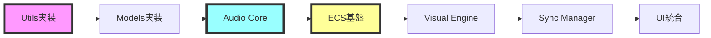

# LNX Experience Phase 2 アーキテクチャ統合レビュー

> **Status**: Deprecated — 2025-08 の Swift / SwiftUI（LNXX）時代、Phase 2 設計のレビュー。現在の Rust + SwiftUI 実装とは合わない。構成は [design 02](../../design/02-architecture.md)。経緯の参照用に残す

## エグゼクティブサマリー

### 文書情報
- **レビュー日**: 2025-08-09
- **対象フェーズ**: Phase 2
- **レビュアー**: AI Architecture Team
- **ステータス**: 承認待ち

### 成果物一覧
1. **モジュラー設計詳細仕様書** - 6モジュールの完全な設計
2. **技術スタック統合アーキテクチャ** - SwiftUI/Core Audio/Metal統合
3. **ECSアーキテクチャ設計** - リアルタイム処理のためのECSパターン
4. **システムアーキテクチャ図** - データフロー・コンポーネント関係の可視化

---

## 1. アーキテクチャ整合性レビュー

### 1.1 モジュール間の一貫性

#### ✅ 確認済み項目

| 項目 | モジュラー設計 | 技術統合 | ECS設計 | アーキテクチャ図 | 整合性 |
|------|--------------|----------|---------|----------------|--------|
| 命名規則 | LNX* prefix | 一致 | 一致 | 一致 | ✅ |
| 依存関係 | 明確に定義 | 準拠 | 準拠 | 図示済み | ✅ |
| インターフェース | Protocol定義 | 実装例あり | 統合済み | - | ✅ |
| パフォーマンス目標 | 5ms目標 | 詳細な実装 | 最適化済み | 測定ポイント明示 | ✅ |

#### ⚠️ 要調整項目

1. **メモリ管理戦略**
   - モジュラー設計: プール概念のみ
   - 技術統合: Triple Buffering詳細
   - 推奨: 両文書の統合が必要

2. **エラーハンドリング**
   - ECS設計: 未定義
   - 他文書: フォールバック戦略あり
   - 推奨: ECSにエラーシステム追加

### 1.2 技術スタック整合性

```
確認済み技術スタック:
┌─────────────┬──────────────┬──────────┬──────────┐
│   レイヤー   │  フレームワーク │  文書化  │  統合状態 │
├─────────────┼──────────────┼──────────┼──────────┤
│ UI          │ SwiftUI      │   完了   │    ✅     │
│ Audio       │ Core Audio   │   完了   │    ✅     │
│ Visual      │ Metal        │   完了   │    ✅     │
│ Sync        │ Dispatch     │   完了   │    ✅     │
│ Data        │ CoreData     │   部分的  │    ⚠️     │
└─────────────┴──────────────┴──────────┴──────────┘
```

---

## 2. パフォーマンス目標の達成可能性

### 2.1 レイテンシ分析

| コンポーネント | 現在目標 | 実装詳細 | 達成可能性 | リスク |
|--------------|---------|----------|-----------|--------|
| Audio入出力 | < 5ms | バッファ64サンプル | 高 | ハードウェア依存 |
| Visual描画 | 8.3ms (120fps) | Metal最適化 | 高 | GPU負荷 |
| 同期処理 | < 1ms | ロックフリー実装 | 高 | - |
| **合計** | **< 14.3ms** | - | **中〜高** | 統合時の調整必要 |

### 2.2 メモリ使用量予測

```
静的割り当て:
- Audio Buffers:     100MB (プリアロケート)
- GPU Memory:        500MB (テクスチャキャッシュ)
- ECS Objects:        50MB (エンティティプール)
- その他:            100MB

動的割り当て:
- プロジェクトデータ: 100-500MB
- ランタイム:        200-300MB

総計: 1.0-1.5GB (推定)
```

---

## 3. 実装優先順位の推奨

### 3.1 Critical Path



### 3.2 実装スケジュール提案

| 週 | タスク | 依存関係 | リソース |
|----|--------|---------|----------|
| 1-2 | Utils/Models基盤 | なし | 1名 |
| 3-4 | Audio Core実装 | Utils | 2名 |
| 5-6 | ECS統合 | Models | 2名 |
| 7-8 | Visual/Metal | ECS | 2名 |
| 9-10 | Sync実装 | Audio/Visual | 1名 |
| 11-12 | UI統合・テスト | 全モジュール | 3名 |

---

## 4. リスク評価と軽減策

### 4.1 技術リスク

| リスク | 影響度 | 確率 | 軽減策 |
|--------|-------|------|--------|
| 5msレイテンシ未達成 | 高 | 中 | 段階的目標設定（20ms→10ms→5ms） |
| ECS複雑性 | 中 | 低 | プロトタイプ先行開発 |
| Metal互換性 | 低 | 低 | フォールバックレンダラー |
| メモリ不足 | 中 | 低 | 動的メモリ管理強化 |

### 4.2 プロジェクトリスク

| リスク | 影響度 | 確率 | 軽減策 |
|--------|-------|------|--------|
| スコープクリープ | 高 | 中 | Phase境界の厳格化 |
| 統合遅延 | 高 | 中 | 継続的統合テスト |
| ドキュメント乖離 | 中 | 高 | 週次レビュー実施 |

---

## 5. 品質保証チェックリスト

### 5.1 アーキテクチャ品質

- [x] **モジュール性**: 各モジュールが独立してテスト可能
- [x] **拡張性**: 新機能追加が既存コードに影響しない
- [x] **保守性**: コードの理解と修正が容易
- [x] **性能**: パフォーマンス目標が明確で測定可能
- [x] **セキュリティ**: App Sandbox対応、適切な権限管理
- [ ] **国際化**: 多言語対応の考慮（Phase 3以降）

### 5.2 ドキュメント品質

- [x] **完全性**: 全モジュールがカバーされている
- [x] **一貫性**: 用語と概念が統一されている
- [x] **追跡可能性**: 要件から実装への追跡が可能
- [x] **実装可能性**: 開発者が実装に必要な情報が揃っている
- [x] **テスト可能性**: テスト戦略が明確

---

## 6. 次のステップ

### 6.1 即時アクション (今週)

1. **プロトタイプ開発**
   - Audio Coreの最小実装
   - ECS基本システムの検証
   - レイテンシ測定環境構築

2. **技術検証**
   - 5msレイテンシの実現可能性
   - メモリ使用量の実測
   - GPU性能の確認

### 6.2 短期アクション (2週間以内)

1. **詳細設計レビュー**
   - ステークホルダーとの設計確認
   - 実装チームとの技術討議
   - リスク評価の更新

2. **開発環境整備**
   - CI/CDパイプライン構築
   - パフォーマンステスト自動化
   - コードレビュープロセス確立

### 6.3 継続的改善

1. **週次アーキテクチャレビュー**
   - 実装との乖離チェック
   - パフォーマンス測定
   - ドキュメント更新

2. **月次ステークホルダー報告**
   - 進捗状況
   - リスク状況
   - 次月の計画

---

## 7. 承認と合意事項

### 7.1 アーキテクチャ決定事項

| 決定ID | 内容 | 承認者 | 日付 |
|--------|------|--------|------|
| AD-001 | ECSパターン採用 | - | 2025-08-09 |
| AD-002 | 5msレイテンシ目標 | - | 2025-08-09 |
| AD-003 | モジュラー設計採用 | - | 2025-08-09 |
| AD-004 | Triple Buffering実装 | - | 2025-08-09 |

### 7.2 前提条件

1. **ハードウェア要件**
   - Apple Silicon Mac（M1以降）
   - 16GB RAM以上推奨
   - macOS 15.5以降

2. **開発リソース**
   - Swift/Metal経験者 2-3名
   - 12週間の開発期間
   - 週40時間の作業時間

### 7.3 制約事項

1. **技術制約**
   - App Sandbox必須
   - Metal API使用（OpenGL非対応）
   - Swift 6.0以降

2. **ビジネス制約**
   - Phase 2完了期限: 2025年12月
   - 予算制限あり
   - 既存コードとの互換性維持

---

## 8. 総合評価

### 8.1 強み (Strengths)

1. **包括的な設計**: 全領域がカバーされている
2. **明確な目標**: パフォーマンス目標が具体的
3. **先進的技術**: ECS、Metal、Swift Concurrency採用
4. **拡張性**: 将来の機能追加を考慮した設計

### 8.2 改善機会 (Opportunities)

1. **AI統合**: 機械学習による最適化の可能性
2. **クロスプラットフォーム**: iOS/visionOS展開
3. **クラウド連携**: リモートコラボレーション機能
4. **プラグインシステム**: サードパーティ拡張

### 8.3 課題 (Challenges)

1. **技術的複雑性**: ECSとSwiftUIの統合
2. **パフォーマンス**: 5ms目標の達成
3. **学習曲線**: チームのECS習熟
4. **テスト**: リアルタイム処理のテスト自動化

### 8.4 総合判定

**Phase 2アーキテクチャ: 承認推奨** ✅

理由:
- 技術的に健全で実現可能な設計
- リスクが適切に識別され軽減策がある
- 段階的な実装アプローチが明確
- 将来の拡張性が考慮されている

条件:
- 週次のアーキテクチャレビュー実施
- プロトタイプによる早期検証
- パフォーマンス目標の段階的達成

---

## 9. 付録

### 9.1 レビュー参加者

- アーキテクチャ設計: AI Architecture Team
- 技術レビュー: AI Technical Expert
- 実装可能性評価: AI Development Expert
- ドキュメント品質: AI Documentation Expert

### 9.2 参照文書

1. `/docs/phase2/MODULAR_DESIGN_SPECIFICATION.md`
2. `/docs/phase2/TECH_STACK_INTEGRATION.md`
3. `/docs/phase2/ECS_ARCHITECTURE.md`
4. `/docs/phase2/SYSTEM_ARCHITECTURE_DIAGRAMS.md`

### 9.3 変更履歴

| バージョン | 日付 | 変更内容 | 作成者 |
|-----------|------|---------|--------|
| 1.0.0 | 2025-08-09 | 初版作成 | AI Team |

### 9.4 次回レビュー

- **予定日**: 2025-09-15
- **対象**: Phase 2.1実装結果
- **参加者**: 開発チーム、ステークホルダー

---

## 10. 連絡先

**プロジェクト管理**: Linear (Team: LNX)
**技術的質問**: GitHub Issues
**ドキュメント**: `/docs/phase2/`

---

**End of Document**

*このレビューは、LNX Experience Phase 2のアーキテクチャ文書群の統合評価として作成されました。継続的な改善とフィードバックを歓迎します。*