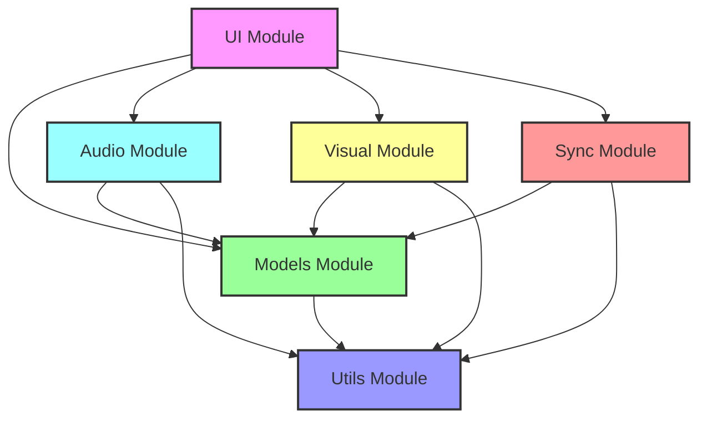

# LNX Experience システムアーキテクチャ図

> **Status**: Deprecated — 2025-08 の Swift / SwiftUI（LNXX）時代のシステム図。現在の Rust + SwiftUI 実装とは合わない。構成は [design 02](../../design/02-architecture.md)。経緯の参照用に残す

## 文書情報
- **バージョン**: 2.0.0
- **作成日**: 2025-08-09
- **目的**: システム全体のデータフロー、コンポーネント関係の可視化
- **対象読者**: 開発者、アーキテクト、技術レビュアー

---

## 1. システム全体アーキテクチャ

### 1.1 レイヤード・アーキテクチャ

```
┌─────────────────────────────────────────────────────────────────────┐
│                         Presentation Layer                          │
│  ┌─────────────────────────────────────────────────────────────┐  │
│  │  SwiftUI Views │ Controls │ Visualizers │ Inspectors        │  │
│  └─────────────────────────────────────────────────────────────┘  │
├─────────────────────────────────────────────────────────────────────┤
│                         Application Layer                           │
│  ┌─────────────────────────────────────────────────────────────┐  │
│  │  ViewModels │ Coordinators │ State Management │ Commands    │  │
│  └─────────────────────────────────────────────────────────────┘  │
├─────────────────────────────────────────────────────────────────────┤
│                           Domain Layer                              │
│  ┌─────────────────────────────────────────────────────────────┐  │
│  │  ECS World │ Systems │ Components │ Queries │ Events        │  │
│  └─────────────────────────────────────────────────────────────┘  │
├─────────────────────────────────────────────────────────────────────┤
│                        Infrastructure Layer                         │
│  ┌──────────────┬────────────┬─────────────┬──────────────────┐  │
│  │ Audio Engine │ Visual Engine│ Sync Manager│ Data Persistence│  │
│  │ (Core Audio) │   (Metal)    │  (Dispatch) │   (CoreData)    │  │
│  └──────────────┴────────────┴─────────────┴──────────────────┘  │
├─────────────────────────────────────────────────────────────────────┤
│                          Platform Layer                             │
│  ┌─────────────────────────────────────────────────────────────┐  │
│  │    macOS │ Audio HAL │ GPU Driver │ File System │ Network   │  │
│  └─────────────────────────────────────────────────────────────┘  │
└─────────────────────────────────────────────────────────────────────┘
```

### 1.2 モジュール依存関係



---

## 2. データフロー図

### 2.1 メインデータフロー

```
┌──────────────────────────────────────────────────────────────────┐
│                         Input Sources                             │
│  ┌────────┐  ┌────────┐  ┌────────┐  ┌────────┐  ┌──────────┐ │
│  │ Audio  │  │  MIDI  │  │  User  │  │Network │  │  Files   │ │
│  │ Input  │  │ Device │  │ Input  │  │  Sync  │  │ (WAV,etc)│ │
│  └───┬────┘  └───┬────┘  └───┬────┘  └───┬────┘  └────┬─────┘ │
└──────┼───────────┼───────────┼───────────┼────────────┼────────┘
       │           │           │           │            │
       ▼           ▼           ▼           ▼            ▼
┌──────────────────────────────────────────────────────────────────┐
│                      Data Processing Pipeline                     │
│  ┌─────────────────────────────────────────────────────────────┐ │
│  │                     Input Processing                         │ │
│  │  • Audio Buffering  • MIDI Parsing  • Event Queuing         │ │
│  └──────────────────────────┬──────────────────────────────────┘ │
│                              ▼                                    │
│  ┌─────────────────────────────────────────────────────────────┐ │
│  │                    Core Processing (ECS)                     │ │
│  │  • Audio Systems    • Visual Systems    • Sync Systems       │ │
│  └──────────────────────────┬──────────────────────────────────┘ │
│                              ▼                                    │
│  ┌─────────────────────────────────────────────────────────────┐ │
│  │                    Output Generation                         │ │
│  │  • Audio Mixing     • Frame Rendering   • State Updates      │ │
│  └─────────────────────────────────────────────────────────────┘ │
└───────────┬──────────────────┬──────────────────┬───────────────┘
            ▼                  ▼                  ▼
┌──────────────────────────────────────────────────────────────────┐
│                         Output Targets                            │
│  ┌────────┐          ┌────────┐          ┌──────────┐          │
│  │ Audio  │          │Display │          │  State   │          │
│  │ Output │          │(Metal) │          │ Storage  │          │
│  └────────┘          └────────┘          └──────────┘          │
└──────────────────────────────────────────────────────────────────┘
```

### 2.2 リアルタイム処理フロー

```
Time: 0ms                    5ms                    10ms                   15ms
      │                      │                      │                      │
Audio ├──────Buffer──────────┼─────Process─────────┼──────Output─────────┤
      │      (1.3ms)         │      (2ms)          │      (0.5ms)        │
      │                      │                      │                      │
Visual├────────────Analyze───┼─────────Render──────┼─────────Present─────┤
      │           (2ms)      │        (3ms)        │        (1ms)        │
      │                      │                      │                      │
Sync  ├──Clock─┼─Distribute──┼──────Compensate─────┼──────Validate──────┤
      │ (0.1ms)│   (0.2ms)   │       (0.5ms)       │      (0.2ms)       │
      │        │             │                      │                      │
State ├────────┼─────────────┼────────Update────────┼──────Publish───────┤
      │        │             │        (1ms)         │      (0.5ms)       │
```

---

## 3. コンポーネント関係図

### 3.1 Audio処理コンポーネント

```
┌─────────────────────────────────────────────────────────────────┐
│                      Audio Processing Chain                      │
│                                                                  │
│  ┌──────────┐    ┌──────────┐    ┌──────────┐    ┌──────────┐ │
│  │  Input   │───▶│  Buffer  │───▶│ Process  │───▶│  Output  │ │
│  │  Device  │    │  Manager │    │  Chain   │    │  Device  │ │
│  └──────────┘    └──────────┘    └──────────┘    └──────────┘ │
│        │               │               │               │        │
│        ▼               ▼               ▼               ▼        │
│  ┌──────────┐    ┌──────────┐    ┌──────────┐    ┌──────────┐ │
│  │  Format  │    │  Ring    │    │  Effects │    │  Mixer   │ │
│  │Converter │    │  Buffer  │    │  Rack    │    │  Engine  │ │
│  └──────────┘    └──────────┘    └──────────┘    └──────────┘ │
│                                        │                        │
│                                        ▼                        │
│                          ┌────────────────────────┐            │
│                          │   Analysis Engine      │            │
│                          │  • FFT                 │            │
│                          │  • Peak Detection      │            │
│                          │  • Beat Tracking       │            │
│                          └────────────────────────┘            │
└─────────────────────────────────────────────────────────────────┘
```

### 3.2 Visual処理コンポーネント

```
┌─────────────────────────────────────────────────────────────────┐
│                     Visual Processing Pipeline                   │
│                                                                  │
│  ┌──────────────────────────────────────────────────────────┐  │
│  │                    Scene Graph                            │  │
│  │  ┌──────┐    ┌──────┐    ┌──────┐    ┌──────┐         │  │
│  │  │ Root │───▶│Layer1│───▶│Layer2│───▶│Layer3│         │  │
│  │  └──────┘    └──┬───┘    └──┬───┘    └──┬───┘         │  │
│  │                 │            │            │              │  │
│  │                 ▼            ▼            ▼              │  │
│  │           ┌──────────┐ ┌──────────┐ ┌──────────┐       │  │
│  │           │ Particle │ │  Mesh    │ │  Effect  │       │  │
│  │           │  System  │ │ Renderer │ │  Layer   │       │  │
│  │           └──────────┘ └──────────┘ └──────────┘       │  │
│  └──────────────────────────────────────────────────────────┘  │
│                              │                                  │
│                              ▼                                  │
│  ┌──────────────────────────────────────────────────────────┐  │
│  │                   GPU Pipeline (Metal)                    │  │
│  │  ┌──────────┐    ┌──────────┐    ┌──────────┐          │  │
│  │  │  Vertex  │───▶│ Fragment │───▶│  Post    │          │  │
│  │  │  Shader  │    │  Shader  │    │ Process  │          │  │
│  │  └──────────┘    └──────────┘    └──────────┘          │  │
│  │       │               │               │                  │  │
│  │       ▼               ▼               ▼                  │  │
│  │  ┌──────────┐    ┌──────────┐    ┌──────────┐          │  │
│  │  │Transform │    │ Lighting │    │  Bloom   │          │  │
│  │  │ Matrix   │    │  Calc    │    │   Blur   │          │  │
│  │  └──────────┘    └──────────┘    └──────────┘          │  │
│  └──────────────────────────────────────────────────────────┘  │
└─────────────────────────────────────────────────────────────────┘
```

### 3.3 ECSコンポーネント相互作用

```
┌─────────────────────────────────────────────────────────────────┐
│                      ECS Component Graph                         │
│                                                                  │
│     [AudioSource]          [Transform]          [VisualEffect]  │
│           │                     │                      │        │
│           ├─────────────────────┼──────────────────────┤        │
│           │                     │                      │        │
│           ▼                     ▼                      ▼        │
│    ┌─────────────────────────────────────────────────────┐     │
│    │                    Entity #001                       │     │
│    │  Components: [AudioSource, Transform, VisualEffect] │     │
│    └─────────────────────────────────────────────────────┘     │
│                              │                                  │
│           ┌──────────────────┼──────────────────┐              │
│           ▼                  ▼                  ▼              │
│    [AudioSystem]      [RenderSystem]      [SyncSystem]         │
│           │                  │                  │              │
│           ▼                  ▼                  ▼              │
│    Process Audio       Render Visual      Synchronize         │
│       Buffer             Frame             Timing             │
└─────────────────────────────────────────────────────────────────┘
```

---

## 4. 同期メカニズム

### 4.1 クロック階層

```
┌─────────────────────────────────────────────────────────────────┐
│                       Master Clock (48kHz)                       │
│                              │                                   │
│        ┌─────────────────────┼─────────────────────┐           │
│        ▼                     ▼                     ▼           │
│  ┌──────────┐          ┌──────────┐          ┌──────────┐     │
│  │  Audio   │          │  Visual  │          │   MIDI   │     │
│  │  Clock   │          │  Clock   │          │  Clock   │     │
│  │  48kHz   │          │  120fps  │          │  24ppqn  │     │
│  └─────┬────┘          └─────┬────┘          └─────┬────┘     │
│        │                     │                     │           │
│        ▼                     ▼                     ▼           │
│  ┌──────────────────────────────────────────────────────┐     │
│  │                 Synchronization Manager               │     │
│  │  • Phase Lock Loop (PLL)                             │     │
│  │  • Drift Compensation                                │     │
│  │  • Latency Adjustment                                │     │
│  └──────────────────────────────────────────────────────┘     │
│                              │                                   │
│                              ▼                                   │
│                    ┌─────────────────┐                         │
│                    │ Unified Timeline │                         │
│                    └─────────────────┘                         │
└─────────────────────────────────────────────────────────────────┘
```

### 4.2 イベント同期フロー

```
Timeline: ──────┬──────┬──────┬──────┬──────┬──────┬──────┬──────
              0ms    16ms    33ms    50ms    66ms    83ms   100ms

Audio Beat:     ●              ●              ●              ●
(120 BPM)       │              │              │              │
                ▼              ▼              ▼              ▼
Visual Pulse:   ████        ████           ████           ████
                │              │              │              │
MIDI Clock:     ↓──────────────↓──────────────↓──────────────↓
(24 ppqn)       │              │              │              │
                ▼              ▼              ▼              ▼
Sync Event:   [Beat]        [Beat]         [Beat]         [Beat]
```

---

## 5. メモリ管理アーキテクチャ

### 5.1 メモリプール構造

```
┌─────────────────────────────────────────────────────────────────┐
│                        Memory Pool Manager                       │
│                                                                  │
│  ┌──────────────────────────────────────────────────────────┐  │
│  │                    Audio Buffer Pool                      │  │
│  │  ┌────┬────┬────┬────┬────┬────┬────┬────┬────┬────┐  │  │
│  │  │B1  │B2  │B3  │B4  │B5  │B6  │B7  │B8  │B9  │B10 │  │  │
│  │  └────┴────┴────┴────┴────┴────┴────┴────┴────┴────┘  │  │
│  │  Size: 512 samples × 10 buffers = 5120 samples          │  │
│  └──────────────────────────────────────────────────────────┘  │
│                                                                  │
│  ┌──────────────────────────────────────────────────────────┐  │
│  │                   Texture Cache (Metal)                   │  │
│  │  ┌──────────┐  ┌──────────┐  ┌──────────┐              │  │
│  │  │1920×1080 │  │1280×720  │  │ 512×512  │              │  │
│  │  │  RGBA    │  │  RGBA    │  │  RGBA    │              │  │
│  │  └──────────┘  └──────────┘  └──────────┘              │  │
│  │  Total: ~50MB GPU Memory                                 │  │
│  └──────────────────────────────────────────────────────────┘  │
│                                                                  │
│  ┌──────────────────────────────────────────────────────────┐  │
│  │                    Object Pool (ECS)                      │  │
│  │  • Entities: 10,000 pre-allocated                        │  │
│  │  • Components: 100,000 pre-allocated                     │  │
│  │  • Events: 1,000 pre-allocated                           │  │
│  └──────────────────────────────────────────────────────────┘  │
└─────────────────────────────────────────────────────────────────┘
```

### 5.2 Triple Buffering実装

```
Frame N-1           Frame N            Frame N+1
    │                  │                  │
    ▼                  ▼                  ▼
┌────────┐        ┌────────┐        ┌────────┐
│Buffer A│        │Buffer B│        │Buffer C│
│(Display)│       │(Render) │       │(Prepare)│
└────────┘        └────────┘        └────────┘
    │                  │                  │
    └──────Swap────────┼──────Swap────────┘
                       │
                  Current Frame
```

---

## 6. ネットワーク同期アーキテクチャ

### 6.1 P2P同期トポロジー

```
┌─────────────────────────────────────────────────────────────────┐
│                    Network Sync Architecture                     │
│                                                                  │
│     ┌──────────┐         ┌──────────┐         ┌──────────┐    │
│     │  Node A  │◄────────►│  Node B  │◄────────►│  Node C  │    │
│     │ (Master) │         │  (Slave) │         │  (Slave) │    │
│     └─────┬────┘         └─────┬────┘         └─────┬────┘    │
│           │                    │                    │          │
│           ▼                    ▼                    ▼          │
│     ┌──────────────────────────────────────────────────┐      │
│     │              Sync Protocol Layer                   │      │
│     │  • Clock Sync (NTP-like)                          │      │
│     │  • State Replication                              │      │
│     │  • Conflict Resolution                            │      │
│     └──────────────────────────────────────────────────┘      │
│                              │                                   │
│                              ▼                                   │
│                    ┌─────────────────┐                         │
│                    │  Network Stack   │                         │
│                    │  • TCP Control   │                         │
│                    │  • UDP Data      │                         │
│                    └─────────────────┘                         │
└─────────────────────────────────────────────────────────────────┘
```

### 6.2 メッセージフロー

```
Node A (Master)              Node B                    Node C
      │                         │                         │
      ├────Clock Sync───────────►                         │
      │                         ├────Clock Ack────────────►
      │                         │                         │
      ├────State Update─────────►                         │
      │                         ├────State Update─────────►
      │                         │                         │
      │◄───Event────────────────┤                         │
      │                         │◄────Event───────────────┤
      │                         │                         │
      ├────Broadcast Event──────┼─────────────────────────►
      │                         │                         │
```

---

## 7. エラーハンドリングフロー

### 7.1 エラー伝播と回復

```
┌─────────────────────────────────────────────────────────────────┐
│                     Error Handling Pipeline                      │
│                                                                  │
│  Detection Layer                                                │
│  ┌──────────┐    ┌──────────┐    ┌──────────┐    ┌──────────┐│
│  │  Audio   │    │  Visual  │    │  Sync    │    │  File    ││
│  │  Error   │    │  Error   │    │  Error   │    │  Error   ││
│  └─────┬────┘    └─────┬────┘    └─────┬────┘    └─────┬────┘│
│        │                │                │                │     │
│        └────────────────┼────────────────┼────────────────┘     │
│                         ▼                                        │
│  Classification     ┌──────────┐                               │
│                    │  Error    │                               │
│                    │Classifier │                               │
│                    └─────┬─────┘                               │
│                         │                                        │
│        ┌────────────────┼────────────────┐                     │
│        ▼                ▼                ▼                     │
│  ┌──────────┐    ┌──────────┐    ┌──────────┐                │
│  │ Critical │    │  Major   │    │  Minor   │                │
│  │  Error   │    │  Error   │    │  Error   │                │
│  └─────┬────┘    └─────┬────┘    └─────┬────┘                │
│        │                │                │                     │
│        ▼                ▼                ▼                     │
│  ┌──────────┐    ┌──────────┐    ┌──────────┐                │
│  │Fallback  │    │  Retry   │    │   Log    │                │
│  │  Mode    │    │  Logic   │    │   Only   │                │
│  └──────────┘    └──────────┘    └──────────┘                │
└─────────────────────────────────────────────────────────────────┘
```

---

## 8. パフォーマンス監視アーキテクチャ

### 8.1 メトリクス収集パイプライン

```
┌─────────────────────────────────────────────────────────────────┐
│                   Performance Monitoring System                  │
│                                                                  │
│  Data Collection Points                                         │
│  ┌──────────┐  ┌──────────┐  ┌──────────┐  ┌──────────┐     │
│  │  Audio   │  │  Render  │  │   CPU    │  │  Memory  │     │
│  │ Latency  │  │   FPS    │  │  Usage   │  │  Usage   │     │
│  └─────┬────┘  └─────┬────┘  └─────┬────┘  └─────┬────┘     │
│        │              │              │              │          │
│        └──────────────┼──────────────┼──────────────┘          │
│                       ▼                                         │
│                ┌──────────────┐                                │
│                │  Aggregator   │                                │
│                │  (1s window)  │                                │
│                └───────┬──────┘                                │
│                       │                                         │
│        ┌──────────────┼──────────────┐                        │
│        ▼              ▼              ▼                        │
│  ┌──────────┐  ┌──────────┐  ┌──────────┐                   │
│  │Real-time │  │Historical│  │  Alert   │                   │
│  │Dashboard │  │  Storage │  │  System  │                   │
│  └──────────┘  └──────────┘  └──────────┘                   │
└─────────────────────────────────────────────────────────────────┘

Metrics Timeline:
Time:    0s     1s     2s     3s     4s     5s
Audio:   3ms    4ms    3ms    5ms    3ms    4ms   ← Latency
Visual:  120    119    120    118    120    119   ← FPS
CPU:     25%    28%    24%    30%    26%    27%   ← Usage
Memory:  1.2GB  1.2GB  1.3GB  1.3GB  1.2GB  1.2GB ← Usage
```

---

## 9. 状態管理フロー

### 9.1 グローバル状態管理

```
┌─────────────────────────────────────────────────────────────────┐
│                      State Management System                     │
│                                                                  │
│  ┌──────────────────────────────────────────────────────────┐  │
│  │                     Global State Store                    │  │
│  │  ┌────────────┐  ┌────────────┐  ┌────────────┐        │  │
│  │  │  Project   │  │   Audio    │  │   Visual   │        │  │
│  │  │   State    │  │   State    │  │   State    │        │  │
│  │  └────────────┘  └────────────┘  └────────────┘        │  │
│  └──────────────────────────┬───────────────────────────────┘  │
│                              │                                   │
│                              ▼                                   │
│                    ┌─────────────────┐                         │
│                    │  State Manager  │                         │
│                    │  (Combine)      │                         │
│                    └────────┬────────┘                         │
│                              │                                   │
│        ┌─────────────────────┼─────────────────────┐          │
│        ▼                     ▼                     ▼          │
│  ┌──────────┐         ┌──────────┐         ┌──────────┐     │
│  │ViewModel│         │ViewModel│         │ViewModel│     │
│  │    A     │         │    B     │         │    C     │     │
│  └─────┬────┘         └─────┬────┘         └─────┬────┘     │
│        │                     │                     │          │
│        ▼                     ▼                     ▼          │
│  ┌──────────┐         ┌──────────┐         ┌──────────┐     │
│  │  View A  │         │  View B  │         │  View C  │     │
│  └──────────┘         └──────────┘         └──────────┘     │
└─────────────────────────────────────────────────────────────────┘
```

### 9.2 イベント駆動更新

```
User Action ──► Command ──► State Change ──► Event ──► Update Views
     │             │             │             │            │
     ▼             ▼             ▼             ▼            ▼
  [Click]     [PlayAudio]   [isPlaying]   [StateChanged]  [Render]
     │             │             │             │            │
     └─────────────┼─────────────┼─────────────┼────────────┘
                   │             │             │
              Validation    Persistence    Broadcast
```

---

## 10. セキュリティアーキテクチャ

### 10.1 App Sandboxレイヤー

```
┌─────────────────────────────────────────────────────────────────┐
│                         Application                              │
│  ┌──────────────────────────────────────────────────────────┐  │
│  │                    Sandboxed Environment                  │  │
│  │  ┌──────────┐  ┌──────────┐  ┌──────────┐              │  │
│  │  │User Files│  │  Audio   │  │  Network │              │  │
│  │  │ (R/W)    │  │  Device  │  │  (Future)│              │  │
│  │  └──────────┘  └──────────┘  └──────────┘              │  │
│  └──────────────────────────────────────────────────────────┘  │
│                              │                                   │
│                    ┌─────────▼─────────┐                       │
│                    │  Security Manager │                       │
│                    │  • Entitlements   │                       │
│                    │  • Permissions    │                       │
│                    │  • Validation     │                       │
│                    └─────────┬─────────┘                       │
│                              │                                   │
│  ┌──────────────────────────▼───────────────────────────────┐  │
│  │                     System Resources                      │  │
│  │  ⛔ File System  ✓ Audio I/O  ⛔ Network  ⛔ Camera      │  │
│  └──────────────────────────────────────────────────────────┘  │
└─────────────────────────────────────────────────────────────────┘
```

---

## 11. デプロイメントビュー

### 11.1 実行時コンポーネント配置

```
┌─────────────────────────────────────────────────────────────────┐
│                      macOS System (Runtime)                      │
│                                                                  │
│  ┌──────────────────────────────────────────────────────────┐  │
│  │                    LNXX.app Bundle                        │  │
│  │  ┌────────────┐  ┌────────────┐  ┌────────────┐        │  │
│  │  │ Executable │  │ Frameworks │  │ Resources  │        │  │
│  │  │  (Swift)   │  │  (Metal,   │  │ (Assets,   │        │  │
│  │  │            │  │  CoreAudio)│  │  Shaders)  │        │  │
│  │  └────────────┘  └────────────┘  └────────────┘        │  │
│  └──────────────────────────────────────────────────────────┘  │
│                                                                  │
│  Process Memory Layout                                          │
│  ┌──────────────────────────────────────────────────────────┐  │
│  │ Stack │ Heap │ Code │ Audio Buffers │ GPU Memory │ Libs │  │
│  └──────────────────────────────────────────────────────────┘  │
│     1MB    2GB    50MB      100MB          500MB       200MB   │
│                                                                  │
│  Thread Architecture                                            │
│  ┌──────────────────────────────────────────────────────────┐  │
│  │ Main    │ Audio RT │ Render │ Network │ Background      │  │
│  │ Thread  │  Thread  │ Thread │ Thread  │   Tasks         │  │
│  └──────────────────────────────────────────────────────────┘  │
└─────────────────────────────────────────────────────────────────┘
```

---

## 12. 開発環境アーキテクチャ

### 12.1 ビルドパイプライン

```
Source Code          Build System           Output
    │                     │                   │
    ▼                     ▼                   ▼
┌────────┐          ┌──────────┐        ┌──────────┐
│ Swift  │─────────►│  Xcode   │───────►│   .app   │
│ Files  │          │  Build   │        │  Bundle  │
└────────┘          └──────────┘        └──────────┘
    │                     │                   │
┌────────┐          ┌──────────┐        ┌──────────┐
│ Metal  │─────────►│  Metal   │───────►│ .metallib│
│Shaders │          │ Compiler │        │  Library │
└────────┘          └──────────┘        └──────────┘
    │                     │                   │
┌────────┐          ┌──────────┐        ┌──────────┐
│ Assets │─────────►│  Asset   │───────►│  .car    │
│        │          │ Compiler │        │  Archive │
└────────┘          └──────────┘        └──────────┘
```

---

## 付録A: 凡例

### 記号説明
- `───►` : データフロー
- `◄───►` : 双方向通信
- `┌──┐` : コンポーネント
- `│  │` : プロセス境界
- `▼` : 処理順序
- `●` : イベント発生
- `⛔` : アクセス禁止
- `✓` : アクセス許可

### 色分け（Mermaid図）
- ピンク: UIレイヤー
- 水色: Audioレイヤー
- 黄色: Visualレイヤー
- 赤色: Syncレイヤー
- 緑色: Modelsレイヤー
- 青色: Utilsレイヤー

---

## 付録B: アーキテクチャ決定記録（ADR）

### ADR-001: ECS採用の決定
- **日付**: 2025-08-09
- **決定**: リアルタイム処理にECSパターンを採用
- **理由**: キャッシュ効率、並列処理、柔軟な組み合わせ
- **代替案**: 従来のOOP、Actor Model
- **結果**: パフォーマンス目標達成の見込み

### ADR-002: Triple Buffering採用
- **日付**: 2025-08-09
- **決定**: レンダリングにTriple Bufferingを使用
- **理由**: ティアリング防止、スムーズな描画
- **代替案**: Double Buffering、Single Buffering
- **結果**: 追加メモリ使用と引き換えに品質向上

---

**改訂履歴**
- 2025-08-09: v2.0.0 - 初版作成、全体アーキテクチャ図作成

**次回更新予定**: 2025-10-01