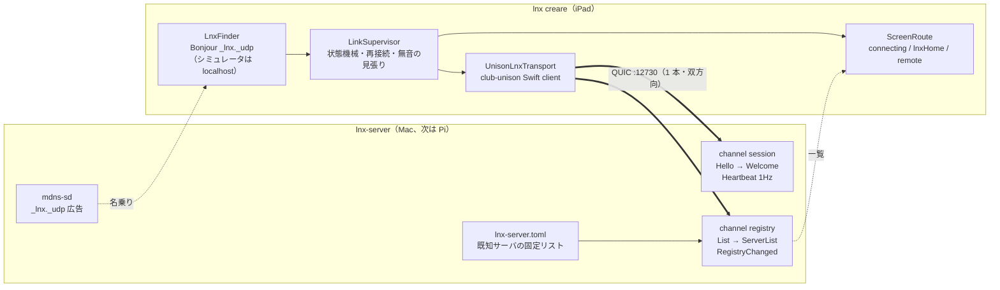

# 01. LNX サーバと lnx creare の常時接続

> **Status**: Draft（Status log 参照）
> **Related**: `spec/01-core-concept/SPEC.md`（場の同期）、`spec/02-creare/SPEC.md`（統合のハブ）、`mem_1Cgfoo741LiQbchNsvJrY6`（起票・裁定）
> **対象**: `crates/lnx-server/`, `apps/ios/LnxCreare/Link/`, `apps/ios/LnxCreare/Screens/`

## Abstract

iPad の lnx creare は、LNX サーバへ 1 本の常時接続（Unison Protocol / QUIC）を張る。
アプリからは request、サーバからは event。サーバは名乗り（Welcome）と心拍（Heartbeat）を返し、
知っているサーバの一覧（registry）を持つ。一覧から選ぶと、iPad の画面がそのサーバ用に切り替わる。

第一区切りではサーバを開発中の Mac で立てる。Raspberry Pi への配置は次。

## Architecture



### 分岐の答え（GO で決まったこと）

| 分岐 | 答え | 理由 |
|---|---|---|
| ハブの形 | **紹介型（A案）**から。LNX は一覧を返し、相手には iPad が直接つなぐ | Unison は今 1 対 1。経由型（中継）は Unison の Hub 層ができたら載せ替える |
| 画面の切り替え | **内蔵 2 画面**（LNX 自身の画面、相手の名前だけ出す汎用画面） | サーバが画面を配る案（C）は北極星。まず切り替わる体験を作る |
| サーバの場所 | **Mac** | 「別に今ラズパイいらないね。ここのサーバで良いわ」 |
| iPad 側の接続 | **club-unison の Swift client**（Rust / UniFFI は使わない） | SDK があり配布実績もある。Rust コアは音の段で |
| 再接続 | **アプリが持つ**（Unison の client は意図的に auto-reconnect しない） | 倍々の間（0.5 秒 → 上限 10 秒）。心拍が止まったら切れたとみなす |
| 信頼 | dev は `skipVerify`、サーバは `dev_localhost` の自己署名 | pin（`TrustPolicy.pinned`）は次の区切り |
| 音 | この区切りでは出さない | lnx-engine の接続は次 |

### 「常時接続」の iOS での意味

背面に回るとアプリは止まり、QUIC は切れる。実際の意味は
**前面にいる間は常時、戻ったら即つなぎ直す、サーバ側に状態を預けない**。
再接続のたびに Hello からやり直し、一覧は List で取り直す。

## Data Model

スキーマの正本は `crates/lnx-server/schemas/lnx.kdl`（`unison schema-lint` を通す）。
Swift 側の写しは `apps/ios/LnxCreare/Link/LnxProtocol.swift`（codegen は無い。手で揃える）。

| channel | request → returns | event | 備考 |
|---|---|---|---|
| `session` | `Hello{client, client_version}` → `Welcome{server_name, server_version, server_time_ms}` | `Heartbeat{seq, uptime_ms}` | 心拍は Hello のあと 1 秒ごと。最初の 1 拍は即座 |
| `registry` | `List{}` → `ServerList{servers}` | `RegistryChanged{servers}` | event は差分ではなく snapshot 全体 |

`servers` の 1 件（`ServerEntry`）: `id`（例 `ladyland.field`）, `name`, `kind`（画面の選択に使う）, `host`, `port`。
設定ファイル（TOML）の `[[servers]]` がそのまま一覧になる。例は `crates/lnx-server/lnx-server.example.toml`。

Swift の channel meta は **1 channel に 1 つの Event 型**しか持てない（`StreamChannelMeta.Event`）。
だから registry の変化は「現れた / 消えた」の 2 種類ではなく、snapshot 1 種類にした。

## Implementation

### サーバ（Rust、`crates/lnx-server`）

- `serve::build(cfg)` が `ProtocolServer` を組む。`with_identity(name, VERSION, "club.chronista.lnx")` → `enable_discovery(LNX_KDL)` → `register_channel("session" | "registry")`
- `serve_session`: `Hello` で Welcome を返し、心拍タスクを 1 本起こす（多重 Hello では張り直さない）。`recv` が閉じたら心拍を止める
- `serve_registry`: `List` で `Registry::snapshot()`、`watch` の変化を `RegistryChanged` で押し出す
- `Registry` は `tokio::sync::watch` の `Sender` を正本に持つ（`send_replace` で購読者ゼロでも更新できる）
- `Advertiser`（mdns-sd）が `_lnx._udp` を広告。TXT に `version` と `protocol=unison`
- 待ち受けは `[::]:12730`（UDP / QUIC、dual stack）。cert は既定の `dev_localhost`。`--no-mdns` / `--name` / `--config` / `LNX_SERVER_ADDR`
- 試験は実 QUIC で回す（`tests/link.rs`）: `listener("[::1]:0").spawn()` → `ProtocolClient::new(QuicClient::insecure_localhost())`

### アプリ（Swift、`apps/ios/LnxCreare/Link`）

- `LnxTransport` / `LnxSession` が接続の抽象。実物は `UnisonLnxTransport`（connect / openChannel / request を**すべて timeout で包む**）、テストは `FakeTransport`
- `LinkSupervisor`（`@MainActor @Observable`）: `idle → connecting(attempt) → connected(Welcome) → reconnecting(attempt, delay)`。
  窓を開けたら心拍・一覧・切断・無音を並行に見張り、どれかが終わったら畳んでつなぎ直す。
  無音の見張りは**最初の心拍が来てから**数え始める（`unison mock` のように心拍を出さない相手を切らない）
- `BackoffPolicy`: 0.5 秒から倍々、上限 10 秒
- `LnxFinder`: 実機は Bonjour（`NWBrowser` → UDP の "接続" で host:port に解く）。シミュレータは `[::1]:12730` に直結
- `ScreenRoute.resolve(state, selection)`: つながるまで `connecting`、つながれば `lnxHome`、選べば `remote(server)`
- `RemoteServer.endpointLabel`: 画面用の `host:port`。`Text("\(port)")` は桁区切り（7,879）になるので文字列で組む

### 開発の回し方

```bash
mise run server:run      # Mac で LNX サーバ（example.toml の一覧つき）
mise run server:mock     # スキーマだけの偽サーバ（心拍は出ない）
mise run ios:test        # Swift の単体テスト（iPad シミュレータ）
mise run ios:run         # ビルド → シミュレータへインストール → 起動
mise run server:test     # cargo test -p lnx-server（実 QUIC の往復を含む）
```

テストは三層。Rust は `tests/link.rs` が実 QUIC で Hello → 心拍 → List を往復する。Swift の単体テストは
`FakeTransport` で supervisor の状態機械を回す。`LnxCreareUITests` は実サーバ相手に一覧をタップして画面が
切り替わり戻ることを見る（サーバが居なければ skip。`mise run server:run` を立ててから `mise run ios:test`）。
シミュレータの端末は `LNX_IOS_SIM` と `LNX_IOS_OS` で選ぶ（同名の端末が runtime ごとにあるため）。

## やってはいけない

- **request を timeout なしで await しない。** 応答が消えると永遠に固まり、再接続も起きない（Ladyland の fieldd で踏んだ実例）
- **`withTaskGroup` の `addTask` に `@MainActor` 付きの閉包を渡さない。** Swift 6.4 の isolation checker が「解けない」と言って止まる。子は nonisolated にし、状態の更新だけ `@MainActor` のメソッドへ渡す
- **スキーマを変えたら `LnxProtocol.swift` も同じ PR で。** codegen は無く、ズレると Hello の応答が decode できずに timeout になる
- **mdns-sd の TXT はタプルの slice で渡さない。** `IntoTxtProperties` は `HashMap<String, String>` と `Vec<TxtProperty>` だけ
- **Swift の 1 channel に複数の event 型を置かない。** `Event` は 1 つ。種類が要るなら payload に `kind` を持たせるか channel を分ける

## 関連 / 未決

- 経由型（iPad は LNX と 1 本だけ、LNX が中継）は Unison の Hub 層の仕事。LNX で先行実装してよい
- registry の生きた供給源（VP daemon の `registry.list`、Ladyland の fieldd）、証明書 pin、Pi 配置、音（lnx-engine）は次の区切り
- Bonjour 探索は**実機確認待ち**（シミュレータは localhost 直結で検証した）

## Status log

- 2026-11-03: Draft。第一区切りの実装と同じブランチ（`wip/lnx-server`）
- 2026-11-03: Mac の lnx-server と iPad シミュレータで通しを確認。接続・名乗り・心拍・一覧、サーバを落として戻すと再接続、一覧から選んで画面が切り替わり戻る（UI テスト）。Bonjour の広告は `dns-sd -B _lnx._udp` で確認、実機からの探索は未
