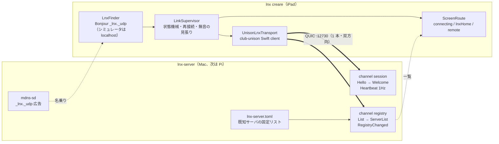

# 01. LNX サーバと lnx creare の常時接続

> **Status**: Draft（Status log 参照）
> **Related**: [spec 01](../spec/01-core-concept.md)（場の同期）、[spec 02](../spec/02-creare.md)（統合のハブ）、[design 02](02-architecture.md)（全体の構成）、`mem_1Cgfoo741LiQbchNsvJrY6`（起票・裁定）
> **対象**: `crates/lnx-server/`, `apps/ios/LnxCreare/Link/`, `apps/ios/LnxCreare/Screens/`, `apps/ios/LnxCreare/Mac/`

## Abstract

iPad の lnx creare は、LNX サーバへ 1 本の常時接続（Unison Protocol / QUIC）を張る。
アプリからは request、サーバからは event。サーバは名乗り（Welcome）と心拍（Heartbeat）を返し、
知っているサーバの一覧（registry）を持つ。一覧から選ぶと、iPad の画面がそのサーバ用に切り替わる。

第一区切りではサーバを開発中の Mac で立てる。Raspberry Pi への配置は次。

## Architecture



### 分岐の答え（GO で決まったこと）

| 分岐 | 答え | 理由 |
|---|---|---|
| ハブの形 | **紹介型（A案）**から。LNX は一覧を返し、相手には iPad が直接つなぐ | Unison は今 1 対 1。経由型（中継）は Unison の Hub 層ができたら載せ替える |
| 画面の切り替え | **内蔵 2 画面**（LNX 自身の画面、相手の名前だけ出す汎用画面） | サーバが画面を配る案（C）は北極星。まず切り替わる体験を作る |
| サーバの場所 | **Mac** | 「別に今ラズパイいらないね。ここのサーバで良いわ」 |
| iPad 側の接続 | **club-unison の Swift client**（Rust / UniFFI は使わない） | SDK があり配布実績もある。Rust コアは音の段で |
| 再接続 | **アプリが持つ**（Unison の client は意図的に auto-reconnect しない） | 倍々の間（0.5 秒 → 上限 10 秒）。心拍が止まったら切れたとみなす |
| 信頼 | サーバは保存した自己署名（起動ごとに作り直さない）。アプリは同じ機械（localhost）なら `skipVerify`、LAN のサーバは **QR でペアリング**した leaf 証明書に `TrustPolicy.pinned` | TOFU（初回を信頼）は club-unison に証明書を取り出す口が無い。ビルド時の同梱はサーバが増えると破綻する（裁定 2026-11-04、`mem_1Cgghdxbp4bGRPyQccDFDn`） |
| 音 | この区切りでは出さない | lnx-engine の接続は次 |

### 「常時接続」の iOS での意味

背面に回るとアプリは止まり、QUIC は切れる。実際の意味は
**前面にいる間は常時、戻ったら即つなぎ直す、サーバ側に状態を預けない**。
再接続のたびに Hello からやり直し、一覧は List で取り直す。

## Data Model

スキーマの正本は `crates/lnx-server/schemas/lnx.kdl`（`unison schema-lint` を通す）。
Swift 側の写しは `apps/ios/LnxCreare/Link/LnxProtocol.swift`（codegen は無い。手で揃える）。

| channel | request → returns | event | 備考 |
|---|---|---|---|
| `session` | `Hello{client, client_version}` → `Welcome{server_name, server_version, server_time_ms}` | `Heartbeat{seq, uptime_ms}` | 心拍は Hello のあと 1 秒ごと。最初の 1 拍は即座 |
| `registry` | `List{}` → `ServerList{servers}` | `RegistryChanged{servers}` | event は差分ではなく snapshot 全体 |

### ペアリングの QR（サーバ → アプリ）

```
lnx://pair?v=1&name=<サーバ名>&cert=<leaf 証明書 DER の base64url、padding なし>
```

- `name` はサーバの名乗り（`cfg.name`、例 `lnx-mac`）で、Bonjour の TXT の `name` と同じ値。アプリは Keychain（service `club.chronista.lnx.creare.pin`、account = name）に DER を置き、Bonjour で見つけた先の TXT の `name` で引く（TXT に無い古いサーバはインスタンス名）
- club-unison Swift の `pinned` は leaf DER の**バイト一致だけ**を見る（hostname / SAN は見ない）。だからサーバは証明書を**作り直してはいけない**（作り直すと pin が外れ、アプリは「ペアリングし直す」まで回り続ける）
- 読み取りは VisionKit の `DataScannerViewController`（実機のみ）。読めない機械（シミュレータ、Mac）は同じ文字列を貼る
- `cert` は `SecCertificateCreateWithData` で証明書として読めるものだけ受け取る（壊れた QR を pin にすると回り続ける）
- QR を出すのは **Mac 版**（裁定 `mem_1CggiZeAYrK7rqz3VNpszU`）。ホームの「iPad をペアリング」→ 手元用 `[::1]:12731` に `skipVerify` でつなぎ `pairing.Get` → `PairingCode` で読めるか確かめてから `CIQRCodeGenerator` で出す（`PairingOffer` / `PairingOfferView`）

`servers` の 1 件（`ServerEntry`）: `id`（例 `ladyland.field`）, `name`, `kind`（画面の選択に使う）, `host`, `port`。
設定ファイル（TOML）の `[[servers]]` がそのまま一覧になる。例は `crates/lnx-server/lnx-server.example.toml`。

Swift の channel meta は **1 channel に 1 つの Event 型**しか持てない（`StreamChannelMeta.Event`）。
だから registry の変化は「現れた / 消えた」の 2 種類ではなく、snapshot 1 種類にした。

## Implementation

### サーバ（Rust、`crates/lnx-server`）

- `serve::build(cfg)` が `ProtocolServer` を組む。`with_identity(name, VERSION, "club.chronista.lnx")` → `enable_discovery(LNX_KDL)` → `register_channel("session" | "registry")`
- `serve_session`: `Hello` で Welcome を返し、心拍タスクを 1 本起こす（多重 Hello では張り直さない）。`recv` が閉じたら心拍を止める
- `serve_registry`: `List` で `Registry::snapshot()`、`watch` の変化を `RegistryChanged` で押し出す
- `Registry` は `tokio::sync::watch` の `Sender` を正本に持つ（`send_replace` で購読者ゼロでも更新できる）
- `Advertiser`（mdns-sd）が `_lnx._udp` を広告する。広告は手元用と本体の両方の待ち受けを bind できてから始める（確保できずに落ちるプロセスに、goodbye で本物の記録を消させない。試験は `tests/startup.rs`）。TXT に `name`（名乗り = QR の name）と `version` と `protocol=unison`。Bonjour のインスタンス名は同名が二つあると「lnx-mac (2)」に改名されるので、アプリは pin の鍵に TXT の `name` を使う
- 待ち受けは `[::]:12730`（UDP / QUIC、dual stack）。cert は `identity::ServerIdentity` が一度だけ作って保存した自己署名（`--state-dir` / `LNX_SERVER_STATE`、既定は `~/Library/Application Support/club.chronista.lnx-server` の `cert.pem` と `key.pem`、鍵は 0600）。起動時にペアリング用の QR と URL（`lnx://pair?v=1&name=<名乗り>&cert=<leaf DER の base64url、padding なし>`）を出す（QR は `--qr` のときだけ。ふだんは Mac 版が窓に出す）。`--no-mdns` / `--name` / `--config` / `--log-file` / `LNX_SERVER_ADDR`
- 止め方: SIGTERM（launchd の `bootout` / `kickstart -k`）と SIGINT（Ctrl-C）を main の最初で受け、待ち受けを畳んで抜ける。
  `Advertiser` の drop は goodbye（TTL 0）の取り下げを最大 1 秒待ち、mdns-sd が +120ms に予約する再送が出るまで 200ms 置いてから、
  daemon の停止をまた最大 1 秒待つ（待たずにプロセスが抜けると送られず、幽霊が残る。shutdown は再送の予約を捨てる）。
  ログは端末でなければ色の制御文字を入れない（常駐のログはファイル）。試験は `tests/shutdown.rs`（実プロセスにシグナルを送る）
- 常駐: この Mac では launchd のユーザー LaunchAgent（`club.chronista.lnx-server`、`RunAtLoad` + `KeepAlive`）。
  `tasks/_lib/agent.rb` が plist を組み、`server:install` / `restart` / `logs` / `status` / `uninstall` が出し入れする（guide 01）。
  証明書は `server:run` と同じ既定の置き場を使う（pin を外さない）。実行ファイルは `~/.local/share/lnx-server/bin` へ写したものを指し、
  設定は `~/Library/Application Support/club.chronista.lnx-server/lnx-server.toml`（無ければ example から写す）
- 設定と名乗り: `--config` が無ければ、証明書と同じ置き場の `lnx-server.toml` を読む。それも無ければ、最初の起動で
  名乗り（`--name` があればそれ、無ければ `lnx-<LocalHostName を小文字に>`）・既知サーバ無しで作って保存する（`ServerConfig::load_or_create`。同じ置き場の一時ファイルに書いてから hard link で無いときだけ置くので、書きかけの空ファイルは残らず、同時に立ち上がっても取り合わない。読むときは `name` が無ければ止まる）。
  名乗りは iPad が pin を引く鍵なので、証明書と同じく一度決めたら使い続ける（`lnx` 固定だと LAN に 2 台あると改名でぶつかる）
- ログの置き場: `--log-file <path>`（`LNX_SERVER_LOG`）は先頭の `~/` を自分で展開し、stdout / stderr をそのファイル（追記）へ dup2 で向ける。
  tracing を始める前に向けるので、ペアリング URL の行も panic も入り、色は付かない。SMAppService の plist は `~` を展開せず
  StandardOutPath に家のパスを書けないための口（試験は `tests/startup.rs`）
- Mac 版 lnx creare（メニューバー）が lnx-server を同梱し、SMAppService で同じラベル `club.chronista.lnx-server` を載せる（mac lane）。
  launchd は同じラベルを二つ載せないので、`server:install` の LaunchAgent とは二重に立たない。`server:*` のタスクは
  launchd の持ち主が `managed_by = com.apple.xpc.ServiceManagement`（`launchctl print`）のものをアプリのジョブとみなし、降ろさずに止まってメニューを案内する
  （plist の有無では決めない。#38 の plist が残っていても消えていても取り違えない）
- Mac 版の常駐（SMAppService）: Mac 版 lnx creare が lnx-server を `.app` に同梱し（`Contents/MacOS/lnx-server`、アプリと同じ identity で署名）、
  `Contents/Library/LaunchAgents/club.chronista.lnx-server.plist` をメニューバーの「開始」で `SMAppService.agent` に登録する（前例 midistage `mem_1Cfuxqjxy6HUi7p7ByQRY4`）。
  アプリの側は、`server:install` の plist が残っていれば登録せずに `server:uninstall` を案内する（同じラベルなので、走っているのはそちら）。
  常駐が走っていないのに launchd の外のプロセスが 12730 / 12731 を握っていれば（`lsof -F pcn`。常駐自身の pid は除く）、「開始」「再起動」を出さずに握っている pid を案内する（`ServerPhase.portTaken`。2026-11-05 の事故の守り）。
  登録済みで落ち続けているとき・許可待ちのときは「停止」（許可待ちは「登録をやめる」）だけ出す。見張り（2 秒おき）の lsof は常駐が走っていないときだけ回し、
  開始・再起動の前には必ず読む。見張りでも開始・再起動の確認でも、外のものに見えたら launchd を読み直す（開始の直後や KeepAlive がちょうど起こし直したとき、launchd を読んだあとで常駐が bind していることがある）
  `KeepAlive = { SuccessfulExit = false }`（SIGTERM で畳んだ exit 0 は起こし直さない）。plist は `~` を書けないので、設定・名乗り・証明書はサーバの既定の置き場、ログは `--log-file`。
  停止 = 登録の解除、再起動 = 解除 → 前のプロセスが消えるのを待つ → 登録（SMAppService の unregister は reap を待たない）。
  常駐の実体は登録した .app の中の実行ファイルなので、登録は `mac:install` で `~/Applications` に入れた .app から（`build-mac` の .app は作り直しのたびに変わる）。
  入れ直したら「再起動」で登録し直す（SDK のヘッダが実行ファイルを変えたら登録し直すよう求めている。2026-11-05 に一度だけ測った: 実行ファイルを入れ替えて（同じチーム署名、中身は別）登録し直さずに kill -9 すると、launchd は 1 秒以内に新しい実行ファイルで立て直した。ログイン時は未測定）。アプリ側は `apps/ios/LnxCreare/Mac/`、手順は guide 01
- 試験は実 QUIC で回す（`tests/link.rs`）: `listener("[::1]:0").spawn()` → `ProtocolClient::new(QuicClient::insecure_localhost())`

### アプリ（Swift、`apps/ios/LnxCreare/Link`）

- `LnxTransport` / `LnxSession` が接続の抽象。実物は `UnisonLnxTransport`（connect / openChannel / request を**すべて timeout で包む**）、テストは `FakeTransport`
- `withTimeout`（`Link/Timeout.swift`）: club-unison の待ちは cancel に応じないので、処理と期限を構造化しない Task で競わせ、先に終わった方で一度だけ戻る（`withThrowingTaskGroup` だと子が終わるまで戻れない）。外からの cancel でもすぐ戻る。遅れて成功した値は `onLateSuccess` へ（connect は接続を閉じる）
- `LinkTrust.decide(target, pins)`: localhost は `.connect(.skipVerify)`、ペアリング済みの LAN は `.connect(.pinned(der))`、未ペアリングは `.needsPairing(name)`。`PinStore` の実物は `CachedPinStore.shared`（Keychain の上の cache をアプリ全体で 1 つ。画面が 0.5 秒ごとに pin の有無を見るので、Keychain は名前ごとに一度だけ読む。窓ごとに作ると解除・ペアリングが他の窓に届かない）、テストは `MemoryPinStore`
- `LinkSupervisor`（`@MainActor @Observable`）: `idle → connecting(attempt) → connected(Welcome) → reconnecting(attempt, delay)`。
  未ペアリングの LAN の先では `needsPairing(serverName)` で止まり、つながない。`paired(code)` で pin を残してつなぎ直す。
  `requestPairing()` は再接続中の画面の「ペアリングし直す」から呼ぶ（LAN の先だけ）。前の pin が残っていれば `cancelPairing()` で戻れる。
  ホームの「ペアリングを解除」（下のボタンと右上のメニューの両方、確認は一段）は `unpair()`（pin を消してペアリング画面へ。iPhone / iPad の LAN の先だけ）。Mac 版の「iPad をペアリング」もボタンと右上のメニューの両方。アプリを消しても Keychain の pin は残るので、やり直しはこちらで
  `paired(code)` は今の先と名前が同じ QR だけ受け取る（違う・今の先の名前が分からないときは false）。
  接続の世代（epoch）を持ち、止める・解除・切り替えのたびに進める。古い世代のタスクは状態を書かない（cancel 後に遅れて戻った応答が connected を書き戻さない）。
  `reconnectNow()` はつなぎ直しの待ちを飛ばす。前面に戻ったとき（`scenePhase == .active`）と、窓が戻って idle のときに `RootView` が呼ぶ。
  窓を開けたら心拍・一覧・切断・無音を並行に見張り、どれかが終わったら畳んでつなぎ直す。
  無音の見張りは**最初の心拍が来てから**数え始める（`unison mock` のように心拍を出さない相手を切らない）
- `BackoffPolicy`: 0.5 秒から倍々、上限 10 秒
- `LnxFinder`: 実機は Bonjour（`NWBrowser` の `.bonjourWithTXTRecord` → UDP の "接続" で host:port に解く）。見つけた先は `.host(address, port:, name: TXT の name、無ければインスタンス名)`。
  解けた先は service ごとの帳簿（`FoundTargets`）に載せ、Bonjour から消えた service の先は忘れる。解決が 5 秒で決まらない・失敗したら、広告が残っている間は IPv4 / IPv6 を交互に試し直す。browser が失敗したら作り直す。
  実機はペアリング済みの先を優先し（LAN に別の `_lnx._udp` が居ても縛られない）、無ければ先頭（IPv4 が前）。
  シミュレータと Mac は常に `[::1]:12730`（カメラで QR を読めず、同じ機械のサーバで足りる。Mac から別の LNX へつなぐのは次）
- `ScreenRoute.resolve(state, selection)`: つながるまで `connecting`、つながれば `lnxHome`、選べば `remote(server)`、ペアリングが要れば `pairing(serverName)`
- `RemoteServer.endpointLabel`: 画面用の `host:port`。`Text("\(port)")` は桁区切り（7,879）になるので文字列で組む

### 開発の回し方

```bash
mise run server:install  # Mac で LNX サーバを常駐させる（launchd。ふだんはこれ）
mise run server:run      # 端末で LNX サーバ（example.toml の一覧つき。常駐中は止まって案内する）
mise run server:test     # cargo test -p lnx-server（実 QUIC の往復を含む）と常駐タスクのテスト
mise run ios:test        # Swift の単体テストと UI テスト（iPad シミュレータ）
mise run ios:run         # ビルド → シミュレータへインストール → 起動
```

タスクの実体は `tasks/` 以下の Ruby（mise の file task）。偽サーバが要るときは `unison mock --schema crates/lnx-server/schemas/lnx.kdl --addr '[::1]:12730'` を直接打つ。

テストは三層。Rust は `tests/link.rs` が実 QUIC で Hello → 心拍 → List を往復する。Swift の単体テストは
`FakeTransport` で supervisor の状態機械を回す。`LnxCreareUITests` は実サーバ相手に一覧をタップして画面が
切り替わり戻ることを見る（サーバが居なければ skip。`mise run server:run` を立ててから `mise run ios:test`）。
シミュレータの端末は `LNX_IOS_SIM` と `LNX_IOS_OS` で選ぶ（同名の端末が runtime ごとにあるため）。

## 事故のときログで何を見るか

「iPad が LNX を見つけない / 解決が時間切れ」のとき、サーバが LAN 側で名乗りに答えているかを、ログと直接の問い合わせで切り分ける。

- **ログ:** 常駐（Mac 版のメニュー、`server:install`）は `~/Library/Logs/lnx-server.log`（`mise run server:logs`）。
  mdns-sd の出来事を `mdns:` で始まる行で出す（`advertise::describe_event`）。立ち上がりに、名乗った NIC ごとの `mdns: 名乗った <名前>（<ホスト>:<NIC>）` が出る
- **直接問う:** 同じ Mac の `dns-sd -L` / `-G` は mDNSResponder のキャッシュの見え方で、当てにならない。
  NIC ごとに legacy unicast（エフェメラルな port から 224.0.0.251 / ff02::fb へ SRV を問う）で、IPv4 と IPv6 を別々に問う。
  道具（`ask.py` / `ask6.py`）は今は `/tmp/lnx-mdns-diag` にあるだけ（残すならタスクにする）

| 形 | NIC ごとに問った結果 | ログ |
|---|---|---|
| (a) ローカルネットワークの許可 | lo0 は答え、LAN 側（en0 など）は IPv4 も IPv6 も答えない | `mdns:` の出来事が無いまま黙る。常駐の初めての起動では、判定がつくまでの数秒だけ起きる |
| (b) XNU の巻き添え | IPv4 だけ、join の早い NIC から順に答えない（lo0 → en0 → …）。IPv6 は答える | その前に `mdns: アドレスが消えた <IPv4>（IPv4）`（warn）。bridge100（iPad の USB）の抜き差しで起きやすい |
| (ii) 改名 | 元の名前で問うと、その NIC だけ答えない（改名後の名前なら答える） | `mdns: 名前がぶつかって改名した <元> → <新>（<RR>、<NIC>）`（warn） |

- **戻し方:** いまはサーバを立て直すしかない（Mac 版のメニュー「再起動」、`server:restart`）。根を断つ直し（IPv4 の IpDel を受けたら ServiceDaemon を作り直す / mdns-sd で消えたアドレスで leave しない）は未決
- **深く追うとき:** `RUST_LOG=info,mdns_sd=debug` で mdns-sd の中のログがそのまま出る（受けた packet ごとに出るので常駐には多すぎる。Mac 版では plist の EnvironmentVariables）
- `get_metrics()` の定期の debug 出力は入れていない。上の 3 つは出来事で見分けられるため。要るなら間隔をここに書いてから足す

## やってはいけない

- **手元用の listener を `[::]` や LAN のアドレスに bind しない。** ペアリング URL（= pin する証明書）を誰にでも渡すことになる。`serve::loopback_only` が起動時に断る

- **request を timeout なしで await しない。** 応答が消えると永遠に固まり、再接続も起きない（Ladyland の fieldd で踏んだ実例）
- **`withTaskGroup` の `addTask` に `@MainActor` 付きの閉包を渡さない。** Swift 6.4 の isolation checker が「解けない」と言って止まる。子は nonisolated にし、状態の更新だけ `@MainActor` のメソッドへ渡す
- **スキーマを変えたら `LnxProtocol.swift` も同じ PR で。** codegen は無く、ズレると Hello の応答が decode できずに timeout になる
- **mdns-sd の TXT はタプルの slice で渡さない。** `IntoTxtProperties` は `HashMap<String, String>` と `Vec<TxtProperty>` だけ
- **Swift の 1 channel に複数の event 型を置かない。** `Event` は 1 つ。種類が要るなら payload に `kind` を持たせるか channel を分ける
- **実機で「LNX を探しています」のまま動かないときは、まず「ローカルネットワーク」の許可を疑う。** 許可しないと Bonjour は何も返さない。アプリを消して入れ直すと聞き直す（iPad の実例 2026-11-04）
- **実機の足跡は stderr に出す。** stdout はパイプ先でバッファされ、`devicectl … --console` に届かない。`--console` の devicectl を殺すとアプリも終わる。行の頭に時刻（その機械の時刻、ミリ秒）を付けている。**ログは起動ごとに別のファイルへ取る**（同じファイルに `>` で取り直すと、前の起動の区間が消える。サーバ側の出来事と突き合わせられなくなった実例 2026-11-04）
- **同じ Mac で、本番と同じ名前の lnx-server をもう一つ立てない。** 試験は別の `--name` か `--no-mdns`。
  Bonjour を始めてから落ちると goodbye を出し、動いている本物の記録（SRV / TXT / A）を LAN 中のキャッシュから消す。
  （2026-11-05 から、port を確保できずに落ちるものは名乗らない。それでも、別の port で立った同じ名前のものは名乗って落ちる）
  改名（`lnx-mac (2)`）してから落ちても、共有しているホスト名 `lnx-mac.local` の A / AAAA を消す（2026-11-04 に同じ mdns-sd で再現）
- **ほかの lnx-server が 12730 / 12731 を握っているうちに、Mac 版の「開始」で常駐させない。** 同梱の lnx-server は bind に失敗して exit 1 し、`KeepAlive` で 10 秒おきに立ち上がり直し続ける。bind の前に Bonjour を始めていた版では、そのたびに同じ名前で名乗っては goodbye を出し、握っている本物の記録を LAN から消した（2026-11-05 06:46〜07:28、端末の `server:run` が握っている間に「開始」され、244 回。System Events でメニューを読んだ操作が「開始」を押した）。今は bind してから名乗る（#40）が、落ち続けるのは同じ
- **常駐中に `server:run` で二つ目を立てない。** 古いサーバを止めても `KeepAlive` で立ち上がり直して取り合う（`server:run` は止まって案内する）

## 関連 / 未決

- 経由型（iPad は LNX と 1 本だけ、LNX が中継）は Unison の Hub 層の仕事。LNX で先行実装してよい
- registry の生きた供給源（VP daemon の `registry.list`、Ladyland の fieldd）、Pi 配置、音（lnx-engine）は次の区切り
- サーバが同じ service のまま IP だけ変えた（browse の変化が来ない）ときは、解き直さない。つなぎ直しが続くときに解き直す道は次
- 切断の検出は心拍の流れが終わること（と無音の見張り）。club-unison の `connectionEvents` は相手からの切断で `.disconnected` を出さないので、`waitUntilDisconnected` は実物では自分で閉じたときにしか戻らない（`FakeSession` はそれより親切）
- club-unison の待ち（connect / openChannel / request）が cancel に応じれば `withTimeout` の工夫は要らなくなる（上流へ相談）
- QR のカメラ読み取りは iPad（iPad13,16）の実機で確認済み（2026-11-04）。iPhone は未
- Bonjour 探索は iPhone 16 Pro と iPad（iPad13,16）の実機で確認済み（2026-11-04）。解決は IPv4 を優先し、だめなら IPv6（scope つき）
- macOS のローカルネットワークの許可は、端末から立てたサーバでは端末のアプリ（VP など）に、常駐（LaunchAgent）では lnx-server 自身に掛かる。
  常駐の初めての起動では、判定がつくまでの数秒、en0 の問い合わせに答えない（lo0 と bridge100 は答える。2026-11-04 実測）。
  ad-hoc 署名のまま作り直した実行ファイルでも、restart の 3 秒後には en0 で答えた（2026-11-04、一度の観測）
- 2026-11-04 07:08〜07:20 に、端末から立てたサーバ（pid 72720）が LAN 側（en0 / bridge100）で SRV / A に答えなくなり、iPad が解決できなかった。
  原因は未確定（サーバのログと iPad の 07:00〜07:19 のログが残っていない）。候補は二つ。
  (a) 07:08 に VP と Claude のセッションが立ち上がり直し、サーバの許可の持ち主（親のアプリ）が消えた。常駐ならこの筋は起きない。
  (b) mdns-sd が消えたアドレスで multicast から抜け、XNU が別の NIC の membership を外す（カーネルの挙動は実験で確認済み）。
  次に起きたら、常駐のログ（`server:logs`）と時刻で突き合わせる
- 2026-11-06 20:1x に Mac 版の常駐（pid 26369）で同じ形が生きたまま出た。IPv4 は en0 と lo0 が答えず bridge100 だけ答え、IPv6 は en0 と lo0 が答えた。
  (b) の形そのもの（(a) なら lo0 は塞がれず、en0 の IPv6 も塞がれる）。引き金は bridge100 の IPv4 が 2 回消えたこととみられるが、unified log が残っておらず時刻は不明

## Status log

- 2026-11-06: mdns-sd の出来事をログに出す（G、mako の GO）。Advertiser が monitor() を受ける専用スレッドを持ち、IpAdd / IpDel / NameChange / Error / Announce を `mdns:` の行で出す
  （IPv4 の IpDel と NameChange と Error は warn、Respond は出さない）。「事故のときログで何を見るか」を足した
- 2026-11-05: 守り（外のプロセスが待ち受けを握っていたら「開始」「再起動」を出さない）をこの Mac で実測。常駐を「停止」して端末と同じ `server:run`（pid 9028）を立てると、
  メニューは「lnx-server（pid 9028）が待ち受けを握っています」「端末の mise run server:run なら Ctrl-C で止めてから「開始」」になり、「開始」は出なかった。
  止めてから「開始」で常駐に戻した。そのあいだ lnx-mac を名乗ったのは常に一つ。アプリが前面にいるとステータス項目は Accessibility に出ない（System Events の最後のメニューバーがアプリ本体のものになる）
- 2026-11-05: この Mac で通しを確認（`~/Applications/LnxCreare.app` から登録、名乗り lnx-mac）。開始 → 12730 / 12731 で待ち受け、ログは `~/Library/Logs/lnx-server.log`、
  en0 から lnx-mac が答える、Mac 版と iPad（USB の bridge100）が hello、QR が出る。停止 → SIGTERM で畳んで launchd から消え、立ち上がり直さず en0 も答えなくなる。
  再起動 → 0.3 秒で新しい pid、port の取り合い無し。kill -9 → 1 秒で立ち上がり直す（en0 で答えるまで約 13 秒）。`server:install` / `restart` / `uninstall` / `run` はアプリのジョブを見て止まる。
  主の窓を閉じてもメニューバーに残り、メニューから開き直すとつなぎ直す。入れ替えた実行ファイルは、登録し直さなくても kill -9 のあと新しい版で立った（一度の観測）。
  ログイン時の自動起動と、iPad / iPhone の Wi-Fi 越しは mako の実機確認。途中、ポートが握られている間に「開始」されて 42 分落ち続けた（「やってはいけない」）
- 2026-11-05: Mac 版のメニューバーから lnx-server を常駐させる（裁定「midistageみたいに、LNXのメニューがあって」→ GO、`mem_1CgiUS2HyVdxMAGfnfE3QX`）。
  `.app` に同梱して SMAppService で登録し、`server:install` の素の LaunchAgent を置き換える。設定・ログの置き場は server lane が持つ
- 2026-11-05: Bonjour の広告を、手元用と本体の待ち受けを bind できてから始める（D、mako の GO）。今までは名乗ってから bind していたので、
  port を握られた起動（KeepAlive の 10 秒おきを含む）が、落ちるときの goodbye で本物の記録を消していた。本体も `spawn` で bind し、
  待ち受けが自分で終わっていないかを 1 秒おきに見て、終わっていたら非 0 で抜ける（club-unison はそのとき Ok を返すが、
  exit 0 だと Mac 版の `KeepAlive = { SuccessfulExit = false }` が立て直さない。この枝は endpoint を外から落とせず試験していない）。
  止めるときは `shutdown` で畳む（最大 2 秒）
- 2026-11-04: Mac 版のメニューバー（SMAppService）に同梱する準備（mac lane の相談 a〜d）。`--config` が無ければ state dir の
  `lnx-server.toml`（無ければ名乗り `lnx-<LocalHostName>` で作って保存）、`--log-file`（`~/` を展開して stdout / stderr を向ける）、
  `server:*` はアプリのジョブを降ろさない。`~/Library/LaunchAgents` の外の plist から試験用ラベルを載せ、`~/` のログ・設定の作成・
  SIGTERM で exit 0 → `SuccessfulExit = false` で立ち上がり直さないこと、を確かめた（4 つのタスクが止まることもこのとき見たが、それは前の判定（plist の有無）でのこと）。
  team-b の指摘で、アプリのジョブの見分けは launchd の持ち主（managed_by）に、設定の作り方は一時ファイル + hard link にした。
  今の判定は、fixture のテストと、SMAppService で載っている midistaged の読み取りで確かめた。Mac 版での端から端までの確認は Mac 版ができてから
- 2026-11-04: サーバを launchd で常駐させる（裁定「常駐させようか」）。SIGTERM / SIGINT で畳んで goodbye を出して抜け、ログに色の制御文字を入れない。
  試験用ラベル（12740 / 12741）で install → kill -9 から立ち上がり直す → restart（SIGTERM で畳む）→ uninstall（en0 に goodbye が出る）まで通した。
  あわせて、同じ名前の二つ目の lnx-server が goodbye で本物の記録を消すことを「やってはいけない」に足した
- 2026-11-04: team-b の deep レビューを受けて接続を固めた: `withTimeout` が期限で必ず戻る、古い世代が状態を書かない、TXT の `name` で pin を引く、消えた service を忘れる、`paired` が名前を確かめる、前面に戻ったら即つなぎ直す、pin の読み出しを cache

- 2026-11-04: Bonjour の TXT に `name` を載せた（ios lane の相談、同名の改名で QR の name と合わなくなる対策）

- 2026-11-04: ペアリング QR は Mac 版が出す（裁定「QRコードは、MacAppが担当したいね」「Bで行こう」、mem_1CggiZeAYrK7rqz3VNpszU）。サーバは手元用の listener を `[::1]:12731` にだけ bind し（`--local-addr` / `LNX_SERVER_LOCAL_ADDR`、ループバック以外は起動を断る）、`lnx-local.kdl` の `pairing` channel の `Get` で `PairingInfo{url, name, cert}` を返す。club-unison 2.2 の channel ハンドラは相手のアドレスを取れないので、判定ではなく bind で守る。ターミナルの QR は `--qr` のときだけ

- 2026-11-04: 証明書を保存して使い続けるようにし、起動時にペアリング用 QR / URL を出す（ios lane の QR ペアリングと合意した契約、起票 mem_1Cgghdxbp4bGRPyQccDFDn）。保存した証明書だけを信頼するクライアントでつながる結合テストを追加
- 2026-11-04: iPad 実機で「ペアリングを解除 → Mac 版の QR をカメラで読む（539 バイト）→ paired（証明書 379 バイト）→ pinned で connected」を通した。サーバを立て直しても pin のままつながる
- 2026-11-04: 証明書 pin（アプリ側）。QR / 貼り付けでペアリングし、LAN のサーバには pin でつなぐ。シミュレータと Mac 版は localhost 固定

- 2026-11-04: LnxCreare ターゲットを iOS + macOS の multiplatform に。`mise run mac:run` で Mac 版が開き、同じ Mac のサーバにつながる
- 2026-11-04: iPhone 16 Pro と iPad の実機で Bonjour → 接続を確認（署名チームは ANYCREATIVE, K.K.）。LnxFinder は IPv4 優先で解決し、`[link]` の足跡を stderr に出す

- 2026-11-03: Draft。第一区切りの実装と同じブランチ（`wip/lnx-server`）
- 2026-11-03: Mac の lnx-server と iPad シミュレータで通しを確認。接続・名乗り・心拍・一覧、サーバを落として戻すと再接続、一覧から選んで画面が切り替わり戻る（UI テスト）。Bonjour の広告は `dns-sd -B _lnx._udp` で確認、実機からの探索は未
