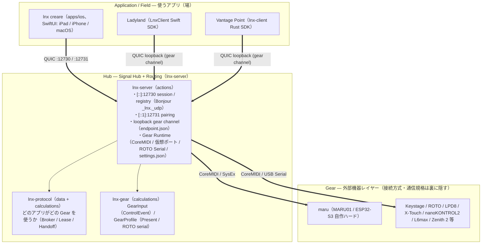

# 02. lnx の構成 — Unison の上に載せる Signal Hub + Routing

> **Status**: Draft（Status log 参照）
> **Related**: [spec 01](../spec/01-core-concept.md)（機器と場をつなぐもの、場の同期）、[spec 02](../spec/02-creare.md)（統合のハブ、UI の方針）、[design 01](01-lnx-server-link.md)（最初の実装）、`mem_1ChTKAVaEY4JhcPwSuBqPc`（midistage・maru・lnx 統合構想 6 Steps）、`mem_1ChTKc23Veo6sEXMJ16mAf`（火花: 全部まとめて Gear）、`mem_1ChTKAxCNTrpAgXr4XM1Cc`（Step 1）、`mem_1ChTKjX4gofAKD7vNcWB62`（Step 2）、`mem_1ChTLTLa5yr1LQ2CtNHo8p`（Step 3）、`mem_1ChTPJv4KqgX7AuML7cY5T`（Step 3.5: Lean 4 + Quint 形式検証）、[archive/ARCHITECTURE.md](../archive/ARCHITECTURE.md)（前身、Deprecated）
> **対象**: `Cargo.toml`, `rust-toolchain.toml`, `crates/lnx-protocol/`, `crates/lnx-gear/`, `crates/lnx-client/`, `crates/lnx-server/`, `clients/swift/`, `formal/lean/`, `formal/quint/`, `apps/ios/project.yml`

## Abstract

spec 01 の「機器と場をつなぐもの（links）」を、**「接続方式や通信規格（MIDI / SysEx / USB Serial / Network QUIC 等）は裏に隠し、すべてを `Gear` として束ね、どのアプリ（場）がどの `Gear` を使うかを司る Signal Hub + Routing（`lnx-server`）」** および Apple ネイティブアプリ（**`lnx creare`、`apps/ios`**）として実装する。

> 「接続方式とか通信規格とかいろいろややこしいんで、全部まとめてGearじゃ。どのアプリがどのGear使うか。そう認識したい。」（mako、`mem_1ChTKc23Veo6sEXMJ16mAf`）

ノード間の通信は **Unison Protocol**（club-unison、QUIC、KDL スキーマ）に統一し、標準のネットワークライブラリを直接は使わない。

## Architecture

### 構成要素と現状

| 構成要素 | 場所 | 役割 | 現状 |
|---|---|---|---|
| **lnx-protocol** | `crates/lnx-protocol` | **[data + calculations]** どのアプリがどの Gear を使うかの wire 型と `Broker` 状態機械（presence / assignment / lease / phase / handoff / setup）。I/O なし | 動く（Step 2 で導入） |
| **lnx-gear** | `crates/lnx-gear` | **[calculations]** Gear ごとの入力正規化（`GearInput` → `ControlEvent`）と表示投影・設定変換（`GearProfile` → `Present` / SysEx / ROTO serial & palette / Keystage）。**`maru`（14bit CC + `TRACK / PARAM / VALUE` SysEx 投影）**・ROTO・Keystage・LPD8・X-Touch・nanoKONTROL2 対応。I/O なし | 動く（Step 2 で導入） |
| **lnx-client** | `crates/lnx-client` | **[actions]** Rust SDK。Vantage Point 等のアプリが `lnx-server` の `gear` channel に接続し、Gear の使用権・引き継ぎ・setup・`SendMidi`・`Present` を行う窓口 | 動く（Step 3 で導入） |
| **LnxClient（Swift）** | `clients/swift` | **[actions]** Swift Package SDK。Ladyland や Mac 版アプリが `lnx-server` の `gear` channel に接続し、仮想ポート許可表（`NativeAccess`）や Gear 操作を行う窓口 | 動く（Step 3 で導入） |
| **lnx-server** | `crates/lnx-server` | **[actions]** lnx サーバ（Signal Hub + Router）。LAN 向け `session` / `registry`（`:12730`、Bonjour `_lnx._udp`）、手元用 `pairing`（`:12731`）、および Gear Runtime（`gear` channel、`endpoint.json`、CoreMIDI 独占・仮想ポート bridge・ROTO USB Serial・設定永続化）を 1 プロセスで担う | 動く（design 01 + Step 3 で Gear Runtime 統合） |
| **lnx creare**（Apple） | `apps/ios` | 入り口のアプリ。SwiftUI、iPad が主。一つのターゲットで iOS / macOS。Mac 版はメニューバーから同梱の `lnx-server` を `SMAppService` で常駐管理する | 動く。接続・名乗り・heartbeat・ペアリング・一覧・画面切り替え |

### Signal Hub + Routing の全体像

### 6 Steps の統合ロードマップ（`mem_1ChTKAVaEY4JhcPwSuBqPc`）

| Step | 内容 | 状態 |
|---|---|---|
| **Step 1** | 未接続の旧 3 crate（`lnx-engine` / `lnx-cli` / Bevy `lnx-creare`）と未使用依存を撤去し workspace を純化 | 完了（#51） |
| **Step 2** | `Gear` を中心語彙にした I/O なしの純粋層 `crates/lnx-protocol` と `crates/lnx-gear`（`maru` の入力変換・SysEx 投影込み）を導入 | 完了（#52） |
| **Step 3** | `lnx-server` に Gear Runtime と `gear` channel を組み込み、`crates/lnx-client`（Rust SDK）と `clients/swift`（`LnxClient`）を追加 | **本変更で完了** |
| **Step 4** | Mac 版 `LnxCreare.app` メニューバーに Gear ステータス一覧・トレース・ログ表示を合流 | 次 |
| **Step 5** | 3D 機材資産（`gear/`）と机配置（`desk.kdl`）を `lnx` に合流し、Mac / iPad の `lnx creare` に展開 | 予定 |
| **Step 6** | `Ladyland` と `VP` を `LnxClient` / `lnx-client` に繋ぎ替え、`midistage` をアーカイブ | 予定 |

### Unison をどう使うか

- サーバ側は `club-unison`（crate 識別子は `unison`）の `ProtocolServer`
  - 本体（`[::]:12730`）: `schemas/lnx.kdl`（`session` / `registry`）
  - 手元ペアリング（`[::1]:12731`）: `schemas/lnx-local.kdl`（`pairing`）
  - Gear Hub（loopback `127.0.0.1` + `[::1]` 同一ポート、`state_dir/endpoint.json`）: `schemas/gear.kdl`（`gear` channel）
- アプリ側は：
  - iOS / macOS `lnx creare`: `UnisonClient` で `session` / `registry` / `pairing` に接続
  - Rust アプリ（VP 等）: `crates/lnx-client` で `endpoint.json` を読んで `gear` channel に接続
  - Swift アプリ（Ladyland 等）: `clients/swift`（`LnxClient`）で `endpoint.json` を読んで `gear` channel に接続

### 分岐の答え

| 分岐 | 答え | 理由 |
|---|---|---|
| 中心語彙 | **すべて `Gear` に統一。「どのアプリがどの `Gear` を使うか」** | 接続方式や通信規格（MIDI / SysEx / USB Serial / QUIC）の複雑さを裏に隠し、3D 資産（`gear/`）や机配置（`desk.kdl`）とも語彙を一本化する（`mem_1ChTKc23Veo6sEXMJ16mAf`） |
| 役割と境界 | **`midistage` と `lnx-server` を統合し、`lnx-server` を唯一の Signal Hub + Router にする**。`maru` は市販コントローラと同じ Gear レイヤーに置く | 裁定 2026-11-27（`mem_1ChTKAVaEY4JhcPwSuBqPc`） |
| 後方互換 | **旧 `midistage` 名や旧パスとの後方互換は持たず、あるべき姿（`lnx` と `Gear` の語彙・置き場）へ一直線に揃える** | 裁定 2026-11-27「後方互換なんて気にせず、あるべき姿に目指して、一直線でいこうよ」（`mem_1ChTKAVaEY4JhcPwSuBqPc`）。`endpoint.json` と `settings.json` も `~/Library/Application Support/club.chronista.lnx-server/` に一本化 |
| 旧 3 crate | **`lnx-engine` / `lnx-cli` / Bevy `lnx-creare` は撤去済み** | Step 1（#51、`mem_1ChTKAxCNTrpAgXr4XM1Cc`） |
| 言語 | サーバ・プロトコル・Gear 変換・Rust SDK は Rust、Apple の UI と Swift SDK は Swift | 純粋計算層と低遅延通信は Rust、UI は Apple ネイティブ（`apps/ios`） |
| ノード間通信 | Unison Protocol 一本 | tokio 等を直接ではなく Unison 経由にする |
| Rust の版 | `rust-toolchain.toml` で 1.99.1 に固定。mise には rust を書かない | 裁定 2026-09-15「Rust toolchain は rustup 一本」（`mem_1Cf5RnR2KKVdmemBSpiU9A`）、1.99.1 は裁定 2026-11-04 |

## Data Model

### Rust workspace（`Cargo.toml`）

- `[workspace]` の 4 member: `crates/lnx-protocol`, `crates/lnx-gear`, `crates/lnx-client`, `crates/lnx-server`
- `workspace.package` は version `0.1.0-alpha3`、edition 2024、license `MIT OR Apache-2.0`
- `workspace.dependencies`: `libc`、`tokio`、`serde`、`serde_json`、`toml`
- profile: release は `opt-level 3` / LTO / `codegen-units 1` / `panic = abort`

### `lnx-server` の Gear Runtime（`crates/lnx-server/src/gear/`）

| モジュール | 役割 |
|---|---|
| `inventory.rs` | 物理ポートから既知の Gear（`roto`, `lpd8`, `nanokontrol`, `keystage`, `numa`, `minilab`, `fgdp`, `xtouch`, `l6max`, `zenith2`, **`maru`**）および未知の `generic:<name>` を識別する |
| `runtime.rs` | `Broker` と保存設定（`settings.json`）、仮想ポート束縛（`NativeBinding`）、ROTO setup ジョブキューを統合管理する |
| `service.rs` | Unison の `gear` channel（`schemas/gear.kdl`）を loopback（`[::1]` と `127.0.0.1` の同一ポート）で提供し、`Endpoint`（`endpoint.json`）を出す |
| `native.rs`, `io_fence.rs` | macOS CoreMIDI の read-only 列挙と CFRunLoop notify スレッド、active lease ごとの仮想 source / destination（`Lnx/…`）ブリッジ生成、SysEx 完了待ち送信、Keystage 接続モードの後始末 |
| `roto_admin.rs`, `roto_setup.rs` | ROTO-CONTROL の USB Serial admin ポートを介した setup 切り替えと差分書き込み（控え保存つき） |
| `settings.rs`, `flow.rs`, `trace.rs` | 原子的な `settings.json` / `endpoint.json` 書き出しと `RuntimeLock`、状態変化の 1 行 info ログ、動的 ON/OFF 可能な MIDI トレース（`lnx_trace` / `LNX_TRACE`） |

## Implementation

- どこに何があるか: 上の表。ビルドと日々の回し方は [guide 01](../guide/01-development.md)
- テスト:
  - Rust: `cargo test --workspace`（`lnx-gear` 72 件、`lnx-protocol` 13 件、`lnx-server` 単体 54 件 + 統合テスト 57 件）
  - Swift SDK: `cd clients/swift && swift test`（Rust `gear_fixture` との実 QUIC 引き継ぎ・ROTO setup RPC 相互接続テスト 6 件）
  - 形式検証:
    - Lean 4（4.36.0、公理ゼロ）: `cd formal/lean && lean -DwarningAsError=true LnxCore.lean`（全 24 定理すべて `does not depend on any axioms`）
    - Quint（0.33.1、6 モード反例探索）: `bun formal/quint/check.ts`（6 モード × 8 シナリオ = 48 シナリオ、6 モード × 5 不変条件 = 30 チェック）
  - iOS / macOS アプリ: `mise run mac:test` / `mise run ios:test`

## やってはいけない

- **Rust の版を mise に書かない。** `rust-toolchain.toml` が正。cargo-edit 等の auto_install が rustc の版で止まった実例（2026-11-04、`.mise.toml` のコメント）
- **前身の `ARCHITECTURE.md` のコード例を写さない。** `unison_protocol::ServiceBuilder` や `unison_node::NodeManager` は実在しない API。実物は club-unison の `ProtocolServer` / `ProtocolClient`
- **スキーマ（`lnx.kdl` / `gear.kdl`）を変えたら Swift 側（`LnxProtocol.swift` / `clients/swift`）も同じ PR で。** codegen は無い
- **`lnx-protocol` と `lnx-gear` に I/O を持ち込まない。** これらは純粋な `data` + `calculations` 層であり、ポート接続・ファイル読み書き・時刻取得・非同期通信は `lnx-server` / `lnx-client`（`actions` 層）に置く

## Status log

- 2025-09-27: 前身 `docs/ARCHITECTURE.md`。Unison エコシステム前提の構想で、分散処理・自動スケーリング・監視・コンテナ化まで含んでいた
- 2026-11-04: SDG の design として `02-architecture.md` に書き直し、Draft。v0.1.0-alpha2 の実装（lnx-server、apps/ios）に合わせ、
  実在しない API のコード例と、実装も裁定も無い節（分散処理 / 自動スケーリング / Prometheus / Docker）を落とした。
  前身は `docs/archive/ARCHITECTURE.md`（Deprecated）
- 2026-11-27: `midistage`・`maru`・`lnx` の統合構想（6 Steps、裁定 `mem_1ChTKAVaEY4JhcPwSuBqPc`）に基づき、`lnx-server` を唯一の Signal Hub + Router とする方針を明記。
  Step 1（#51、`mem_1ChTKAxCNTrpAgXr4XM1Cc`）として、未接続の旧世代 3 crate（`lnx-engine`、`lnx-cli`、Bevy `lnx-creare`）と未使用の音声・GUI 依存を workspace から撤去した
- 2026-11-27: 火花 `mem_1ChTKc23Veo6sEXMJ16mAf`（「接続方式とか通信規格とかいろいろややこしいんで、全部まとめてGearじゃ。どのアプリがどのGear使うか。そう認識したい。」）を受け、中心語彙を `Gear` に統一。
  Step 2（#52、`mem_1ChTKjX4gofAKD7vNcWB62`）として、I/O なしの純粋層 `crates/lnx-protocol`（`GearState` / `Broker` / `wire`）と `crates/lnx-gear`（`GearInput` / `GearProfile` / `roto_serial` / `roto_palette` / `keystage`、`maru` の入力変換と SysEx 投影を含む）を導入した
- 2026-11-27: Step 3（#53、`mem_1ChTLTLa5yr1LQ2CtNHo8p`）として、`lnx-server` に Gear Runtime（`crates/lnx-server/src/gear/`、CoreMIDI / 仮想ポート bridge / ROTO Serial / `settings.json` / `endpoint.json`）と `gear` channel（`schemas/gear.kdl`）を統合し、Rust SDK（`crates/lnx-client`）および Swift SDK（`clients/swift` の `LnxClient`）を新設した
- 2026-11-27: Step 3.5（`mem_1ChTPJv4KqgX7AuML7cY5T`）として、`club-kdl/formal` と同じ流儀で `formal/lean/LnxCore.lean`（Lean 4.36.0、公理ゼロ 24 定理）と `formal/quint/gear_handoff.qnt` + `check.ts`（Quint 0.33.1、6 モード × 8 シナリオ・30 不変条件チェック）による形式検証を追加した
