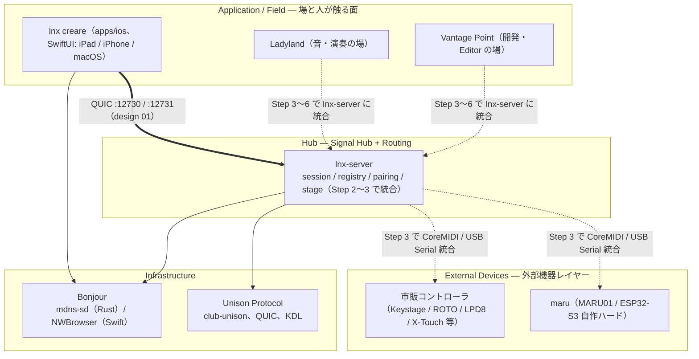

# 02. lnx の構成 — Unison の上に載せる Signal Hub + Routing

> **Status**: Draft（Status log 参照）
> **Related**: [spec 01](../spec/01-core-concept.md)（機器と場をつなぐもの、場の同期）、[spec 02](../spec/02-creare.md)（統合のハブ、UI の方針）、[design 01](01-lnx-server-link.md)（最初の実装）、`mem_1ChTKAVaEY4JhcPwSuBqPc`（midistage・maru・lnx 統合構想 6 Steps）、`mem_1ChTKAxCNTrpAgXr4XM1Cc`（Step 1: 旧世代 3 crate 撤去）、[archive/ARCHITECTURE.md](../archive/ARCHITECTURE.md)（前身、Deprecated）
> **対象**: `Cargo.toml`, `rust-toolchain.toml`, `crates/lnx-server/`, `apps/ios/project.yml`

## Abstract

spec 01 の「機器と場をつなぐもの（links）」を、**外部機器シグナル（MIDI / USB Serial / Network QUIC 等）と場（Ladyland / Vantage Point 等）を双方向につなぐ Signal Hub + Routing（`lnx-server`）** および Apple ネイティブアプリ（**`lnx creare`、`apps/ios`**）として実装する。
ノード間の通信は **Unison Protocol**（club-unison、QUIC、KDL スキーマ）に統一し、標準のネットワークライブラリを直接は使わない。

これまで別リポジトリで進んでいた `midistage`（物理 MIDI 機材・`maru` の検出、lease 引き継ぎ、`Present` 投影、3D `gear/`、机配置 `desk.kdl`）を `lnx` に統合し、Mac 上の常駐デーモンを `lnx-server` 一本にする（`mem_1ChTKAVaEY4JhcPwSuBqPc`）。
その第一歩（Step 1）として、どこにも繋がっていなかった旧世代の 3 crate（`lnx-engine`、`lnx-cli`、Bevy 版 `lnx-creare`）を撤去し、workspace を純化した。

## Architecture

### 構成要素と現状

| 構成要素 | 場所 | 役割 | 現状 |
|---|---|---|---|
| **lnx-server** | `crates/lnx-server` | lnx サーバ（Signal Hub + Router）。lnx creare や各アプリが常時つなぐ窓口。session（名乗り・heartbeat）、registry（既知サーバの一覧）、pairing（QR ペアリング）、Bonjour `_lnx._udp` で名乗る | 動く（design 01）。Step 2〜3 で機材 Runtime（旧 `midistaged`）を統合予定 |
| **lnx creare**（Apple） | `apps/ios` | 入り口のアプリ。SwiftUI、iPad が主。一つのターゲットで iOS / macOS。Mac 版はメニューバーから同梱の `lnx-server` を `SMAppService` で常駐管理する | 動く。接続・名乗り・heartbeat・ペアリング・一覧・画面切り替え |

### Signal Hub + Routing の全体像（統合ターゲット）

### 6 Steps の統合ロードマップ（`mem_1ChTKAVaEY4JhcPwSuBqPc`）

| Step | 内容 | 状態 |
|---|---|---|
| **Step 1** | 未接続の旧 3 crate（`lnx-engine` / `lnx-cli` / Bevy `lnx-creare`）と未使用依存を撤去し workspace を純化 | **本変更で完了** |
| **Step 2** | I/O なしの純粋層 `crates/lnx-protocol`（wire 型・Broker 状態機械）と `crates/lnx-profiles`（`maru`・ROTO・Keystage・LPD8・X-Touch 等の入力正規化と `Present` 投影）を導入 | 次 |
| **Step 3** | `lnx-server` に機材 Runtime と `stage` channel を組み込み、`crates/lnx-client`（Rust SDK）と `clients/swift`（`LnxClient`）を追加 | 予定 |
| **Step 4** | Mac 版 `LnxCreare.app` メニューバーに機材ステータス一覧・MIDI トレース・ログ表示を合流 | 予定 |
| **Step 5** | 3D 機材資産（`gear/`）と机配置（`desk.kdl`）を `lnx` に合流し、Mac / iPad の `lnx creare` に展開 | 予定 |
| **Step 6** | `Ladyland` と `VP` を `LnxClient` / `lnx-client` に繋ぎ替え、`midistage` をアーカイブ | 予定 |

### Unison をどう使うか

- サーバ側は `club-unison`（crate 識別子は `unison`）の `ProtocolServer`。`with_identity(name, VERSION, "club.chronista.lnx")` → `enable_discovery(LNX_KDL)` → `register_channel`。スキーマ `crates/lnx-server/schemas/lnx.kdl` が正本で、バイナリに焼き込んで discovery で配る
- アプリ側は club-unison の Swift package（`UnisonClient`、`apps/ios/project.yml`）
- 待ち受けは UDP / QUIC の `[::]:12730`（本体）と `[::1]:12731`（手元用 pairing）。証明書は保存した自己署名（`cert.pem` / `key.pem`）、LAN の実機は QR ペアリングで leaf DER を pin（design 01）
- 探索は Bonjour。Rust は `mdns-sd` で `_lnx._udp` を広告、Swift は `NWBrowser`

### 分岐の答え

| 分岐 | 答え | 理由 |
|---|---|---|
| 役割と境界 | **`midistage` と `lnx-server` を統合し、`lnx-server` を唯一の Signal Hub + Router にする**。`maru` は市販 MIDI 機材と同じ外部機器レイヤーに置く | `midistage` だと MIDI に縛られるが、実態は MIDI・USB Serial・Network QUIC のシグナルを束ねて Ladyland / VP へルーティングするハブであり、`lnx`（links）の本質そのもの（裁定 2026-11-27、`mem_1ChTKAVaEY4JhcPwSuBqPc`） |
| 後方互換 | **旧 `midistage` 名や旧パスとの後方互換は持たず、あるべき姿（`lnx` の語彙と置き場）へ一直線に揃える** | 裁定 2026-11-27「後方互換なんて気にせず、あるべき姿に目指して、一直線でいこうよ」（`mem_1ChTKAVaEY4JhcPwSuBqPc`） |
| 旧 3 crate | **`lnx-engine` / `lnx-cli` / Bevy `lnx-creare` は撤去** | どこにも繋がっておらず、音のエンジンは Ladyland 側にあるため Step 1 で撤去して workspace を軽くする（`mem_1ChTKAxCNTrpAgXr4XM1Cc`） |
| 言語 | サーバ・プロトコル・プロファイルは Rust、Apple の UI は Swift（SwiftUI） | 低遅延の通信と純粋計算層は Rust、UI は Apple ネイティブ（`apps/ios`） |
| ノード間通信 | Unison Protocol 一本 | tokio 等を直接ではなく Unison 経由にする |
| Rust の版 | `rust-toolchain.toml` で 1.99.1 に固定。mise には rust を書かない | 裁定 2026-09-15「Rust toolchain は rustup 一本」（`mem_1Cf5RnR2KKVdmemBSpiU9A`）、1.99.1 は裁定 2026-11-04 |

## Data Model

### Rust workspace（`Cargo.toml`）

- `[workspace]` の member は現在 `crates/lnx-server`（Step 2〜3 で `lnx-protocol`, `lnx-profiles`, `lnx-client` を追加予定）
- `workspace.package` は version `0.1.0-alpha3`、edition 2024、license `MIT OR Apache-2.0`
- `workspace.dependencies`: `libc`、`tokio`、`serde`、`serde_json`、`toml`
- profile: release は `opt-level 3` / LTO / `codegen-units 1` / `panic = abort`

### 線上の形（wire）

design 01 の Data Model に一本化する。channel `session`（Hello → Welcome、event Heartbeat）、`registry`（List → ServerList、event RegistryChanged）、手元用 `pairing`（Get → url / name / cert）。Step 2〜3 で機器管理の `stage` channel を統合する。

## Implementation

- どこに何があるか: 上の表。ビルドと日々の回し方は [guide 01](../guide/01-development.md)
- つながっているもの: lnx creare ⇄ lnx-server（QUIC、design 01）
- テスト: Rust は `cargo test`（lnx-server は実 QUIC の往復 `tests/link.rs` ほか）。Swift は Swift Testing の単体 + 実サーバ相手の UI テスト（design 01「テストは三層」）

## やってはいけない

- **Rust の版を mise に書かない。** `rust-toolchain.toml` が正。cargo-edit 等の auto_install が rustc の版で止まった実例（2026-11-04、`.mise.toml` のコメント）
- **前身の `ARCHITECTURE.md` のコード例を写さない。** `unison_protocol::ServiceBuilder` や `unison_node::NodeManager` は実在しない API。実物は club-unison の `ProtocolServer` / `ProtocolClient`（`crates/lnx-server/src/serve.rs`、`tests/link.rs`）
- **スキーマ（`lnx.kdl`）を変えたら Swift の写し（`LnxProtocol.swift`）も同じ PR で。** codegen は無い（design 01）

## Status log

- 2025-09-27: 前身 `docs/ARCHITECTURE.md`。Unison エコシステム前提の構想で、分散処理・自動スケーリング・監視・コンテナ化まで含んでいた
- 2026-11-04: SDG の design として `02-architecture.md` に書き直し、Draft。v0.1.0-alpha2 の実装（lnx-server、apps/ios）に合わせ、
  実在しない API のコード例と、実装も裁定も無い節（分散処理 / 自動スケーリング / Prometheus / Docker）を落とした。
  前身は `docs/archive/ARCHITECTURE.md`（Deprecated）
- 2026-11-27: `midistage`・`maru`・`lnx` の統合構想（6 Steps、裁定 `mem_1ChTKAVaEY4JhcPwSuBqPc`）に基づき、`lnx-server` を唯一の Signal Hub + Router とする方針を明記。
  Step 1（`mem_1ChTKAxCNTrpAgXr4XM1Cc`）として、未接続の旧世代 3 crate（`lnx-engine`、`lnx-cli`、Bevy `lnx-creare`）と未使用の音声・GUI 依存を workspace から撤去した
