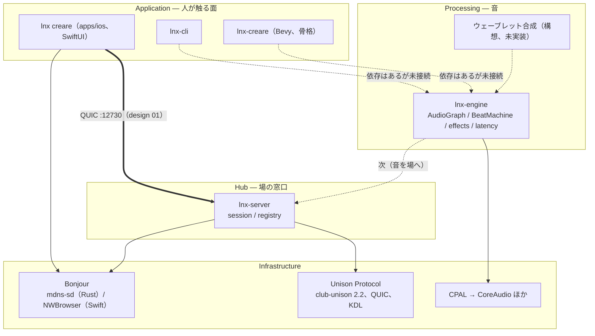

# 02. lnx の構成 — Unison の上に載せる

> **Status**: Draft（Status log 参照）
> **Related**: [spec 01](../spec/01-core-concept.md)（場の同期）、[spec 02](../spec/02-creare.md)（統合のハブ、UI の方針）、[design 01](01-lnx-server-link.md)（最初の実装）、[archive/ARCHITECTURE.md](../archive/ARCHITECTURE.md)（前身、Deprecated）
> **対象**: `Cargo.toml`, `rust-toolchain.toml`, `crates/lnx-engine/`, `crates/lnx-cli/`, `crates/lnx-creare/`, `crates/lnx-server/`, `apps/ios/project.yml`

## Abstract

spec 01 の「場の同期」と spec 02 の「統合のハブ」を、Rust の workspace（4 crate）と Apple ネイティブアプリ（SwiftUI）で実装する。
ノード間の通信は **Unison Protocol**（club-unison、QUIC、KDL スキーマ）に統一し、標準のネットワークライブラリを直接は使わない。
最初に動いたのは「lnx creare が LNX サーバに常時つながる」（design 01、v0.1.0-alpha2）。音（lnx-engine）はまだどこにもつながっていない。

## Architecture

### 構成要素と現状

| 構成要素 | 場所 | 役割 | 現状 |
|---|---|---|---|
| **lnx-engine** | `crates/lnx-engine` | オーディオエンジン。CPAL で入出力、ロックフリーのリングバッファ、AudioGraph、ビートマシン、エフェクト、レイテンシ計測。C ABI（cbindgen）も出す | 動く。`examples/` にビートマシンのデモ |
| **lnx-cli** | `crates/lnx-cli` | `lnx` コマンド（start / stop / status / audio / midi / monitor / config / ui） | 骨格。サブコマンドは定義済みだがハンドラの大半は TODO で、表示は固定値 |
| **lnx-creare**（Bevy） | `crates/lnx-creare` | ビジュアルの窓（Bevy 0.14） | 窓とテキストだけの骨格 |
| **lnx-server** | `crates/lnx-server` | LNX サーバ。lnx creare が常時つなぐ窓口。session（名乗り・心拍）と registry（既知サーバの一覧）、Bonjour `_lnx._udp` で名乗る | 動く（design 01） |
| **lnx creare**（Apple） | `apps/ios` | 入り口のアプリ。SwiftUI、iPad が主。一つのターゲットで iOS / macOS | 動く。接続・名乗り・heartbeat・一覧・画面切り替え |

### レイヤー

### Unison をどう使うか

- サーバ側は `club-unison`（crate 識別子は `unison`）の `ProtocolServer`。`with_identity(name, VERSION, "club.chronista.lnx")` → `enable_discovery(LNX_KDL)` → `register_channel`。スキーマ `crates/lnx-server/schemas/lnx.kdl` が正本で、バイナリに焼き込んで discovery で配る
- アプリ側は club-unison の Swift package（`UnisonClient`、`exactVersion: 2.2.0`、`apps/ios/project.yml`）。Rust コアも UniFFI も使っていない
- 待ち受けは UDP / QUIC の `[::]:12730`（旧 lnx-core の番号を受け継いだ）。証明書は dev の自己署名（`dev_localhost`）、アプリ側は `skipVerify`
- 探索は Bonjour。Rust は `mdns-sd` で `_lnx._udp` を広告、Swift は `NWBrowser`。**Unison Node は使っていない**
- `.claude/CLAUDE.md` の方針は Unison Protocol / Node / Runtime / Connect の 4 つを挙げるが、このリポジトリが依存しているのは Protocol（club-unison）だけ。Node / Runtime / Connect の採用は未決

### 分岐の答え

| 分岐 | 答え | 理由 |
|---|---|---|
| 言語 | コアは Rust、Apple の UI は Swift | 低遅延・ロックフリーの処理は Rust。UI は各プラットフォームの最適なもの（spec 02） |
| ノード間通信 | Unison Protocol 一本 | tokio 等を直接ではなく Unison 経由にする（`.claude/CLAUDE.md`） |
| Rust の版 | `rust-toolchain.toml` で 1.99.1 に固定。mise には rust を書かない | 裁定 2026-09-15「Rust toolchain は rustup 一本」（`mem_1Cf5RnR2KKVdmemBSpiU9A`）、1.99.1 は裁定 2026-11-04。club-unison 2.2 / club-kdl 0.14 の要求は 1.95 以上 |
| サーバの場所 | まず Mac。Raspberry Pi は次 | design 01 |

## Data Model

### Rust workspace（`Cargo.toml`）

- `[workspace]` の 4 member。`workspace.package` は version `0.1.0-alpha2`、edition 2024、license `MIT OR Apache-2.0`
- 主な依存（`workspace.dependencies`）: `cpal` 0.16、`dasp`、`ringbuf` 0.4、`crossbeam-channel`、`atomic_float`、`hound`（WAV）、`midir` 0.9、`serde` / `toml`、`tokio`（sync, rt）。macOS では `coreaudio-rs` / `coreaudio-sys`。`grafton-ndi`（NDI 6）は lnx-engine の `ndi` feature で optional
- `slint` 1.9 は宣言だけで、使う crate は無い。`midir` も依存にあるだけで、MIDI を読むコードはまだ無い（guide 02）
- profile: release は `opt-level 3` / LTO / `codegen-units 1` / `panic = abort`。dev も `opt-level 2`（音のため）

### lnx-engine の主な型（`crates/lnx-engine/src/lib.rs` の re-export）

| 型 | 場所 | 役割 |
|---|---|---|
| `AudioEngine` | `engine.rs` | CPAL のストリームを持ち、`ControlMessage`（Start / Stop / サンプルレート / バッファ / デバイス選択）を crossbeam で受ける。既定 48000 Hz、256 サンプル、入出力それぞれ 8192 のリングバッファ |
| `AudioGraph`, `NodeId`, `ConnectionId` | `graph.rs` | ノードと接続のグラフ。ファイル再生ノード、gain / pan / enabled |
| `DeviceManager`, `AudioDevice` | `devices.rs` | 入出力デバイスの列挙と選択 |
| `BeatMachine`, `DrumPad`, `SequencerPattern`, `TempoController` | `beatmachine.rs` | 16 パッド × 16 ステップ、BPM、swing、パターンの切り替え（README の「ビートマシン機能」） |
| `AudioFilePlayer` ほか | `audio_file.rs` | WAV の読み込みと再生（hound） |
| `LatencyMeter`, `LatencyTester` | `latency.rs` | 往復レイテンシの計測と統計 |
| `AudioEffect`（Delay / Reverb / Compressor / BiquadFilter） | `effects.rs` | エフェクト |
| `lnx_engine_*` | `ffi.rs` | C ABI。`crate-type = ["cdylib", "staticlib", "rlib"]`、cbindgen が `include/lnx_audio_engine.h` を生成 |

### 線上の形（wire）

design 01 の Data Model に一本化する。channel `session`（Hello → Welcome、event Heartbeat）と `registry`（List → ServerList、event RegistryChanged）、
`ServerEntry { id, name, kind, host, port }`。設定は TOML（`crates/lnx-server/lnx-server.example.toml`）。

## Implementation

- どこに何があるか: 上の表。ビルドと日々の回し方は [guide 01](../guide/01-development.md)
- つながっているもの: lnx creare ⇄ lnx-server（QUIC、design 01）だけ
- つながっていないもの
  - lnx-engine ⇄ UI。`apps/ios/README.md` の「次にやること」は、`staticlib` + cbindgen のヘッダを iOS 向けにクロスビルドして xcframework にし、UniFFI で Swift の型を生成する案。未着手
  - lnx-engine ⇄ lnx-server（音を場へ）。design 01 の未決
  - lnx-cli → lnx-engine。依存はあるがハンドラが TODO。`lnx start --daemon` は ichimi 経由で起こす想定のコマンド文字列を印字するだけ
- テスト: Rust は `cargo test`（lnx-server は実 QUIC の往復 `tests/link.rs` を含む）。Swift は Swift Testing の単体 + 実サーバ相手の UI テスト（design 01「テストは三層」）
- CI: `.github/workflows` にあるのは Issue / PR の自動アサインだけ。ビルドとテストの CI は無い

## やってはいけない

- **Rust の版を mise に書かない。** `rust-toolchain.toml` が正。cargo-edit 等の auto_install が rustc の版で止まった実例（2026-11-04、`.mise.toml` のコメント）
- **前身の `ARCHITECTURE.md` のコード例を写さない。** `unison_protocol::ServiceBuilder` や `unison_node::NodeManager` は実在しない API。実物は club-unison の `ProtocolServer` / `ProtocolClient`（`crates/lnx-server/src/serve.rs`、`tests/link.rs`）
- **スキーマ（`lnx.kdl`）を変えたら Swift の写し（`LnxProtocol.swift`）も同じ PR で。** codegen は無い（design 01）
- **性能値を文書に書くときは測った証拠を添える。** README の「< 10ms 達成」「CPU < 5%」はリポジトリに計測の記録が無い（未確認）

## 関連 / 未決

- **UI 技術**: README は Slint、`crates/lnx-creare` は Bevy、spec 02 は Sycamore（Web）+ SwiftUI + MCP。現状動いているのは SwiftUI（`apps/ios`）。どれを本線にするかは決めていない。決まったら spec 02 の表とここを更新する
- **Unison Node / Runtime / Connect**: `.claude/CLAUDE.md` の方針にあるが未使用。Unison に Hub 層ができたら経由型（中継）に載せ替える案は design 01
- **ウェーブレット合成エンジン**（README の Phase 2、プロジェクト名の由来 "wavelet synthesize engine"）: 未実装。設計も無い
- **MIDI**: `midir` は依存にあるだけ。機器の仕様と推奨設定は [guide 02](../guide/02-midi-devices.md)
- **分散処理・自動スケーリング・Prometheus・Docker**（前身の ARCHITECTURE.md）: 実装も、やると決めた記録も無いので、この文書には載せない。原文は archive に残る
- **レイテンシの目標**: spec 01（ライブで知覚できない < 10ms）、spec 02（音 → 映像 < 16ms）。実測の記録は無い

## Status log

- 2025-09-27: 前身 `docs/ARCHITECTURE.md`。Unison エコシステム前提の構想で、分散処理・自動スケーリング・監視・コンテナ化まで含んでいた
- 2026-11-04: SDG の design として `02-architecture.md` に書き直し、Draft。v0.1.0-alpha2 の実装（lnx-server、apps/ios）に合わせ、
  実在しない API のコード例と、実装も裁定も無い節（分散処理 / 自動スケーリング / Prometheus / Docker）を落とした。
  前身は `docs/archive/ARCHITECTURE.md`（Deprecated）
