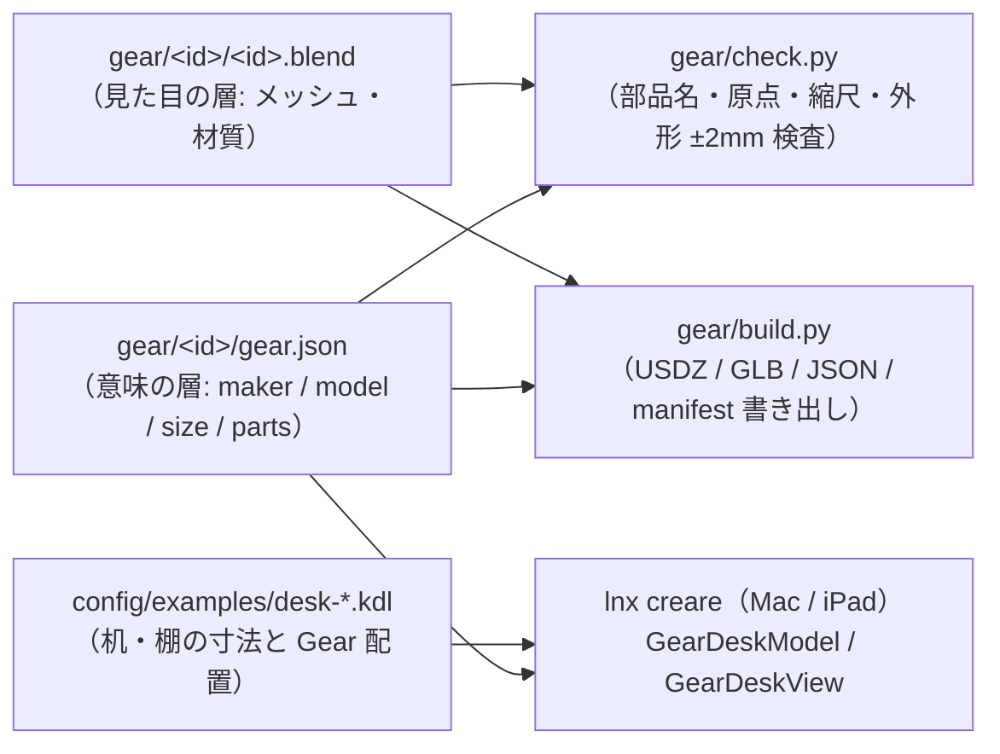

# 03. Gear の 3D 資産と机配置（desk.kdl）

> **Status**: Draft（Status log 参照）
> **Related**: [spec 01](../spec/01-core-concept.md)（道具・楽器との自然な対話）、[design 02](02-architecture.md)（Signal Hub + Routing と Gear 層）、`mem_1ChTKc23Veo6sEXMJ16mAf`（火花: 全部まとめて Gear）、`mem_1ChTQm4n2KdX3Zs3xmEdKK`（Step 5: 3D 資産と机配置の合流）
> **対象**: `gear/`, `config/examples/desk-*.kdl`, `apps/ios/LnxCreare/Model/GearDeskModel.swift`, `apps/ios/LnxCreare/Screens/GearDeskView.swift`

## Abstract

Gear（機材）の形・実寸・操作子の対応と、机・棚の上の配置（`desk.kdl`）を `lnx` の正本として一元管理し、Mac / iPad の `lnx creare` および接続アプリ（Ladyland / Vantage Point 等）が同じ `Gear` ID と座標系を参照できるようにする。

## Architecture

### 二層の 3D 資産（意味の層と見た目の層）

| 層 | 正本 | 形式 | 役割 |
|---|---|---|---|
| **意味の層** | `gear/<id>/gear.json` | JSON（単位 mm、差分が読める） | メーカー（`maker`）、機種名（`model`）、実寸（`size`: `[W, D, H]`）、部品の位置と名前（`parts`）、セクション（`sections`）、操作子 ID（`control`） |
| **見た目の層** | `gear/<id>/<id>.blend` | Blender | 材質・面取り・質感。部品名は意味の層との契約（`gear/check.py` で機械検査） |

## Data Model

### 登録されている Gear（11 種）

| Gear ID | Maker | Model | 外形 W × D × H (mm) | 3D 資産 |
|---|---|---|---|---|
| `roto` | Melbourne Instruments | ROTO-CONTROL | 341 × 99 × 44 | `gear/roto/roto.blend` |
| `lpd8` | AKAI | LPD8 mk2 | 306 × 81 × 34 | `gear/lpd8/lpd8.blend` |
| `nanokontrol` | KORG | nanoKONTROL2 | 325 × 83 × 30 | `gear/nanokontrol/nanokontrol.blend` |
| `keystage` | KORG | Keystage 61 | 979 × 234 × 82 | `gear/keystage/keystage.blend` |
| `numa` | Studiologic | Numa Compact X SE | 1270 × 224 × 100 | `gear/numa/numa.blend` |
| `minilab` | Arturia | MiniLab mkII | 355 × 220 × 50 | `gear/minilab/minilab.blend` |
| `fgdp` | Yamaha | FGDP-50 | 223 × 223 × 51 | `gear/fgdp/fgdp.blend` |
| `xtouch` | Behringer | X-TOUCH | 452 × 301 × 100 | `gear/xtouch/xtouch.blend` |
| `l6max` | ZOOM | LiveTrak L6max | 284 × 114 × 46.5 | `gear/l6max/l6max.blend` |
| `zenith2` | Antelope Audio | Zenith 2 | 135 × 130 × 60 | `gear/zenith2/zenith2.blend` |
| `maru` | Chronista | maru | 90 × 90 × 45 | 箱表示（模型は今後追加） |

### 机配置スキーマ（`config/examples/desk-home.kdl` / `desk-studio.kdl`）

座標系はすべて mm、中心基準、`x` = 右 `+`、`z` = 手前 `+`、`yaw` = 反時計回り角度（度）。

- `footprint center=<x> <z> size=<w> <d>`: 机全体の領域
- `surface "<id>" center=<x> <z> size=<w> <d> elevation=<h> thickness=<t>`: 天板や棚
- `gear "<id>" surface="<surface>" pos=<x> <z> yaw=<deg>`: Gear の配置
- `anchor "<id>" surface="<surface>" pos=<x> <z>`: カメラや UI の注目点

## Implementation

- **Python 純粋層と検証**:
  - `python3 -m unittest discover -s gear/tests -p "test_*.py"`（Blender 不要の 18 テスト）
  - `/Applications/Blender.app/Contents/MacOS/Blender --background --python gear/check.py`（Blender 契約検査）
  - `/Applications/Blender.app/Contents/MacOS/Blender --background --python gear/build.py`（`~/Library/Application Support/tech.anycreative.lnx-server/gear/` への USDZ / GLB / JSON / manifest 書き出し）
- **Apple アプリ（`apps/ios`）**:
  - `LnxCreare/Model/GearDeskModel.swift`: `GearCatalog`（11 種のメーカー・モデル・実寸）と `DeskKdlParser` / `DeskPresets`（`home` / `studio`）
  - `LnxCreare/Screens/GearDeskView.swift`: Mac / iPad 共通の実寸上面図キャンバスと机別 Gear 一覧

## Status log

- 2026-10-10〜10-19: `midistage` にて `gear/`（10 機種の `gear.json` + `.blend`、`gearlib.py` / `build.py` / `check.py` / `generate.py`）および `config/examples/desk-{home,studio}.kdl` を整備
- 2026-11-27: Step 5（`mem_1ChTQm4n2KdX3Zs3xmEdKK`）として `lnx` に合流。配布先を `~/Library/Application Support/tech.anycreative.lnx-server/gear/` に統一し、Mac / iPad の `lnx creare` に `GearDeskModel` と `GearDeskView` を展開した
