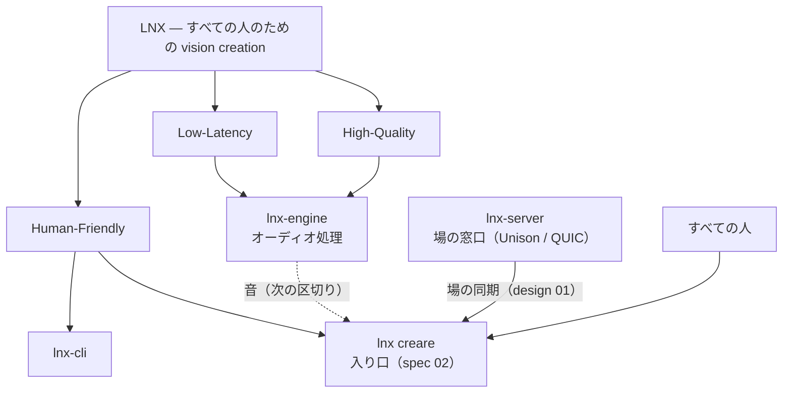

# 01. lnx の本質 — すべての人のための creare

> **Status**: Active（Status log 参照）
> **Related**: [spec 02](02-creare.md)（lnx creare — 入り口）、[design 01](../design/01-lnx-server-link.md)（場の同期の最初の実装）、[design 02](../design/02-architecture.md)（全体の構成）
> **対象**: プロジェクト全体（`crates/`, `apps/`）

## Abstract

**lnx（リンクス）は、機器と場をつなぐもの。** 読みの「リンクス」は links（つなぐもの）に通じる。
Audio / Visual の**リアルタイム表現**のためのツールで、モットーの **Low-Latency, High-Quality, Human-Friendly** は、そこで扱う音と映像の質を語る言葉。
特別な訓練や高価な機材を持つ人のためではなく、**すべての人のための creare（創造）ツール**として作る。
入り口となるアプリ lnx creare は、見るだけのビジュアライザーではなく、内なるビジョンを形にする
**ヴィジョンクリエイティブツール**（spec 02）。

## 名前と表記

- **lnx（リンクス）。** 読みは links（つなぐもの）に通じ、今の役割に合う。lnx creare が lnx サーバに常時つながり、
  そこから場の同期や、ほかの機器（VP daemon、Ladyland）への経路が伸びる（design 01 / 02）
- **画面と文書では小文字の lnx と書く。** 大文字だけの「LNX」は Linux と読まれやすいので、単独では使わない（裁定 2026-11-23、起票 `mem_1ChKHcAuXn7Yfo9mtEoTpm`）。
  文書の初出には読みを添える（lnx（リンクス））。既にある文書の本文の「LNX」はまとめて置き換えず、見出しと初出から直す。
  アプリの画面の文字列と権限の説明文は、Mac のテスト `NamingTests`（`mise run mac:test`）が見張る
- **識別子は変えない。** Bonjour の種類 `_lnx._udp`、ペアリング URL の `lnx://`、bundle id `club.chronista.lnx.creare`、
  証明書と設定の置き場・launchd のラベル `club.chronista.lnx-server`、crate 名 `lnx-*`、環境変数 `LNX_*`、型名（`LnxCreare`、`LnxFinder` など）。
  変えると、ペアリングのし直しや常駐の入れ直しになる
- 標語 **Low-Latency, High-Quality, Human-Friendly** は名前の説明ではなく、音と映像の質を語る言葉として残す

## Motivation

### 創造は誰のものか

音楽制作、ビジュアル表現、リアルタイムパフォーマンスは、かつて特別な訓練を受けた人や高価な機材を持つ人の
専有物だった。しかし創造する喜びは、本来すべての人に開かれているべきもの。LNX はそのための道具。

### creare と vision

**creare**［クレアーレ］はラテン語で「創造する、生み出す、作る」。
**vision** には「視覚・映像」と「ビジョン・展望（心に描く理想）」の二つの意味があり、LNX は両方を創造する。
内なるビジョンを視覚的な表現として世界に顕現させる — これが LNX の哲学。

- 受動的に「見る」のではなく、能動的に「創る」
- Vision（内なる想像力）× Creative（能動的な行為）× Tool（すべての人が使える道具）

LNX は技術ではなく、創造の喜びのために存在する。

## Scope

### In

- Audio と Visual のリアルタイム表現（録音・録画の後処理ではない）
- 統合的表現 — オーディオ × ビジュアル、リアル × ヴァーチャル、XR、ネットワーク越しの分散創造
- **場の同期** — PC の中、リアルの現場、ライブステージ、メタバースのフィールドが一つの表現空間として同期する
- 道具・楽器（アナログ機器、MIDI 機器、センサー、IoT）との自然な対話

### Out — lnx が目指さないもの

| 目指さないもの | 意味 |
|---|---|
| 専門家だけのツール | 複雑な設定を強要しない。マニュアルを読まないと使えない、ではない |
| 後処理ツール | リアルタイム性を犠牲にした高品質ではない。録音・録画の編集ツールではない |
| 単なるビジュアライザー | 受動的に見るだけ、決まったパターンを再生するだけ、ではない |
| 技術デモ | 技術的複雑さの誇示ではない。「できること」より「創造できること」 |

## Requirements

3 つの柱は、スローガンではなく、すべての設計判断の基準。

| 柱 | 意味 |
|---|---|
| **Low-Latency** | 思考と表現の間に遅延を感じさせない |
| **High-Quality** | 表現に値する品質を保証する |
| **Human-Friendly** | 技術的障壁を取り除き、創造に集中できる |

### 1. すべての人のために（For Everyone）

- 初心者: 複雑な設定なしに、すぐに創造を始められる
- 中級者: より深い表現を探求できる
- 上級者: 限界を押し広げるための完全なコントロール

技術的背景に関わらず、誰もが自分のレベルで創造できる。

### 2. リアルタイム性（Real-time）

表現は思考と同期する。

- 即座のフィードバック: アクションと結果の間に遅延がない
- ライブ性: 録音・録画の後処理ではなく、その瞬間の表現
- フロー体験: 技術的な待ち時間が創造の流れを断ち切らない

目安は、ライブでの遅延が知覚できないレベル（< 10ms）、音から映像までが 1 フレーム（< 16ms、spec 02）。

### 3. 統合的表現（Integrated Expression）

表現の境界を超える。

- **オーディオとビジュアル**: 音が視覚を生み、視覚が音を導く。一つの表現として知覚される（クロスモーダル）
- **リアルとヴァーチャル**: 物理空間とデジタル空間の境界が溶ける。現実を否定せず、拡張する
- **XR**: AR / VR / MR での没入的創造、3 次元空間での音の配置、ジェスチャー・視線・動きでの創造
- **場の同期（Field Synchronization）**: 色々な場所で動くフィールドが同期する。距離の超越、同期と非同期、
  複数の場所・複数の人・一つの作品。異なる空間が、同じ表現の異なる側面として存在する

### 4. 創造の民主化（Democratization of Creation）

- 直感的インターフェース: 学習曲線を最小化
- 漸進的な複雑性: 必要に応じて深く潜れる
- オープンな設計: コミュニティが拡張できる

### 5. 道具・楽器との自然な対話（Natural Dialogue with Instruments）

物理世界の道具とデジタル表現の間に、境界を感じさせない。

- **超簡単な接続**: ゼロコンフィグ、自動認識。設定ではなく創造から始まる（プラグアンドクリエイト）
- **賢い連動**: デバイスの種類と文脈に応じて最適な動作を選ぶ（コンテキスト適応）、使用パターンから最適な
  マッピングを作る（学習）、複数デバイスが協調し、音から映像へ直感的に写す（相互作用）
- **物理とデジタルの融合**: アナログ機器（マイク、楽器、ターンテーブル）、MIDI 機器（コントローラー、シンセ、
  ドラムパッド）、デジタル機器（オーディオ I/F、センサー、IoT）のすべてが、境界なく LNX の表現の一部になる

## 全体像



構成要素の実体と現状は [design 02](../design/02-architecture.md)。

## 例（使用シーン）

LNX で実現すること — ライブパフォーマンス（DJ / VJ が音に合わせて映像を生成し、音と光で空間を創る。
XR 空間での没入型パフォーマンス）、個人的な探求（自分の声や楽器の音を視覚化する、実験的なサウンドデザイン）、
協働創造（複数人・ネットワーク越し・観客参加）、空間的体験（AR / MR での現実空間への投影、建築空間へのマッピング）、
ネットワーク表現（世界中とのリアルタイムコラボレーション、非同期での作品の共有と進化）。

```
シーン 1: 初めての起動 — アプリを開く。マイクの音が即座にビジュアルになる。設定なし、待ち時間なし
シーン 2: ライブ       — MIDI 機器をつなぐ。音とビジュアルをリアルタイムに操る。観客は統合された体験を受け取る
シーン 3: 深い探求     — パラメータを調整し、プリセットを保存し、コミュニティと共有する
```

## 関連

- 影響を受けた思想: Live Coding（コードを書くことが表現になる）、Audiovisual Art（音と映像の統合的表現）、
  Flow Theory（没入と創造の状態）、Universal Design（すべての人のためのデザイン）
- 実装への入口: [design 02](../design/02-architecture.md)（構成）、[design 01](../design/01-lnx-server-link.md)
  （場の同期の第一歩 — lnx creare が LNX サーバに常時つながる）
- 旧 `spec/README.md` が描いた spec の体系案（architecture / audio / visual / user-experience / development）は
  まだ書いていない。原文は [archive/SPEC_README.md](../archive/SPEC_README.md)

## Status log

- 2026-11-23: 名前の見せ方を決めた（裁定 mako「いいね。GO」、idea `mem_1ChKHPQeQX8MGazuQCo4gP`）。冒頭で「lnx（リンクス）は、機器と場をつなぐもの」と定義し、
  「名前と表記」を足した。画面の大文字「LNX」単独は「lnx」に（Mac 版のメニュー、接続・ペアリングの画面、権限の説明文）。識別子は変えない
- 2025-11-05: `spec/01-core-concept/SPEC.md` v1.0.0（status: stable）。「すべての人のための creare ツール」を定義、
  LNX-visualizer → LNX-creare のリネームを反映、creare の語源を明記
- 2026-11-04: SDG の骨格（Abstract / Motivation / Scope / Requirements）で `docs/spec/01-core-concept.md` に移設。
  stable → Active。内容は保ち、frontmatter と未作成の spec（`02-architecture/real-time.md` ほか）への参照を落とした。
  全体像の図を簡素化し、場の同期の最初の実装である lnx-server を足した
