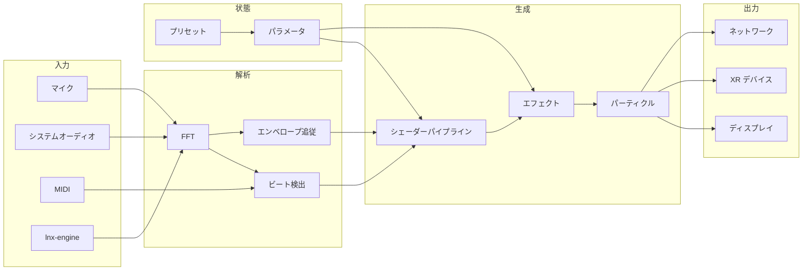

# 02. lnx creare — ヴィジョンクリエイティブツールの入り口

> **Status**: Draft（Status log 参照）
> **Related**: [spec 01](01-core-concept.md)（LNX の本質）、[design 01](../design/01-lnx-server-link.md)（LNX サーバとの常時接続）、[design 02](../design/02-architecture.md)（構成、UI 技術の未決）、[apps/ios/README.md](../../apps/ios/README.md)
> **対象**: `apps/ios/`（SwiftUI、本線）、`crates/lnx-creare/`（Bevy、骨格）

## Abstract

lnx creare は **LNX への入り口**。ユーザーが最初に触れる面で、ここで感じる体験が LNX との最初の対話になる。
コンセプトは **"Open and Create"** — 開いたら即座に創造が始まる。設定は後から、まず体験。複雑さは隠し、必要に応じて露出する。

現在の実装は `apps/ios` の SwiftUI アプリ（iPad が主、iOS / macOS の両対応）。LNX サーバに常時つながり、
知っているサーバの一覧から画面を切り替えるところまでが動く（design 01）。音から映像を生む部分はまだ無い。

## Motivation

**First impression is everything.** lnx creare は LNX の哲学（spec 01）を体現する最前線であり、
すべての人が創造を始められる場所でなければならない。

単なるビジュアライザーではなく、内なるビジョンをオーディオとビジュアルの統合的表現として創造する
**ヴィジョンクリエイティブツール**。ここで感じる体験が、すべての始まり。

## Scope

### In — 3 つの役割

| 役割 | 何をするか |
|---|---|
| **入り口**（Gateway） | LNX エコシステムへの最初のタッチポイント。誰もがすぐに創造を始められる。学習曲線を最小化 |
| **創造の場**（Creative Space） | オーディオをビジュアルに変換し、リアルタイムに生成する。インタラクティブな表現の探求 |
| **統合のハブ**（Integration Hub） | lnx-engine との連携、MIDI / オーディオ入力の受付、XR / ネットワークへの拡張基盤。LNX サーバへの常時接続（design 01）はここに属する |

### Out — lnx creare が目指さないもの

| 目指さないもの | 意味 |
|---|---|
| 複雑な設定画面 | 起動時のウィザード、設定を全部決めないと使えない、ではない |
| 専門用語の羅列 | 技術用語で威圧しない。わかりやすい言葉で説明する |
| 一方的な表示 | ただビジュアルを流すだけ、インタラクションが無い、ではない |
| パフォーマンスの犠牲 | 美しいが重い、遅延が大きい、ではない |

## Requirements

### 1. 即座性（Immediacy） — ゼロから創造まで 3 秒以内

```
0 秒: アプリを開く
1 秒: 画面が表示される
2 秒: オーディオ入力が始まる
3 秒: ビジュアルが生成される
```

設定画面なし、すぐ始まる。デフォルトで美しい。待ち時間ゼロ。

### 2. 直感性（Intuitiveness） — マニュアルを読まずに使える

視覚的フィードバック、自然な操作感、予測可能な挙動。

### 3. 漸進的複雑性（Progressive Complexity） — シンプルに始まり、深く潜れる

```
Level 1: 起動して見る
Level 2: パラメータを触る
Level 3: プリセットを作る
Level 4: カスタムシェーダーを書く
```

初心者から上級者まで、それぞれのレベルで楽しめる。

### 4. 低遅延（Low-Latency） — 入力と表現の同期

オーディオ入力からビジュアル生成まで **< 16ms（60fps）**。ユーザー操作への即座のフィードバック。

### 5. 美しさ（Beauty） — デフォルトで美しい

初めて起動した時から美しい映像。アートとしての価値、視覚的な喜び。

### 処理の流れ（構想）



- 解析: リアルタイム FFT（< 10ms）、ビート検出（BPM 推定）、エンベロープ追従、周波数帯域分析
- 生成: シェーダーベースのレンダリング、パーティクル、エフェクトとポストプロセス
- UI: パラメータ操作、プリセット管理、リアルタイムプレビュー

**どれもまだ実装されていない。** いま動くのは入力のうち「LNX サーバとの接続」だけ（design 01）。

### UI の方針（未決）

コアロジックは Rust で共有し、UI は複数のフロントエンドを持つ、という構想。

| UI | 想定する相手 | 技術の候補 | 現状 |
|---|---|---|---|
| Native（Apple） | Apple ユーザー、プロ、visionOS | SwiftUI + Rust（UniFFI） | **本線**。`apps/ios` が iOS / macOS で動く。Rust コアはまだつないでいない |
| Web | すべての人、クイックアクセス、共有・教育 | Sycamore + Tabler.io + Trunk（WASM） | 未着手 |
| MCP Server | AI / LLM、開発者、自動化 | rmcp | 未着手 |

ほかに Bevy の窓（`crates/lnx-creare`）が骨格だけあり、`README.md` の技術スタックは Slint を挙げている。
**どの技術を本線にするかは決めていない**（design 02 の「未決」）。

## 例（使用フロー）

- **初めての起動**: 起動 → ウェルカム画面 → マイクを許可 → 何もしなくても環境音がビジュアルになる →
  音楽を流すとビートに反応して色が変わり形が動く → スライダーを動かすとリアルタイムに変わる
- **ライブパフォーマンス**: MIDI 機器をつなぐと自動認識されコントローラーに割り当たる → プリセットを選ぶ →
  MIDI でリアルタイムに操り、音に反応するビジュアルを観客に届ける → ウィンドウキャプチャで配信（内部録画は将来）
- **実験と探求**: GLSL / WGSL でカスタムシェーダーを書く → LFO やエンベロープでパラメータを自動化 →
  プリセットとして保存し、コミュニティと共有する

## ロードマップ

| Phase | 目標 | 状態 |
|---|---|---|
| 1. Core Foundation | Rust コア — Audio Analysis / Visual Generation / State Management | プロジェクト構造のみ。モジュールは未着手 |
| 2. Web UI | Sycamore + Tabler.io + Trunk、Web Audio API、WebGL | 未着手 |
| 3. Native UI（Apple） | SwiftUI、UniFFI、Metal、CoreAudio、visionOS | Xcode プロジェクト（`apps/ios`、iOS + macOS）と LNX サーバへの常時接続（design 01、v0.1.0-alpha2）まで。UniFFI / Metal / CoreAudio は未 |
| 4. MCP Server | rmcp、LNX API、Claude / GPT 連携、バッチ処理 | 未着手 |
| 5. Advanced | カスタムシェーダー、MIDI（全 UI）、録画・エクスポート、ネットワーク同期、XR | 未着手 |
| 6. Ecosystem | プリセット共有、プラグイン、ドキュメント、チュートリアル、コミュニティ | 未着手 |

## 関連

- 技術的参考: Bevy Engine（ECS）、TouchDesigner（リアルタイムビジュアル）、VDMX（VJ）、Shadertoy（シェーダーコミュニティ）
- 将来の spec: オーディオ処理の原理、ビジュアル表現の原理、UX 原則（旧 `spec/README.md` の体系案 03〜05。まだ書いていない）

## Status log

- 2025-11-05: `spec/02-creare/SPEC.md` v1.0.0（status: draft）。役割と原則を定義、"Open and Create" を提示、
  5 つの原則（即座性、直感性、漸進的複雑性、低遅延、美しさ）を確立
- 2026-11-04（#18）: v1.1.0。iOS アプリの Xcode プロジェクト作成（`apps/ios`）をロードマップに反映
- 2026-11-04: SDG の骨格で `docs/spec/02-creare.md` に移設（Draft のまま）。内容は保ち、UI の技術スタックの詳細は
  「UI の方針（未決）」の表に圧縮、コアモジュールの構成図は「処理の流れ」の図に畳んだ。現状（SwiftUI が本線、
  Bevy は骨格、Web / MCP は未着手、どれを本線にするかは未決）を事実として書いた
