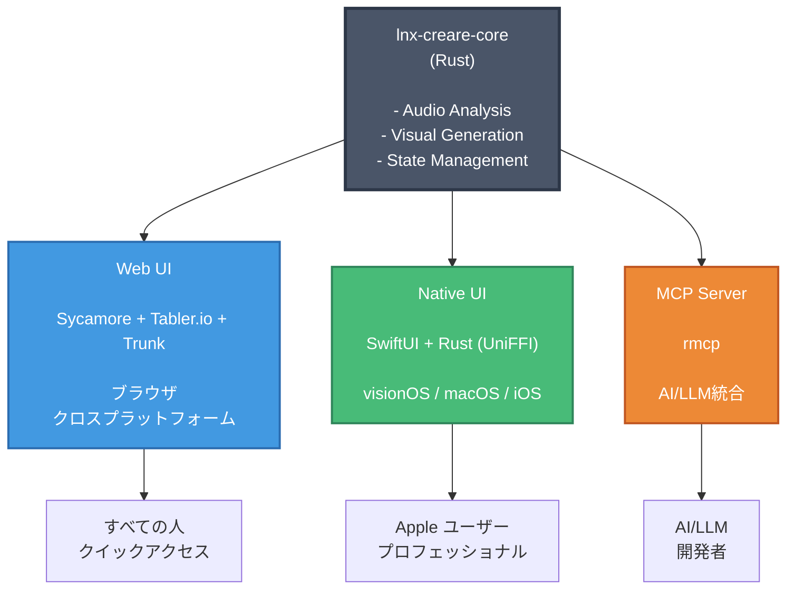
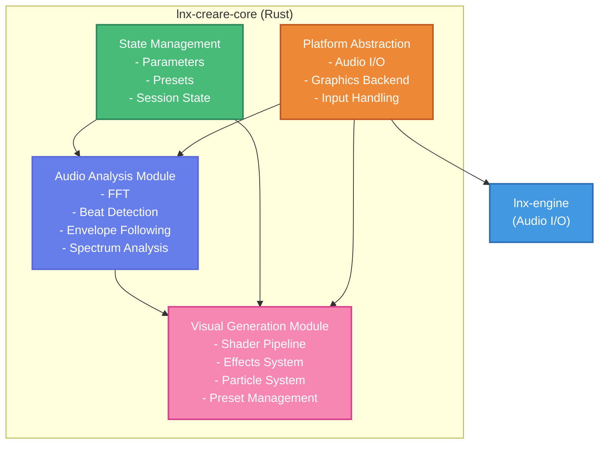
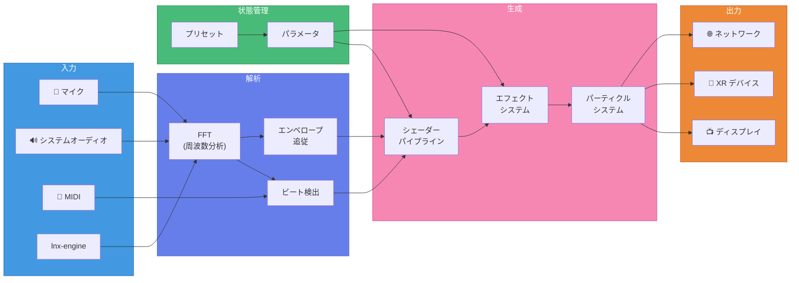

# lnx-creare Specification

## なぜ (Why)

### LNXへの扉

lnx-creareは、単なるアプリケーションではありません。
それは**LNXへの入り口**——vision creationの世界への扉です。

ユーザーが初めて触れるのはこのツールです。
ここで感じる体験が、LNXとの最初の対話となり、創造への期待を形作ります。

**First impression is everything.**

lnx-creareは、LNXの哲学を体現する最前線であり、
すべての人が創造を始められる場所でなければなりません。

## 何を (What)

### lnx-creareとは

lnx-creareは、**ヴィジョンクリエイティブツール**です。
内なるビジョンを、オーディオとビジュアルの統合的表現として創造します。

#### 3つの役割

1. **入り口** (Gateway)
   - LNXエコシステムへの最初のタッチポイント
   - 誰もがすぐに創造を始められる
   - 学習曲線を最小化

2. **創造の場** (Creative Space)
   - オーディオをビジュアルに変換
   - リアルタイムでのビジュアル生成
   - インタラクティブな表現の探求

3. **統合のハブ** (Integration Hub)
   - lnx-engineとの連携
   - MIDI/オーディオ入力の受付
   - XR/ネットワークへの拡張基盤

### コアコンセプト

**"Open and Create"**

- アプリを開く → 即座に創造が始まる
- 設定は後から、まず体験
- 複雑さは隠し、必要に応じて露出

## 原則 (Principles)

### 1. 即座性 (Immediacy)

**ゼロから創造まで、3秒以内**

```
0秒: アプリを開く
1秒: 画面が表示される
2秒: オーディオ入力が始まる
3秒: ビジュアルが生成される
```

- 設定画面なし、すぐ始まる
- デフォルトで美しい
- 待ち時間ゼロ

### 2. 直感性 (Intuitiveness)

**マニュアルを読まずに使える**

- 視覚的フィードバック
- 自然な操作感
- 予測可能な挙動

### 3. 漸進的複雑性 (Progressive Complexity)

**シンプルに始まり、深く潜れる**

```
Level 1: 起動して見る
Level 2: パラメータを触る
Level 3: プリセットを作る
Level 4: カスタムシェーダーを書く
```

初心者から上級者まで、それぞれのレベルで楽しめる。

### 4. 低遅延 (Low-Latency)

**入力と表現の同期**

- オーディオ入力からビジュアル生成まで < 16ms (60fps)
- ユーザー操作への即座のフィードバック
- リアルタイム性を損なわない

### 5. 美しさ (Beauty)

**デフォルトで美しい**

- 初めて起動した時から美しい映像
- アートとしての価値
- 視覚的な喜び

## アーキテクチャ (Architecture)

### マルチUI戦略

lnx-creareは**複数のUIフロントエンド**を持ちます。
コアロジックはRustで実装し、各プラットフォームに最適なUIを提供。



### 各UIの特徴

#### 1. Web UI (Sycamore + Tabler.io + Trunk)

**対象ユーザー**: すべての人、クイックアクセス

**技術スタック**:

- **Sycamore**: リアクティブなRust製Webフレームワーク
- **Tabler.io**: 美しいUIコンポーネントライブラリ
- **Trunk**: RustのWASMビルドツール

**特徴**:

- ブラウザで即座にアクセス可能
- インストール不要
- クロスプラットフォーム（Windows/Mac/Linux/モバイル）
- 軽量で高速
- URLで共有可能

**ユースケース**:

- 初めての体験
- クイックプロトタイピング
- 配信・共有
- 教育・ワークショップ

#### 2. Native UI (Swift + Rust w/UniFFI)

**対象ユーザー**: Apple エコシステムユーザー

**技術スタック**:

- **SwiftUI**: Apple純正のUIフレームワーク
- **Rust Core**: lnx-creareコアロジック
- **UniFFI**: Rust ↔ Swift FFI

**特徴**:

- ネイティブなルック＆フィール
- OSとの深い統合
- 最高のパフォーマンス
- visionOS対応（空間コンピューティング）
- macOS/iOS統一コードベース

**ユースケース**:

- プロフェッショナルワークフロー
- VR/AR表現（visionOS）
- モバイルパフォーマンス
- オフライン使用

#### 3. MCP Server (rmcp)

**対象ユーザー**: AI/LLMユーザー、開発者

**技術スタック**:

- **rmcp**: Rust製MCP (Model Context Protocol) サーバー
- **LNX API**: コア機能へのプログラマティックアクセス

**特徴**:

- Claude/GPTなどからの操作
- プログラマティックな制御
- 自動化・スクリプティング
- バッチ処理

**ユースケース**:

- AI支援による創造
- 自動ビジュアル生成
- バッチレンダリング
- 開発者向けAPI

### コアアーキテクチャ



### データフロー

オーディオ入力からビジュアル出力までのリアルタイム処理フロー：



### コンポーネント詳細

1. **Audio Input Module**
   - マイク入力
   - システムオーディオキャプチャ
   - MIDI入力
   - lnx-engineからのストリーム

2. **Analysis Module**
   - リアルタイムFFT（< 10ms）
   - ビート検出（BPM推定）
   - エンベロープ追従
   - 周波数帯域分析

3. **Visualization Module**
   - シェーダーベースレンダリング
   - パーティクルシステム
   - エフェクトパイプライン
   - ポストプロセス

4. **UI Module**
   - パラメータコントロール
   - プリセット管理
   - リアルタイムプレビュー

## 例 (Examples)

### 使用フロー

#### シナリオ1: 初めての起動

```
1. lnx-creareを起動
   → 美しいウェルカム画面
   → 「マイクにアクセスしますか？」→ 許可

2. 何もしない
   → 環境音がビジュアルに変換される
   → 美しい映像が流れる

3. 音楽を再生
   → ビートに合わせてビジュアルが反応
   → 色が変わる、形が動く

4. パラメータを触ってみる
   → スライダーを動かす
   → リアルタイムで変化
   → 自分好みに調整
```

#### シナリオ2: ライブパフォーマンス

```
1. MIDI機器を接続
   → 自動認識
   → コントローラーにマッピング

2. プリセットを選択
   → 事前に作成したビジュアルを読み込み

3. ライブ開始
   → MIDI入力でリアルタイムコントロール
   → オーディオに反応するビジュアル
   → 観客は統合された体験

4. 録画・配信
   → ウィンドウキャプチャで配信
   → または内部録画機能（将来）
```

#### シナリオ3: 実験と探求

```
1. カスタムシェーダーを書く
   → 高度なユーザー向け
   → GLSL/WGSLでシェーダー記述

2. パラメータを自動化
   → LFOやエンベロープで制御
   → 複雑な動きを生成

3. プリセットとして保存
   → コミュニティと共有
   → ライブラリを構築
```

## 反例 (Anti-patterns)

### lnx-creareが目指さないもの

❌ **複雑な設定画面**

- 起動時にウィザード、ではない
- 設定を全て決めないと使えない、ではない

❌ **専門用語の羅列**

- 技術的な用語で威圧しない
- わかりやすい言葉で説明

❌ **一方的な表示**

- ただビジュアルを流すだけ、ではない
- インタラクションがない、ではない

❌ **パフォーマンスの犠牲**

- 美しいが重い、ではない
- 遅延が大きい、ではない

## 開発ロードマップ (Roadmap)

### Phase 1: Core Foundation

**目標**: Rustコアロジックの確立

- [x] プロジェクト構造の確立
- [ ] lnx-creare-core の設計
- [ ] Audio Analysis Module
  - [ ] FFT実装
  - [ ] Beat Detection
  - [ ] Envelope Following
- [ ] Visual Generation Module
  - [ ] 基本的なシェーダーパイプライン
  - [ ] エフェクトシステム
- [ ] State Management
  - [ ] パラメータ管理
  - [ ] プリセットシステム

### Phase 2: Web UI

**目標**: ブラウザで動くプロトタイプ

- [ ] Sycamore + Tabler.io セットアップ
- [ ] WASMビルドパイプライン（Trunk）
- [ ] Web Audio APIとの連携
- [ ] WebGLレンダリング
- [ ] 基本的なUIコンポーネント
  - [ ] パラメータコントロール
  - [ ] プリセット選択
  - [ ] ビジュアルプレビュー

### Phase 3: Native UI (Apple)

**目標**: visionOS/macOS/iOSネイティブアプリ

- [x] iOS アプリの Xcode プロジェクト作成（apps/ios、SwiftUI + XcodeGen、メイン開発機は iPad）
- [ ] UniFFIによるSwift FFI
- [ ] SwiftUIインターフェース
- [ ] Metal レンダリング
- [ ] CoreAudio統合
- [ ] visionOS空間UI
- [ ] macOS/iOS最適化

### Phase 4: MCP Server

**目標**: AI/LLM統合

- [ ] rmcpサーバー実装
- [ ] LNX APIの設計
- [ ] Claude/GPT連携
- [ ] バッチ処理機能
- [ ] 自動化スクリプト

### Phase 5: Advanced Features

**目標**: プロフェッショナル機能

- [ ] カスタムシェーダー対応
- [ ] MIDI入力（全UI）
- [ ] 録画・エクスポート機能
- [ ] ネットワーク同期
- [ ] XR拡張機能

### Phase 6: Ecosystem

**目標**: コミュニティと拡張性

- [ ] プリセット共有プラットフォーム
- [ ] プラグインシステム
- [ ] ドキュメント整備
- [ ] チュートリアル作成
- [ ] コミュニティフォーラム

## 関連 (Related)

### 関連するspec

- `01-core-concept/SPEC.md` - LNXの本質
- `03-audio/` - オーディオ処理の原理（将来）
- `04-visual/` - ビジュアル表現の原理（将来）
- `05-user-experience/` - UX原則（将来）

### 技術的参考

- Bevy Engine - ECSアーキテクチャ
- TouchDesigner - リアルタイムビジュアル
- VDMX - VJソフトウェア
- Shadertoy - シェーダーコミュニティ

## 履歴 (History)

### v1.0.0 (2025-11-05)

- 初版作成
- lnx-creareの役割と原則を定義
- "Open and Create"コンセプトを提示
- 5つの原則を確立：即座性、直感性、漸進的複雑性、低遅延、美しさ

---

**Remember**: lnx-creareは入り口。ここで感じる体験が、すべての始まり。
