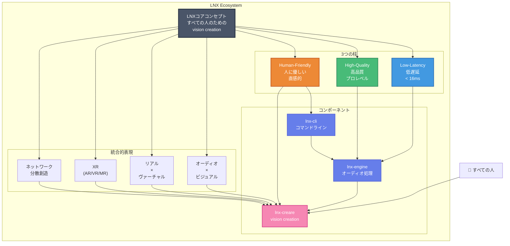

# LNX Core Concepts

## なぜ (Why)

### 創造は誰のものか？

音楽制作、ビジュアル表現、リアルタイムパフォーマンス——これらはかつて、特別な訓練を受けた人々や高価な機材を持つ人々の専有物でした。

しかし、創造する喜びは、本来すべての人に開かれているべきです。

**LNXは、すべての人のためのcreare（創造）ツールです。**

## 何を (What)

### LNXとは

LNXは、Audio/Visualの**リアルタイム表現**を可能にするツールです。

- **低遅延** (Low-Latency) - 思考と表現の間に遅延を感じさせない
- **高品質** (High-Quality) - 表現に値する品質を保証する
- **人に優しい** (Human-Friendly) - 技術的障壁を取り除き、創造に集中できる

### creareの意味

**creare** [クレアーレ] - ラテン語で「創造する、生み出す、作る」

lnx-creareは、単なるビジュアライザー（見るツール）ではありません。
それは**ヴィジョンクリエイティブツール**——ビジョンを創造するツールです。

- 受動的に「見る」のではなく
- 能動的に「創る」
- 単なる視覚ではなく
- **ビジョン**（vision）を形にする

**vision**には二つの意味があります：

1. **視覚・映像** - 目に見える表現
2. **ビジョン・展望** - 心に描く未来、理想、想像

LNXは両方を創造します。
内なるビジョンを、視覚的な表現として世界に顕現させる——これがLNXの哲学です。

### Vision Creative Tool

**ヴィジョンクリエイティブツール**という表現は：

- Vision（ビジョン）- 内なる想像力、心に描く理想
- Creative（クリエイティブ）- 創造的、能動的な行為
- Tool（ツール）- すべての人が使える道具

この3つの要素が統合され、LNXの本質を表現しています。

## LNXの全体像



## 原則 (Principles)

### 1. すべての人のために (For Everyone)

LNXは特定の専門家のためのツールではありません。

- **初心者**: 複雑な設定なしに、すぐに創造を始められる
- **中級者**: より深い表現を探求できる
- **上級者**: 限界を押し広げるための完全なコントロール

技術的背景に関わらず、誰もが自分のレベルで創造できる。

### 2. リアルタイム性 (Real-time)

表現は、思考と同期すべきです。

- **即座のフィードバック**: アクションと結果の間に遅延がない
- **ライブ性**: 録音・録画の後処理ではなく、その瞬間の表現
- **フロー体験**: 技術的な待ち時間が創造の流れを断ち切らない

### 3. 統合的表現 (Integrated Expression)

表現の境界を超える——これがLNXの本質です。

#### オーディオとビジュアル

- **相互作用**: 音が視覚を生み、視覚が音を導く
- **統一された体験**: 一つの表現として知覚される
- **クロスモーダル**: 感覚の境界を超える

#### リアルとヴァーチャル

- **空間の融合**: 物理空間とデジタル空間の境界が溶ける
- **拡張された現実**: 現実を否定せず、拡張する
- **存在の拡張**: 身体的制約を超えた表現

#### XR (Extended Reality)

- **没入的創造**: AR/VR/MRでの表現空間
- **空間的オーディオ**: 3次元空間での音の配置と動き
- **身体的インタラクション**: ジェスチャー、視線、動きでの創造

#### ネットワーク

- **距離の超越**: 物理的距離を超えた協働創造
- **非同期と同期**: 時間を超えた表現の共有
- **分散された創造**: 複数の場所、複数の人、一つの作品

### 4. 創造の民主化 (Democratization of Creation)

技術的障壁を取り除き、創造の本質に集中できるように。

- **直感的インターフェース**: 学習曲線を最小化
- **漸進的な複雑性**: 必要に応じて深く潜れる
- **オープンな設計**: コミュニティが拡張できる

## 例 (Examples)

### LNXで実現すること

1. **ライブパフォーマンス**
   - DJが音楽に合わせてリアルタイムにビジュアルを生成
   - VJが視覚的なストーリーを紡ぐ
   - アーティストが音と光で空間を創造する
   - XR空間での没入型パフォーマンス

2. **個人的な探求**
   - 音楽を聴きながら、その感情をビジュアルで表現
   - 自分の声や楽器の音を視覚化
   - 実験的なサウンドデザインとビジュアルの探求
   - VR空間での個人的な創造セッション

3. **協働創造**
   - 複数人が同時に音とビジュアルを創り出す
   - ネットワーク越しのリアルタイムセッション
   - 観客参加型のインタラクティブ表現
   - 分散された場所からの共同制作

4. **空間的体験**
   - AR/MRでの現実空間への投影
   - 空間オーディオでの立体的な音響設計
   - 物理とデジタルが融合した展示空間
   - 建築空間への音と光のマッピング

5. **ネットワーク表現**
   - 世界中のクリエイターとのリアルタイムコラボレーション
   - オンラインライブでの同期パフォーマンス
   - 非同期での作品の共有と進化
   - 分散型の創造ネットワーク

### 使用シーン

```
シーン1: 初めての起動
- アプリを開く
- マイクから入力される音が、即座にビジュアルに変換される
- 設定なし、待ち時間なし、ただ「創造」が始まる

シーン2: ライブでの使用
- MIDI機器を接続
- リアルタイムで音とビジュアルをコントロール
- 観客は統合された体験を受け取る
- レイテンシーは知覚できないレベル（<10ms）

シーン3: 深い探求
- パラメータを調整し、独自の表現を探る
- プリセットを保存し、ライブラリを構築
- コミュニティと共有し、学び合う
```

## 反例 (Anti-patterns)

### LNXが目指さないもの

❌ **専門家だけのツール**

- 複雑な設定を強要しない
- マニュアルを読まないと使えない、ではない

❌ **後処理ツール**

- リアルタイム性を犠牲にした高品質、ではない
- 録音・録画の編集ツール、ではない

❌ **単なるビジュアライザー**

- 受動的に見るだけのツール、ではない
- 決まったパターンを再生するだけ、ではない

❌ **技術デモ**

- 技術的複雑さを誇示するもの、ではない
- 「できること」より「創造できること」を優先

## 関連 (Related)

### 影響を受けた思想

- **Live Coding** - コードを書くことが表現となる
- **Audiovisual Art** - 音と映像の統合的表現
- **Flow Theory** - 没入と創造の状態
- **Universal Design** - すべての人のためのデザイン

### 関連するspec

- `02-architecture/real-time.md` - リアルタイム性の追求
- `04-visual/creation.md` - 創造的表現の設計
- `05-user-experience/human-friendly.md` - Human-Friendlyの実現

## 履歴 (History)

### v1.0.0 (2025-11-05)

- 初版作成
- コアコンセプトとして「すべての人のためのcreareツール」を定義
- LNX-visualizer → LNX-creareへのリネームを反映
- creareの語源（ラテン語：創造する）を明記

---

**Remember**: LNXは技術ではなく、創造の喜びのために存在する。
